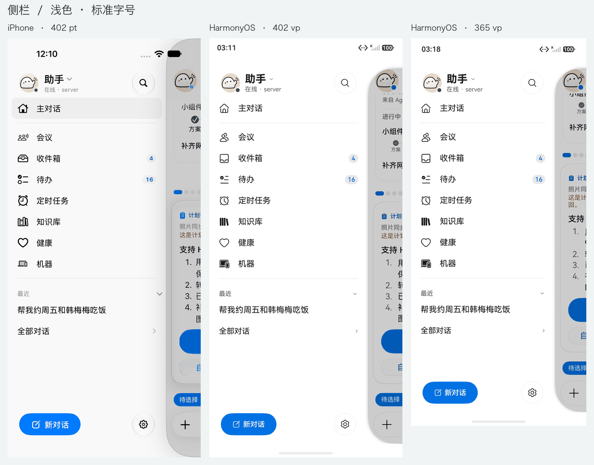
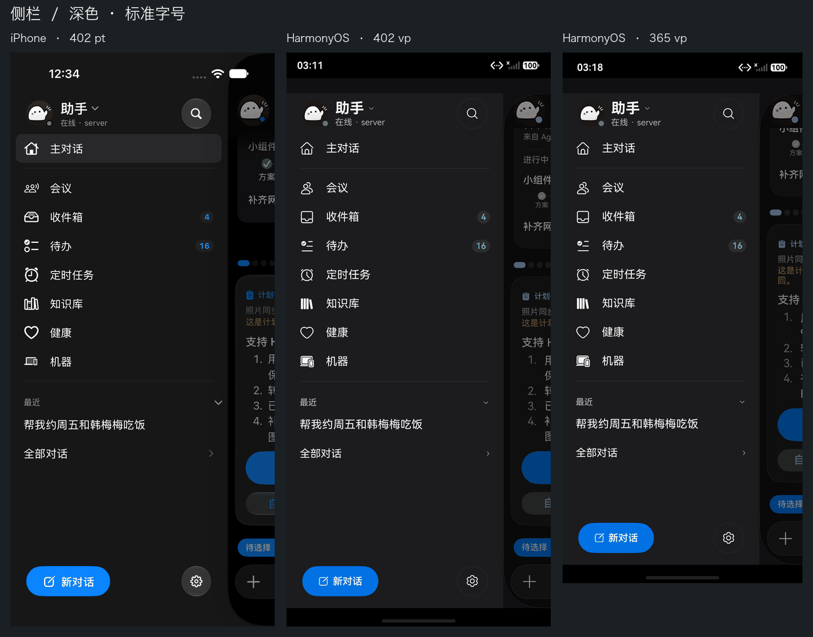
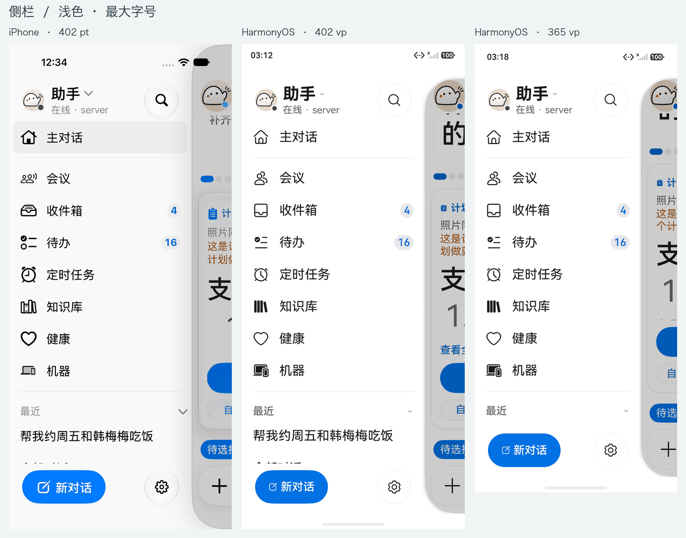

# 侧栏 · Navigation drawer

[返回全部页面 · All pages](../README.md)

在侧栏查找主对话、工作空间和设置入口。

Three independent native captures, left to right: iPhone 402 pt, HarmonyOS 402 vp, HarmonyOS 365 vp. The complete screen, including system bars, is visible.

[Download all original screenshots and accessibility trees for this page](../originals/drawer.zip?raw=1) · [Source and capture method](../SOURCES.md)

Original archive SHA-256: f52eda9d54e03858993c5ba2aaa5544ea6777c3a360b8528d05e1939031cd74e

## 浅色 · 标准字号

| Device | Pixels | Captured at | PNG digest | Hierarchy digest |
| --- | --- | --- | --- | --- |
| iPhone 402 pt | 1206 × 2622 | 2026-11-23T04:10:47.812+00:00 | ce3893d4f80ea3ef | b698869812e8a467 |
| HarmonyOS 402 vp | 1206 × 2622 | 2026-11-23T15:11:51+08:00 | 4e97aa398844a471 | 465a6d2182d47597 |
| HarmonyOS 365 vp | 1280 × 2832 | 2026-11-23T15:18:14+08:00 | c113a4e07588dd3b | 7ec29a56548aece2 |

## 深色 · 标准字号

| Device | Pixels | Captured at | PNG digest | Hierarchy digest |
| --- | --- | --- | --- | --- |
| iPhone 402 pt | 1206 × 2622 | 2026-11-23T04:34:14.617+00:00 | ed105bb76319bbdf | 83d2a07dc327e6dd |
| HarmonyOS 402 vp | 1206 × 2622 | 2026-11-23T15:11:56+08:00 | c82b580b91b100cd | 6cdad7605b611da3 |
| HarmonyOS 365 vp | 1280 × 2832 | 2026-11-23T15:18:26+08:00 | 315beddef2084662 | 1284f68f776beb41 |

## 浅色 · 最大字号

| Device | Pixels | Captured at | PNG digest | Hierarchy digest |
| --- | --- | --- | --- | --- |
| iPhone 402 pt | 1206 × 2622 | 2026-11-23T04:34:34.057+00:00 | e4d7a3f89bce4337 | e3e131ab16ded319 |
| HarmonyOS 402 vp | 1206 × 2622 | 2026-11-23T15:12:01+08:00 | 6fed1c9dca756d9d | fffad64254a009ce |
| HarmonyOS 365 vp | 1280 × 2832 | 2026-11-23T15:18:32+08:00 | 48d83f1e8778536f | 32b7f42f3ca959bf |

Full 64-character digests and ZIP entry paths are under this page in the [manifest](../manifest.json).

[← 机器监控读数](machine-monitor.md)
[切换助手 →](assistant-menu.md)
