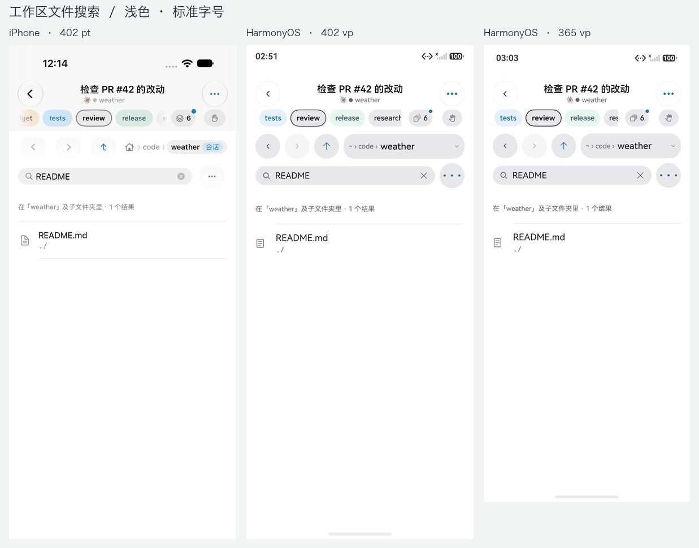
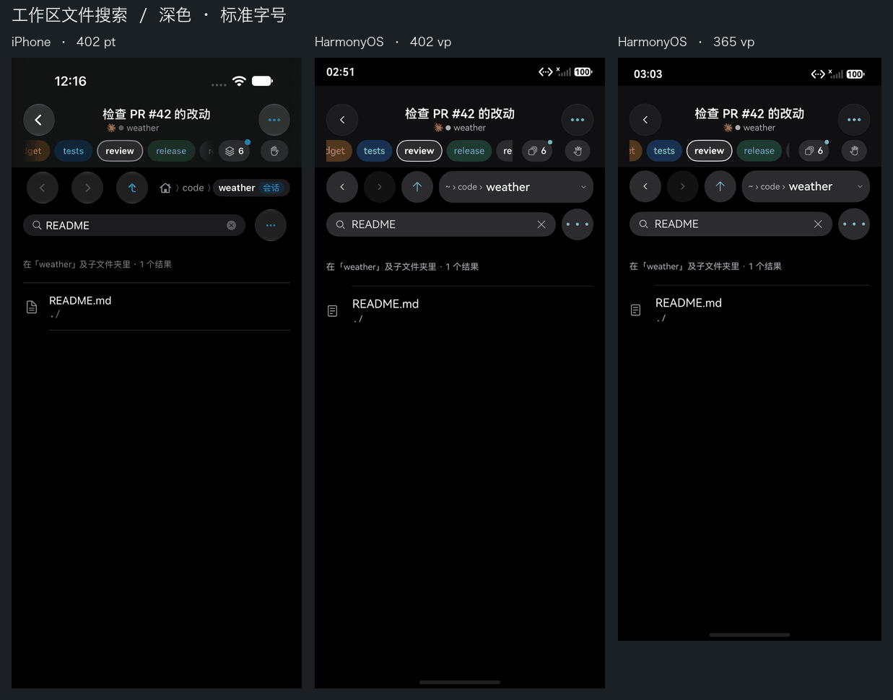
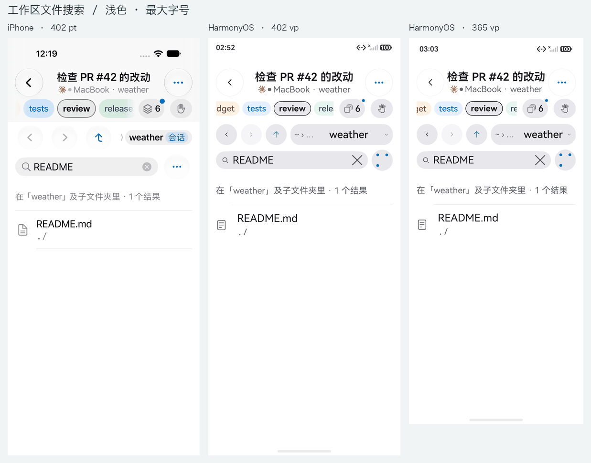

# 工作区文件搜索 · Find a file

[返回全部页面 · All pages](../README.md)

在当前工作目录及子目录搜索 README。

Three independent native captures, left to right: iPhone 402 pt, HarmonyOS 402 vp, HarmonyOS 365 vp. The complete screen, including system bars, is visible.

[Download all original screenshots and accessibility trees for this page](../originals/file-search.zip?raw=1) · [Source and capture method](../SOURCES.md)

Original archive SHA-256: 9dd8bce6459a759ea9105e84a7281c72c23ddba6e3686adea9b61c329a6586a0

## 浅色 · 标准字号

| Device | Pixels | Captured at | PNG digest | Hierarchy digest |
| --- | --- | --- | --- | --- |
| iPhone 402 pt | 1206 × 2622 | 2026-11-23T04:14:22.146+00:00 | 6815fbbf2e1c7616 | 8731e6576d38b531 |
| HarmonyOS 402 vp | 1206 × 2622 | 2026-11-23T14:51:53+08:00 | 0d6ca4a6f7134703 | a3ea2db9fa9ebb32 |
| HarmonyOS 365 vp | 1280 × 2832 | 2026-11-23T15:03:24+08:00 | 72eadde7f9bb778c | 6eded5abc32dfb75 |

## 深色 · 标准字号

| Device | Pixels | Captured at | PNG digest | Hierarchy digest |
| --- | --- | --- | --- | --- |
| iPhone 402 pt | 1206 × 2622 | 2026-11-23T04:16:42.088+00:00 | 625e79e63b78a815 | c12a9ed477431baa |
| HarmonyOS 402 vp | 1206 × 2622 | 2026-11-23T14:51:57+08:00 | f8c6ffa859bf1700 | 05ac576d273227c7 |
| HarmonyOS 365 vp | 1280 × 2832 | 2026-11-23T15:03:27+08:00 | 3b3d0d63b8cb3dd2 | 7f626d68e27c83a0 |

## 浅色 · 最大字号

| Device | Pixels | Captured at | PNG digest | Hierarchy digest |
| --- | --- | --- | --- | --- |
| iPhone 402 pt | 1206 × 2622 | 2026-11-23T04:19:19.150+00:00 | dbbd1541d4f6a1d2 | 196b98f71fddba8c |
| HarmonyOS 402 vp | 1206 × 2622 | 2026-11-23T14:52:01+08:00 | 32a383420ba58ff0 | 01a85df980ff1bc2 |
| HarmonyOS 365 vp | 1280 × 2832 | 2026-11-23T15:03:31+08:00 | f802d83109662132 | 8f2dc2e73328ffe2 |

Full 64-character digests and ZIP entry paths are under this page in the [manifest](../manifest.json).

[← 文件](files.md)
[Git 工作区 →](git.md)
