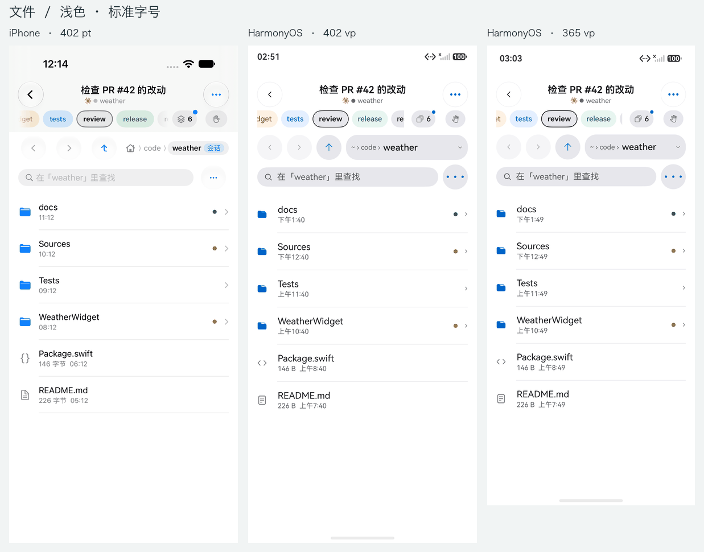
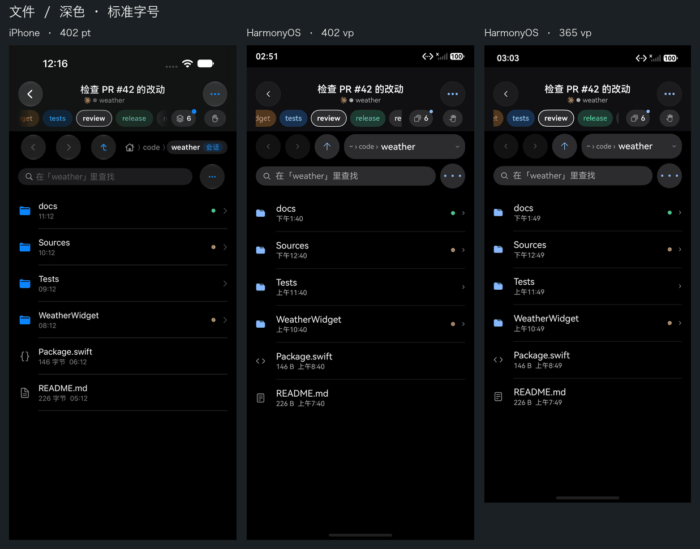
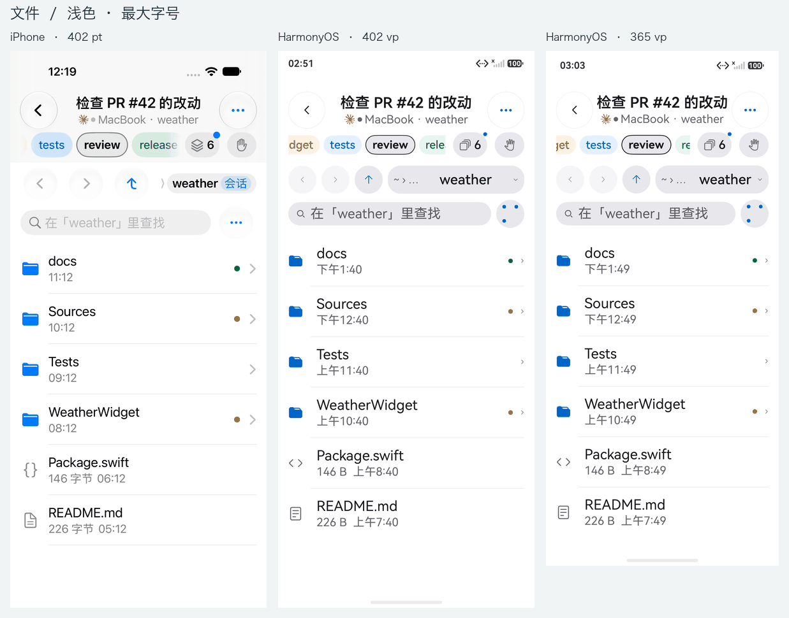

# 文件 · Workspace files

[返回全部页面 · All pages](../README.md)

浏览 weather 目录的文件与文件夹。
Open Files from the More menu of the PR #42 conversation. Its title, space and sibling tabs stay visible.

Three independent native captures, left to right: iPhone 402 pt, HarmonyOS 402 vp, HarmonyOS 365 vp. The complete screen, including system bars, is visible.

[Download all original screenshots and accessibility trees for this page](../originals/files.zip?raw=1) · [Source and capture method](../SOURCES.md)

Original archive SHA-256: 297939840657f8033262a0258da4c5e183cd50162928a47a52a91b5a29bd2757

## 浅色 · 标准字号

| Device | Pixels | Captured at | PNG digest | Hierarchy digest |
| --- | --- | --- | --- | --- |
| iPhone 402 pt | 1206 × 2622 | 2026-11-23T04:14:13.776+00:00 | 739507b9dfe63ca8 | 9123c7565f3c7b55 |
| HarmonyOS 402 vp | 1206 × 2622 | 2026-11-23T14:51:35+08:00 | 79e22c6d29706ae5 | 4f6358f4c6b61f13 |
| HarmonyOS 365 vp | 1280 × 2832 | 2026-11-23T15:03:06+08:00 | 2c314abbf7d6a995 | 94c74d4369c6c1fd |

## 深色 · 标准字号

| Device | Pixels | Captured at | PNG digest | Hierarchy digest |
| --- | --- | --- | --- | --- |
| iPhone 402 pt | 1206 × 2622 | 2026-11-23T04:16:33.840+00:00 | 37523a326742a79a | 4e3a7e27f55a7c3a |
| HarmonyOS 402 vp | 1206 × 2622 | 2026-11-23T14:51:38+08:00 | 0ecbddcd7208aa66 | 33925a1a827b14a5 |
| HarmonyOS 365 vp | 1280 × 2832 | 2026-11-23T15:03:09+08:00 | 37ca0305514ea996 | 396dd763353f95d9 |

## 浅色 · 最大字号

| Device | Pixels | Captured at | PNG digest | Hierarchy digest |
| --- | --- | --- | --- | --- |
| iPhone 402 pt | 1206 × 2622 | 2026-11-23T04:19:10.806+00:00 | a845e0ed41ab1637 | 25d4bdbcb8b76099 |
| HarmonyOS 402 vp | 1206 × 2622 | 2026-11-23T14:51:43+08:00 | 04a37f8d468fcac9 | bcb13e7592098024 |
| HarmonyOS 365 vp | 1280 × 2832 | 2026-11-23T15:03:14+08:00 | b8051601cc5ad231 | 0eba76abe2af9a1e |

Full 64-character digests and ZIP entry paths are under this page in the [manifest](../manifest.json).

[← 回看会话记录](reading-history.md)
[工作区文件搜索 →](file-search.md)
