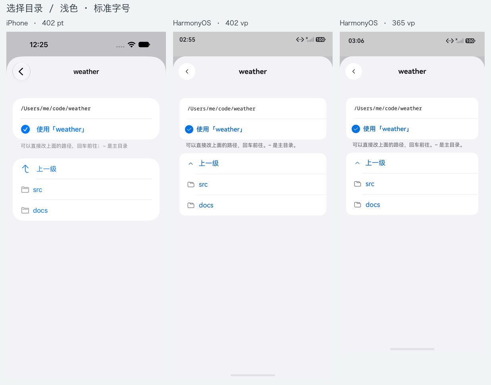
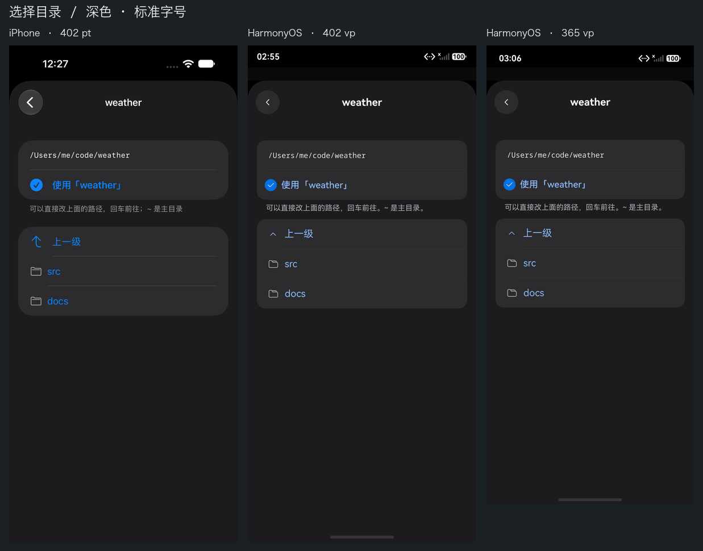
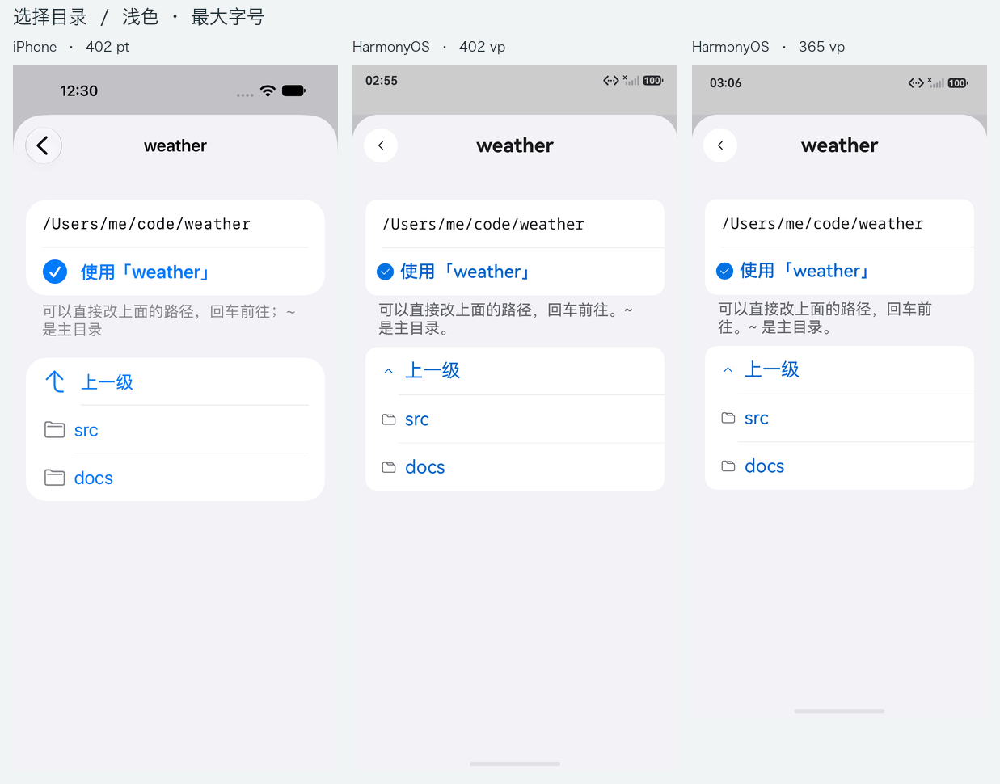

# 选择目录 · Choose a working directory

[返回全部页面 · All pages](../README.md)

浏览目录，并将所选目录交给新会话。
Open the weather directory picker and compare the parent, children and the action to use that directory.

Three independent native captures, left to right: iPhone 402 pt, HarmonyOS 402 vp, HarmonyOS 365 vp. The complete screen, including system bars, is visible.

[Download all original screenshots and accessibility trees for this page](../originals/folder-browser.zip?raw=1) · [Source and capture method](../SOURCES.md)

Original archive SHA-256: f10adac99cbeb28d4ecdc57a688e6193e6e06eb6d7e14e4e3cd8e3e768e222ef

## 浅色 · 标准字号

| Device | Pixels | Captured at | PNG digest | Hierarchy digest |
| --- | --- | --- | --- | --- |
| iPhone 402 pt | 1206 × 2622 | 2026-11-23T04:25:13.383+00:00 | aa0b662dcdf406b2 | 8d7106fb8a0599c2 |
| HarmonyOS 402 vp | 1206 × 2622 | 2026-11-23T14:55:32+08:00 | 1df3a657f8ef303e | 115dce0ab89c474f |
| HarmonyOS 365 vp | 1280 × 2832 | 2026-11-23T15:06:40+08:00 | 2845192a182de446 | 441168b084761a3d |

## 深色 · 标准字号

| Device | Pixels | Captured at | PNG digest | Hierarchy digest |
| --- | --- | --- | --- | --- |
| iPhone 402 pt | 1206 × 2622 | 2026-11-23T04:27:43.026+00:00 | 2c3c90bb7a654510 | 45228fe374371d41 |
| HarmonyOS 402 vp | 1206 × 2622 | 2026-11-23T14:55:35+08:00 | c16029ae3e8ab24c | a6d39d052daccd8b |
| HarmonyOS 365 vp | 1280 × 2832 | 2026-11-23T15:06:44+08:00 | f08b04ddc0dd19de | 91f4e4abe5d16558 |

## 浅色 · 最大字号

| Device | Pixels | Captured at | PNG digest | Hierarchy digest |
| --- | --- | --- | --- | --- |
| iPhone 402 pt | 1206 × 2622 | 2026-11-23T04:30:16.339+00:00 | cc4b9b6a7f4e81b8 | d5ed7373d90186ab |
| HarmonyOS 402 vp | 1206 × 2622 | 2026-11-23T14:55:39+08:00 | 5129b67ae9a8041f | b6fe9eac4d89b263 |
| HarmonyOS 365 vp | 1280 × 2832 | 2026-11-23T15:06:48+08:00 | 9fbcd57d6bd3afa2 | 98dffb2d6f0f422f |

Full 64-character digests and ZIP entry paths are under this page in the [manifest](../manifest.json).

[← 新建 Agent](new-agent.md)
[选择模型 →](models.md)
