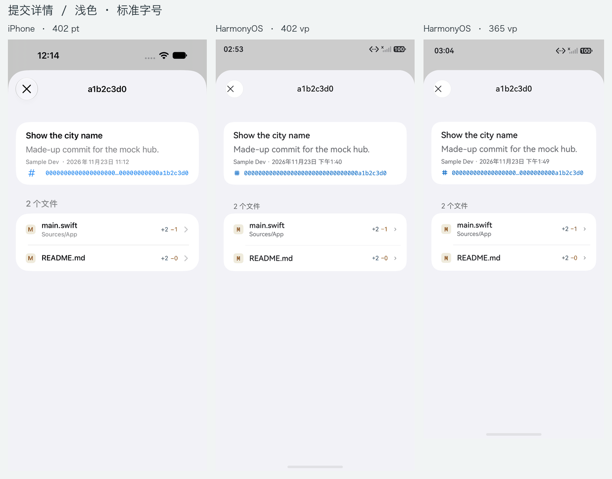
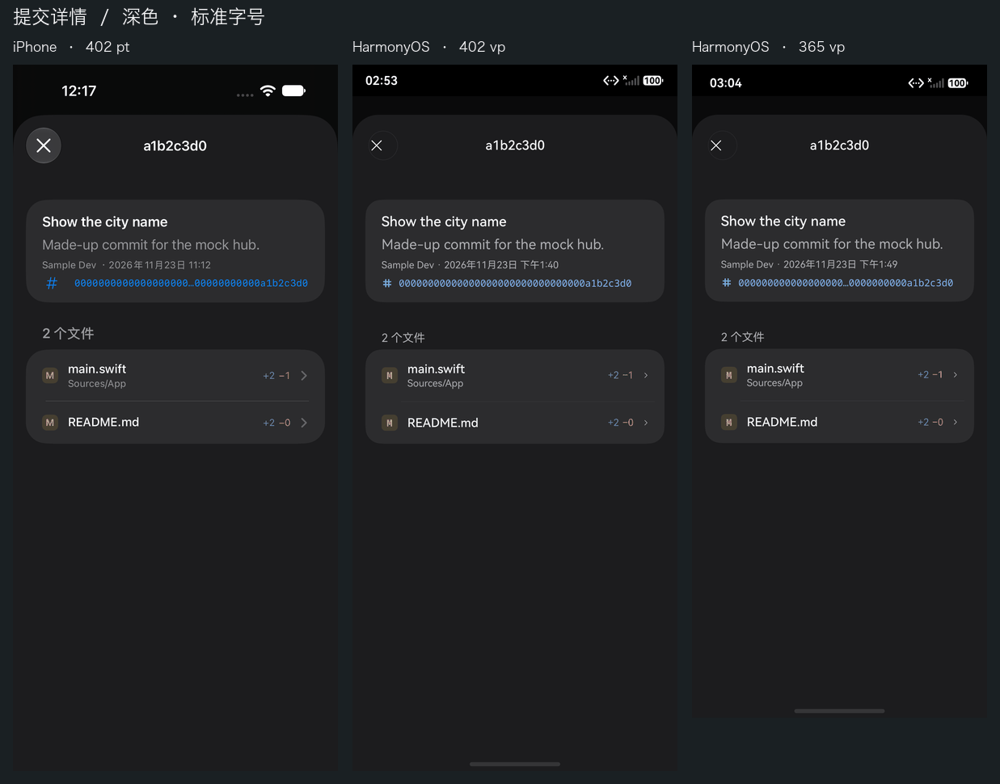
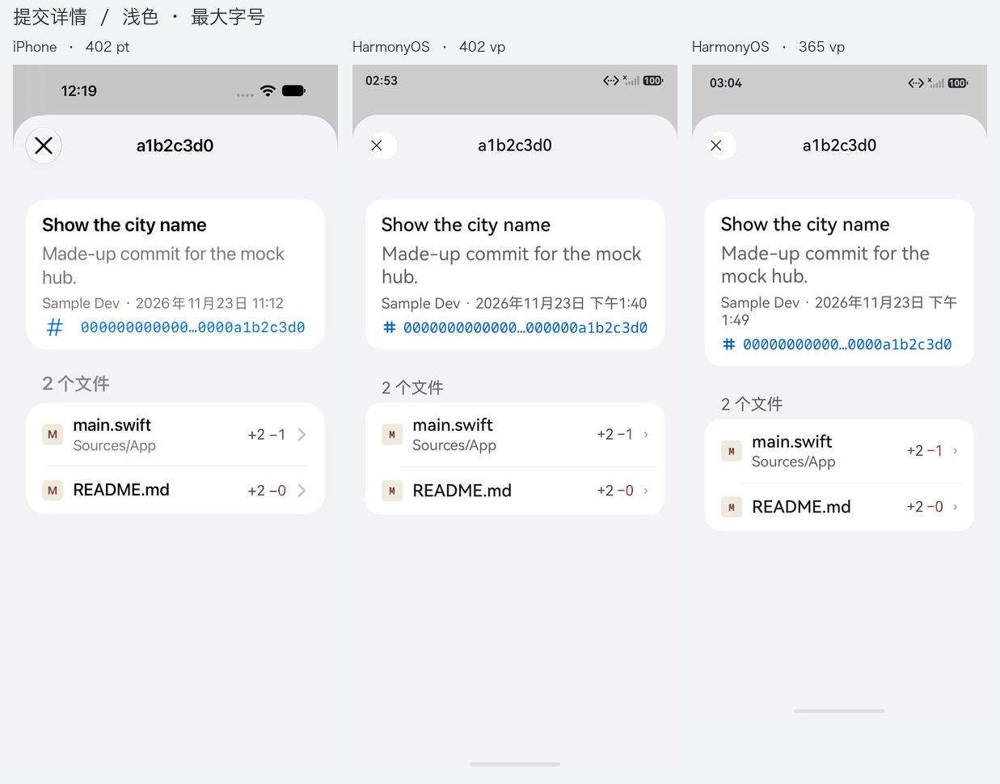

# 提交详情 · Commit details

[返回全部页面 · All pages](../README.md)

查看 Show the city name 提交、作者、短哈希和改动文件。

Three independent native captures, left to right: iPhone 402 pt, HarmonyOS 402 vp, HarmonyOS 365 vp. The complete screen, including system bars, is visible.

[Download all original screenshots and accessibility trees for this page](../originals/git-commit.zip?raw=1) · [Source and capture method](../SOURCES.md)

Original archive SHA-256: 7f9ea71671dadbf624d119dc0f92c86fe4c9af10c2bdb5145638218c5c248fd0

## 浅色 · 标准字号

| Device | Pixels | Captured at | PNG digest | Hierarchy digest |
| --- | --- | --- | --- | --- |
| iPhone 402 pt | 1206 × 2622 | 2026-11-23T04:14:51.048+00:00 | 47687b41ebb766b8 | 4b37707e1736ebcd |
| HarmonyOS 402 vp | 1206 × 2622 | 2026-11-23T14:53:03+08:00 | 382f8c7802f78eba | ceaf7d6b5611bf96 |
| HarmonyOS 365 vp | 1280 × 2832 | 2026-11-23T15:04:33+08:00 | 1453520564499df9 | 5288620850e4efc1 |

## 深色 · 标准字号

| Device | Pixels | Captured at | PNG digest | Hierarchy digest |
| --- | --- | --- | --- | --- |
| iPhone 402 pt | 1206 × 2622 | 2026-11-23T04:17:10.909+00:00 | aa79dc4ca5d006e5 | 72a7fc6d06f88d4e |
| HarmonyOS 402 vp | 1206 × 2622 | 2026-11-23T14:53:07+08:00 | 270e1486da48edd9 | 3858ec519c68821b |
| HarmonyOS 365 vp | 1280 × 2832 | 2026-11-23T15:04:37+08:00 | 294cb5e626238f1e | fd156963a6e44cf8 |

## 浅色 · 最大字号

| Device | Pixels | Captured at | PNG digest | Hierarchy digest |
| --- | --- | --- | --- | --- |
| iPhone 402 pt | 1206 × 2622 | 2026-11-23T04:19:48.199+00:00 | 20da10ce3361c3da | 892a9e5d391964f3 |
| HarmonyOS 402 vp | 1206 × 2622 | 2026-11-23T14:53:11+08:00 | 68715df368615cd6 | c83c700ce5c5f86e |
| HarmonyOS 365 vp | 1280 × 2832 | 2026-11-23T15:04:41+08:00 | d88c0e5c78e8fce3 | dd5355c5a4290c54 |

Full 64-character digests and ZIP entry paths are under this page in the [manifest](../manifest.json).

[← Git 工作区](git.md)
[Git 差异 →](git-diff.md)
