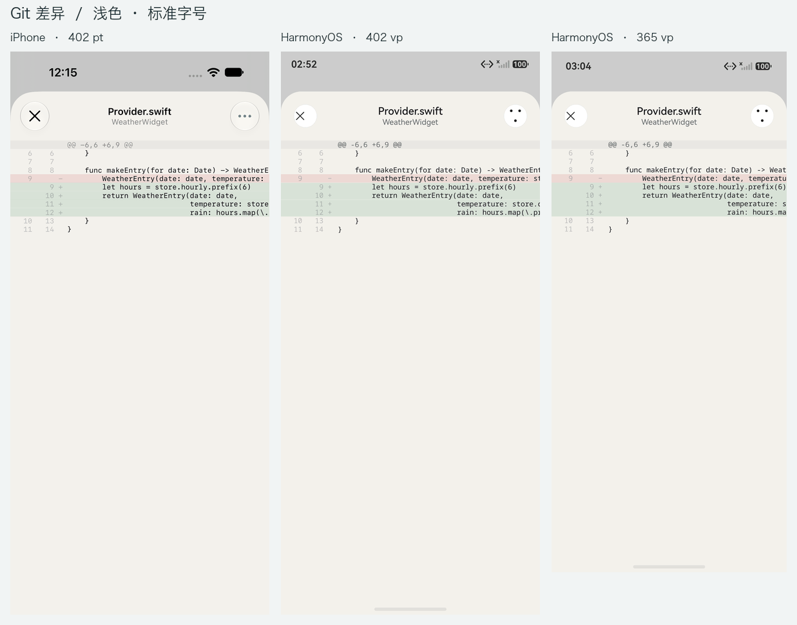
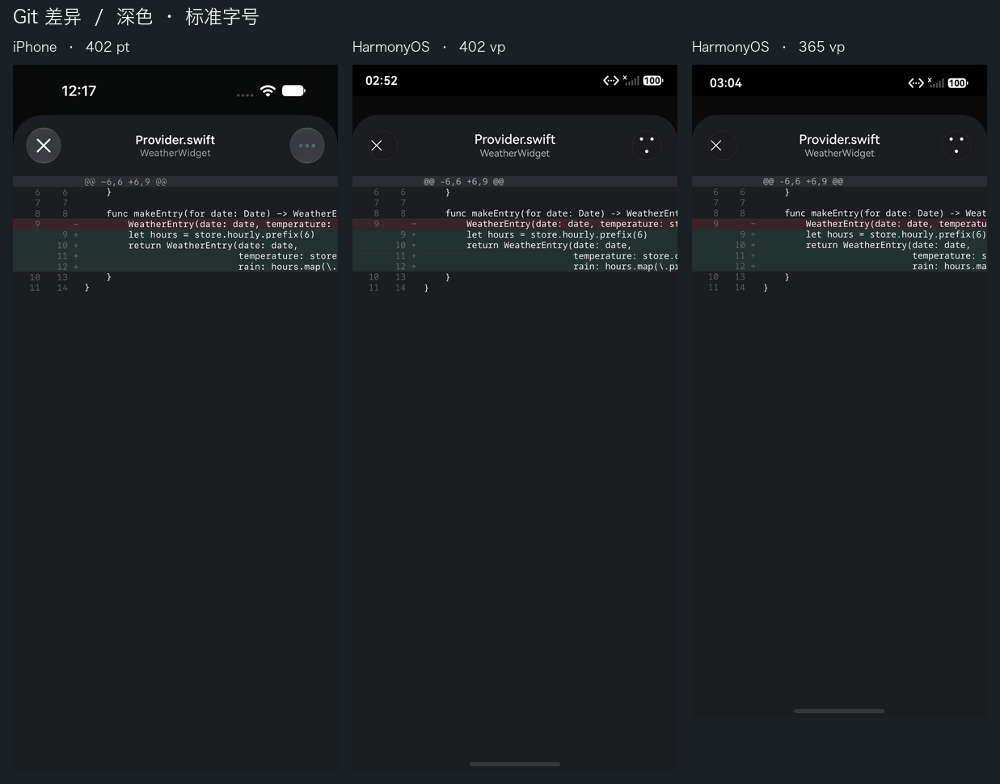

# Git 差异 · File diff

[返回全部页面 · All pages](../README.md)

读取 Provider.swift 的逐行差异。

Three independent native captures, left to right: iPhone 402 pt, HarmonyOS 402 vp, HarmonyOS 365 vp. The complete screen, including system bars, is visible.

[Download all original screenshots and accessibility trees for this page](../originals/git-diff.zip?raw=1) · [Source and capture method](../SOURCES.md)

Original archive SHA-256: b3bc57640676592e4adde6edc22d51728be95eca63942e33f1d7297b662e6e32

## 浅色 · 标准字号

| Device | Pixels | Captured at | PNG digest | Hierarchy digest |
| --- | --- | --- | --- | --- |
| iPhone 402 pt | 1206 × 2622 | 2026-11-23T04:15:05.287+00:00 | d73c455418f0354c | 6cd4151a16d67384 |
| HarmonyOS 402 vp | 1206 × 2622 | 2026-11-23T14:52:41+08:00 | 0e968076a88a75cc | 288b1ab3ddda85cf |
| HarmonyOS 365 vp | 1280 × 2832 | 2026-11-23T15:04:11+08:00 | cdf21ff5f3e68239 | a6ee2974fd1b21fa |

## 深色 · 标准字号

| Device | Pixels | Captured at | PNG digest | Hierarchy digest |
| --- | --- | --- | --- | --- |
| iPhone 402 pt | 1206 × 2622 | 2026-11-23T04:17:25.361+00:00 | c6acbe9fef073fcf | ac6b3fa5b1c07b11 |
| HarmonyOS 402 vp | 1206 × 2622 | 2026-11-23T14:52:45+08:00 | 51da8f482dbc45b0 | ee7157eb9f6fc85d |
| HarmonyOS 365 vp | 1280 × 2832 | 2026-11-23T15:04:15+08:00 | a4f7a6b8dbe1edbe | 6ce7a5fe8e3eade4 |

## 浅色 · 最大字号

| Device | Pixels | Captured at | PNG digest | Hierarchy digest |
| --- | --- | --- | --- | --- |
| iPhone 402 pt | 1206 × 2622 | 2026-11-23T04:20:02.259+00:00 | 02b3cde66e7fcd3e | 07a7527ea5157e6e |
| HarmonyOS 402 vp | 1206 × 2622 | 2026-11-23T14:52:49+08:00 | 848f427584bd239b | 23419a49e9c32b47 |
| HarmonyOS 365 vp | 1280 × 2832 | 2026-11-23T15:04:19+08:00 | f02f33b5f8fd5437 | ba5e56dc829a3d1a |

Full 64-character digests and ZIP entry paths are under this page in the [manifest](../manifest.json).

[← 提交详情](git-commit.md)
[机器总览 →](machines.md)
