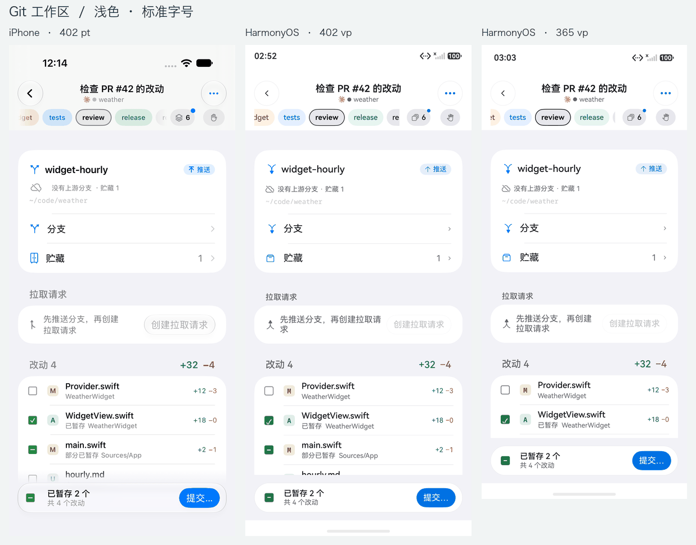
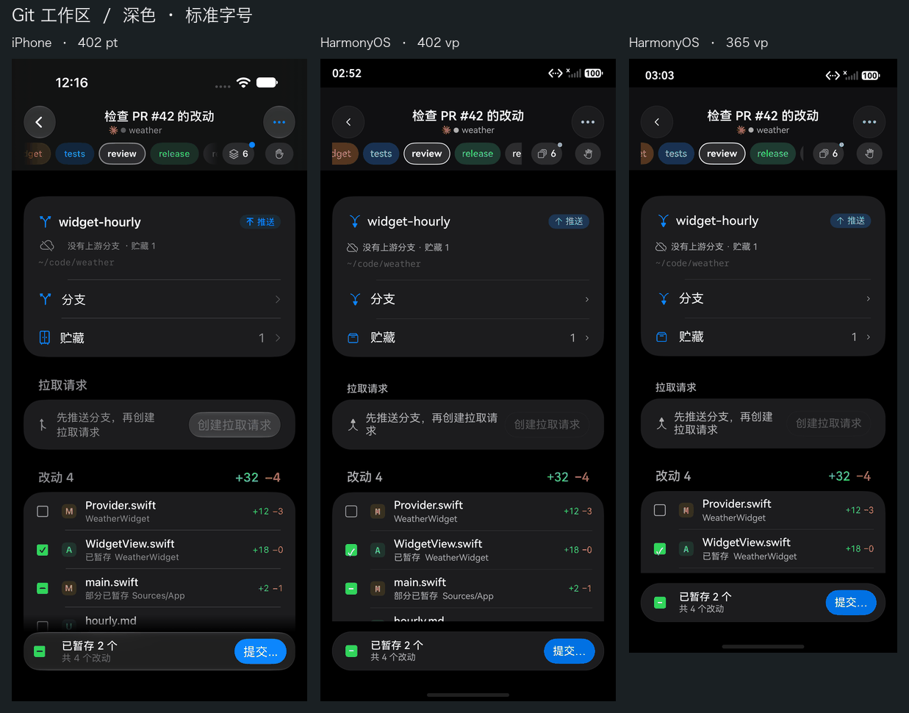

# Git 工作区 · Git workspace

[返回全部页面 · All pages](../README.md)

查看分支、改动文件及暂存状态。
Open Git from the PR #42 conversation menu and inspect its branch, stash, pull request and changes.

Three independent native captures, left to right: iPhone 402 pt, HarmonyOS 402 vp, HarmonyOS 365 vp. The complete screen, including system bars, is visible.

[Download all original screenshots and accessibility trees for this page](../originals/git.zip?raw=1) · [Source and capture method](../SOURCES.md)

Original archive SHA-256: 68674b16aeecc96413cb1e39190e2573ed1e876d32b58f35f14db19ae797e98f

## 浅色 · 标准字号

| Device | Pixels | Captured at | PNG digest | Hierarchy digest |
| --- | --- | --- | --- | --- |
| iPhone 402 pt | 1206 × 2622 | 2026-11-23T04:14:32.201+00:00 | af8e823cccb0f7c8 | 187ea9dfc3cc11d4 |
| HarmonyOS 402 vp | 1206 × 2622 | 2026-11-23T14:52:17+08:00 | fbc96e455e8e153d | 5e4e4c6fcb4e134c |
| HarmonyOS 365 vp | 1280 × 2832 | 2026-11-23T15:03:47+08:00 | 34c1f34b6f87877b | 572c4d0cd6305067 |

## 深色 · 标准字号

| Device | Pixels | Captured at | PNG digest | Hierarchy digest |
| --- | --- | --- | --- | --- |
| iPhone 402 pt | 1206 × 2622 | 2026-11-23T04:16:51.860+00:00 | 75321068a98b50df | 1c195062cc8ce1bc |
| HarmonyOS 402 vp | 1206 × 2622 | 2026-11-23T14:52:20+08:00 | d4560da7e459b393 | fb8df9282f7caf34 |
| HarmonyOS 365 vp | 1280 × 2832 | 2026-11-23T15:03:51+08:00 | 99d0d2f95e4d2051 | e833565c33ee0c32 |

## 浅色 · 最大字号

| Device | Pixels | Captured at | PNG digest | Hierarchy digest |
| --- | --- | --- | --- | --- |
| iPhone 402 pt | 1206 × 2622 | 2026-11-23T04:19:29.110+00:00 | 702348332dbf6bd9 | 0914e5f537c21299 |
| HarmonyOS 402 vp | 1206 × 2622 | 2026-11-23T14:52:24+08:00 | be571478982382be | a56268ad642329e2 |
| HarmonyOS 365 vp | 1280 × 2832 | 2026-11-23T15:03:55+08:00 | fbb5028504f85aa1 | d2c6f6c459b379ee |

Full 64-character digests and ZIP entry paths are under this page in the [manifest](../manifest.json).

[← 工作区文件搜索](file-search.md)
[提交详情 →](git-commit.md)
