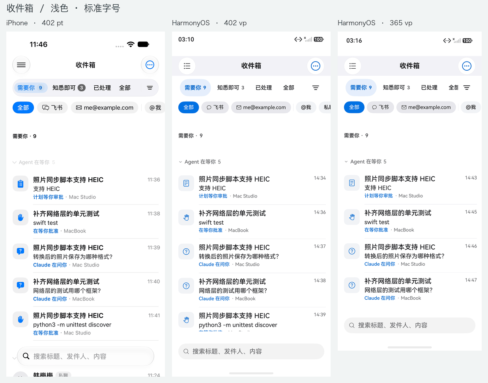
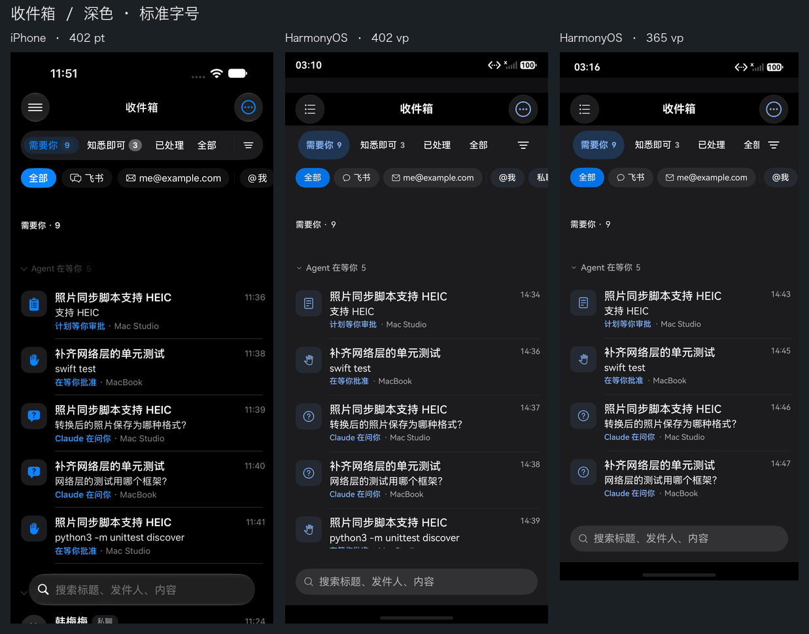
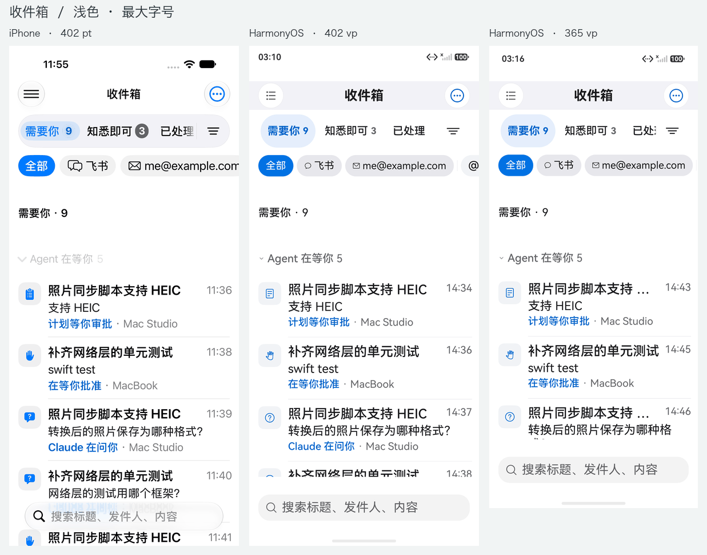

# 收件箱 · Inbox

[返回全部页面 · All pages](../README.md)

查看收件箱的分类、筛选和待处理事项。

Three independent native captures, left to right: iPhone 402 pt, HarmonyOS 402 vp, HarmonyOS 365 vp. The complete screen, including system bars, is visible.

[Download all original screenshots and accessibility trees for this page](../originals/inbox.zip?raw=1) · [Source and capture method](../SOURCES.md)

Original archive SHA-256: 31fb9231815305c200baf7c4f593817efd5ea417d2b55a5ea33ce6c814a0821a

## 浅色 · 标准字号

| Device | Pixels | Captured at | PNG digest | Hierarchy digest |
| --- | --- | --- | --- | --- |
| iPhone 402 pt | 1206 × 2622 | 2026-11-23T03:46:52.984+00:00 | f17fd80e7cb103bc | f7226f4745f246c8 |
| HarmonyOS 402 vp | 1206 × 2622 | 2026-11-23T15:10:18+08:00 | ec15de9ef500162d | 361d4569f9804510 |
| HarmonyOS 365 vp | 1280 × 2832 | 2026-11-23T15:16:43+08:00 | dc25bd39a40e0f57 | 45f8c9d4335e0980 |

## 深色 · 标准字号

| Device | Pixels | Captured at | PNG digest | Hierarchy digest |
| --- | --- | --- | --- | --- |
| iPhone 402 pt | 1206 × 2622 | 2026-11-23T03:51:23.244+00:00 | 286534499fb26ae2 | 3e1e79ef8b4f04d1 |
| HarmonyOS 402 vp | 1206 × 2622 | 2026-11-23T15:10:27+08:00 | 1cdbe22f6b0978f6 | 0ac3f6ae14e5639b |
| HarmonyOS 365 vp | 1280 × 2832 | 2026-11-23T15:16:46+08:00 | 294e8f3a8017a3c3 | 5a08fe984e878471 |

## 浅色 · 最大字号

| Device | Pixels | Captured at | PNG digest | Hierarchy digest |
| --- | --- | --- | --- | --- |
| iPhone 402 pt | 1206 × 2622 | 2026-11-23T03:55:27.213+00:00 | 6502343ca847e070 | f72a46527f39f8c4 |
| HarmonyOS 402 vp | 1206 × 2622 | 2026-11-23T15:10:40+08:00 | 4359f51cbc3eeeec | 5e3d1b8f19aa19c7 |
| HarmonyOS 365 vp | 1280 × 2832 | 2026-11-23T15:16:50+08:00 | 234b52400e8a5101 | 32eed4883cc1a831 |

Full 64-character digests and ZIP entry paths are under this page in the [manifest](../manifest.json).

[← 搜索会话内容](search.md)
[待办 →](todo.md)
