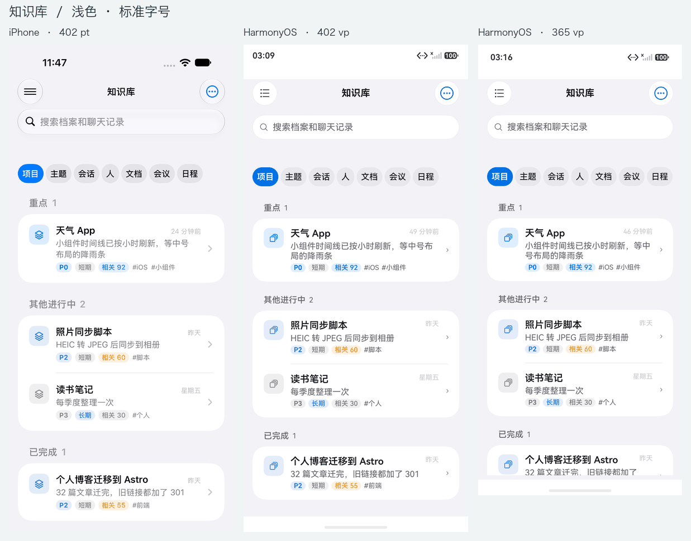
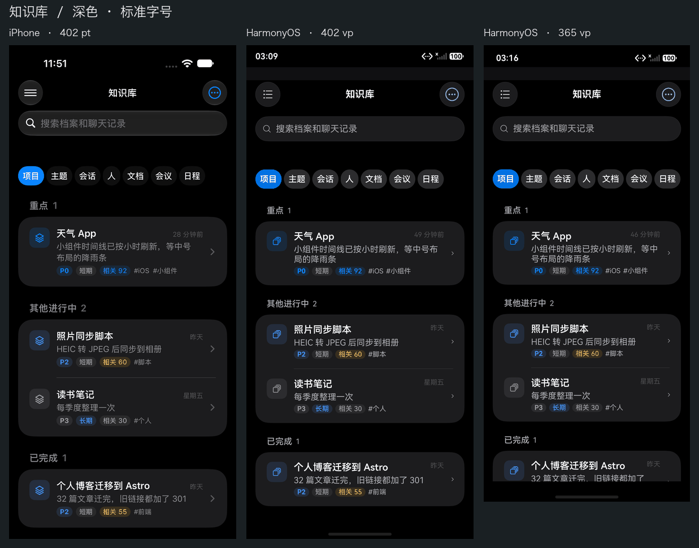
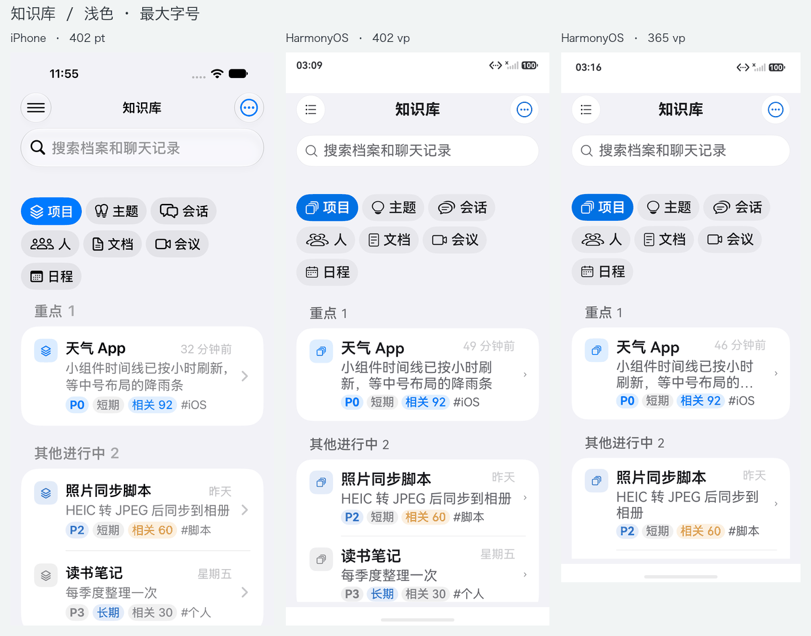

# 知识库 · Knowledge

[返回全部页面 · All pages](../README.md)

浏览知识库的分类和条目。
Compare the same projects across Focus, Other Active and Completed, including priority and state.

Three independent native captures, left to right: iPhone 402 pt, HarmonyOS 402 vp, HarmonyOS 365 vp. The complete screen, including system bars, is visible.

[Download all original screenshots and accessibility trees for this page](../originals/knowledge.zip?raw=1) · [Source and capture method](../SOURCES.md)

Original archive SHA-256: 22030b9bb7ca9f9e2144b7bd98541e6e76adc53deb6990d33277c8a65cc3c2be

## 浅色 · 标准字号

| Device | Pixels | Captured at | PNG digest | Hierarchy digest |
| --- | --- | --- | --- | --- |
| iPhone 402 pt | 1206 × 2622 | 2026-11-23T03:47:04.955+00:00 | adf1c593557eda56 | 11617a745b08deae |
| HarmonyOS 402 vp | 1206 × 2622 | 2026-11-23T15:09:29+08:00 | c962ccc6b14d1900 | 737df2d008eeede5 |
| HarmonyOS 365 vp | 1280 × 2832 | 2026-11-23T15:16:12+08:00 | 81c94b9fe268fe45 | 6c20e864f1e5fb9c |

## 深色 · 标准字号

| Device | Pixels | Captured at | PNG digest | Hierarchy digest |
| --- | --- | --- | --- | --- |
| iPhone 402 pt | 1206 × 2622 | 2026-11-23T03:51:34.509+00:00 | b26965c385855c79 | dc82327574abafce |
| HarmonyOS 402 vp | 1206 × 2622 | 2026-11-23T15:09:33+08:00 | d3143a00a4a96270 | 551dda1cb788ea5b |
| HarmonyOS 365 vp | 1280 × 2832 | 2026-11-23T15:16:15+08:00 | 8924f73d4343386a | 37ff31836d1b2fe1 |

## 浅色 · 最大字号

| Device | Pixels | Captured at | PNG digest | Hierarchy digest |
| --- | --- | --- | --- | --- |
| iPhone 402 pt | 1206 × 2622 | 2026-11-23T03:55:37.604+00:00 | 2d48f1f2f6b2e534 | d2624df61339ed59 |
| HarmonyOS 402 vp | 1206 × 2622 | 2026-11-23T15:09:37+08:00 | 60f2fcdf25bcbdb2 | a45c20bc17e7deb7 |
| HarmonyOS 365 vp | 1280 × 2832 | 2026-11-23T15:16:19+08:00 | a0c9257bff9f47eb | 6ea492d95b93a809 |

Full 64-character digests and ZIP entry paths are under this page in the [manifest](../manifest.json).

[← 今日待办与排序](todo-due.md)
[会议 →](meetings.md)
