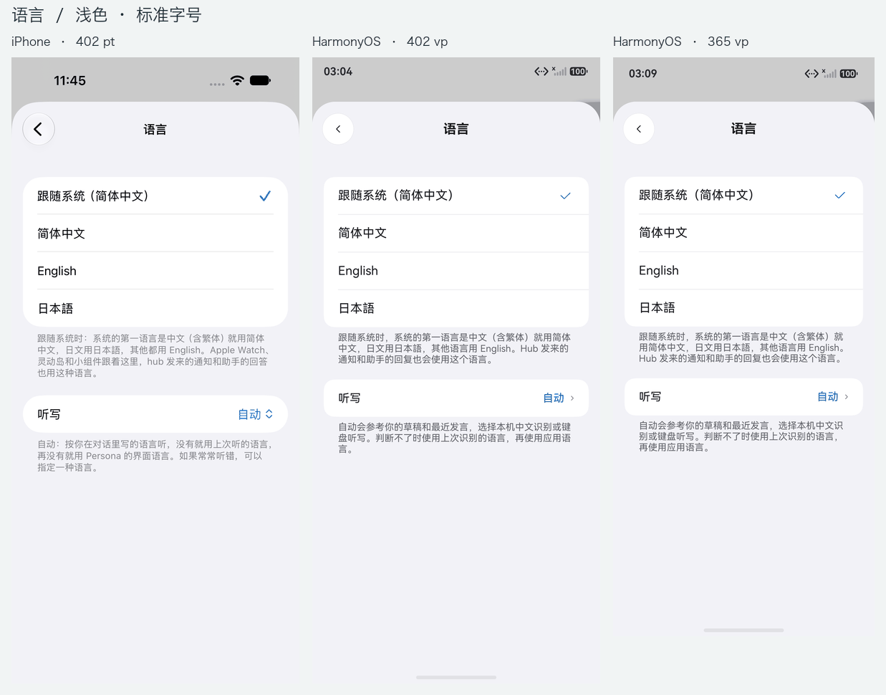
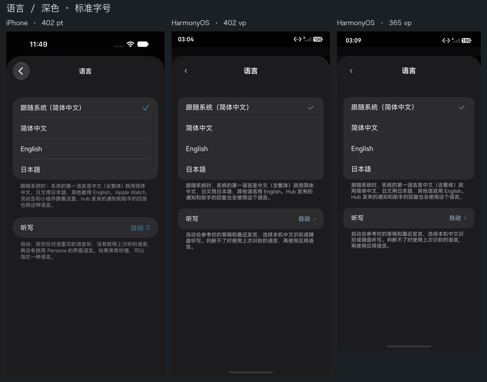
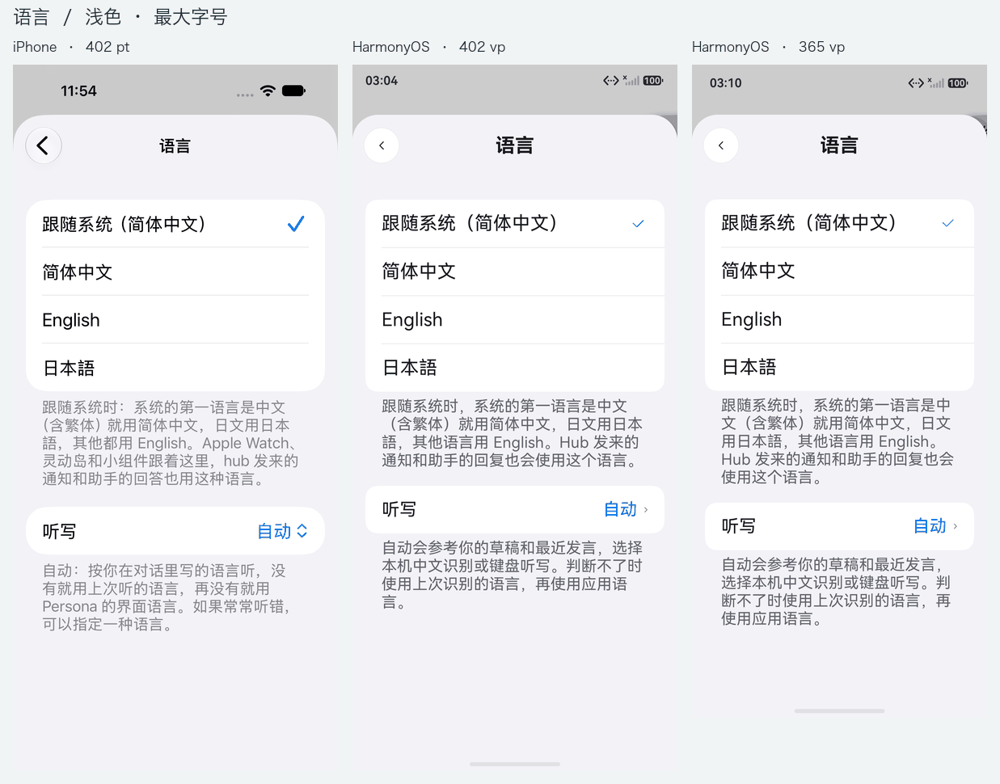

# 语言 · Language settings

[返回全部页面 · All pages](../README.md)

查看可选应用语言和当前语言设置。
Open Language in Settings. Automatic dictation follows the conversation language and the device’s available input methods.

Three independent native captures, left to right: iPhone 402 pt, HarmonyOS 402 vp, HarmonyOS 365 vp. The complete screen, including system bars, is visible.

[Download all original screenshots and accessibility trees for this page](../originals/language.zip?raw=1) · [Source and capture method](../SOURCES.md)

Original archive SHA-256: a3090bc3d3615608095db0981efb12d8c0ed66d5b7d37d4dd2ad7a42f32ca014

## 浅色 · 标准字号

| Device | Pixels | Captured at | PNG digest | Hierarchy digest |
| --- | --- | --- | --- | --- |
| iPhone 402 pt | 1206 × 2622 | 2026-11-23T03:45:10.768+00:00 | fe2b97a653f7f473 | 01bb55439167b5e6 |
| HarmonyOS 402 vp | 1206 × 2622 | 2026-11-23T15:04:16+08:00 | 87a00e92c2a0b002 | 61b5f24883887d49 |
| HarmonyOS 365 vp | 1280 × 2832 | 2026-11-23T15:09:49+08:00 | 2ee9d53d9bd4b876 | 370ddf0df2ea59ce |

## 深色 · 标准字号

| Device | Pixels | Captured at | PNG digest | Hierarchy digest |
| --- | --- | --- | --- | --- |
| iPhone 402 pt | 1206 × 2622 | 2026-11-23T03:49:49.380+00:00 | 7970e0c0c894c9f9 | bed21ca367bc8af4 |
| HarmonyOS 402 vp | 1206 × 2622 | 2026-11-23T15:04:19+08:00 | 578eab01ff85d91b | 1fdd7bed973cc791 |
| HarmonyOS 365 vp | 1280 × 2832 | 2026-11-23T15:09:53+08:00 | fe3cbe43e4c48b8c | 089bf33d958e011b |

## 浅色 · 最大字号

| Device | Pixels | Captured at | PNG digest | Hierarchy digest |
| --- | --- | --- | --- | --- |
| iPhone 402 pt | 1206 × 2622 | 2026-11-23T03:54:06.279+00:00 | e3aa1b7f7093ffa2 | 3b67b25ee0685736 |
| HarmonyOS 402 vp | 1206 × 2622 | 2026-11-23T15:04:23+08:00 | 297a547726087f2f | 9d91d2f6bc1d176e |
| HarmonyOS 365 vp | 1280 × 2832 | 2026-11-23T15:10:13+08:00 | 4a5fca789c52243d | 2dc8f1b706a59c28 |

Full 64-character digests and ZIP entry paths are under this page in the [manifest](../manifest.json).

[← 返回设置搜索结果](settings-search-restored.md)
[Agent 偏好 →](agent-preferences.md)
