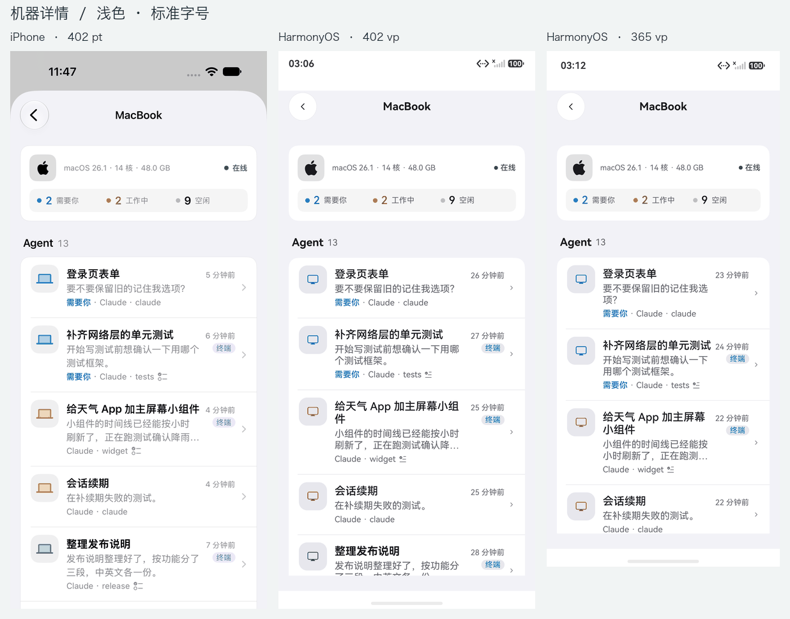
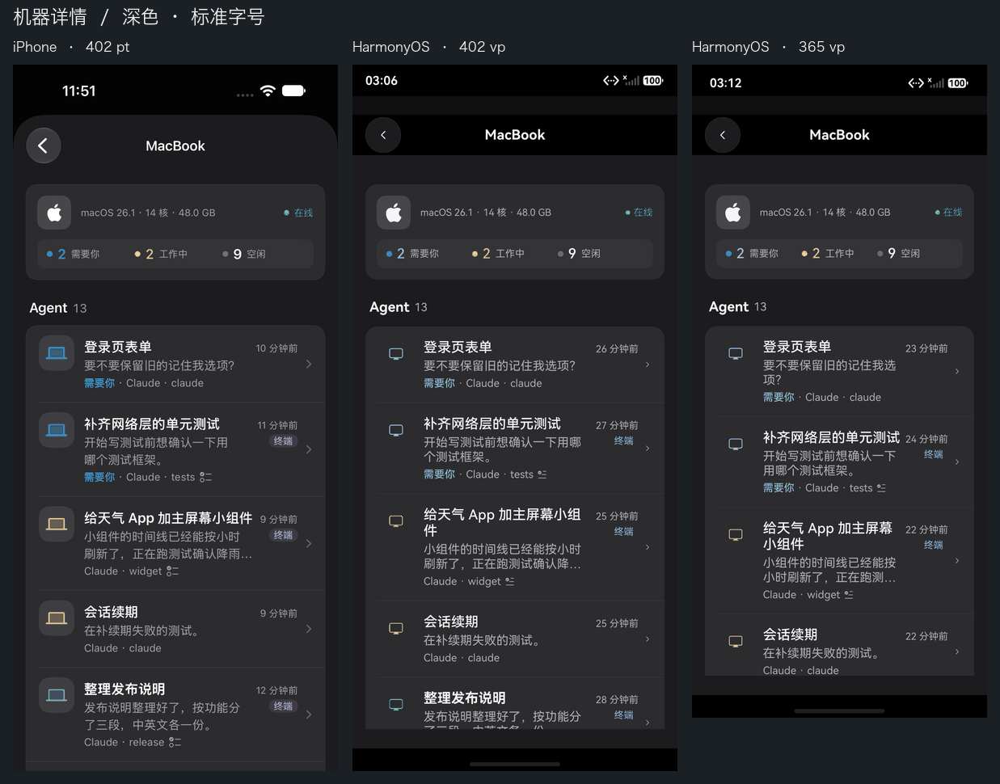
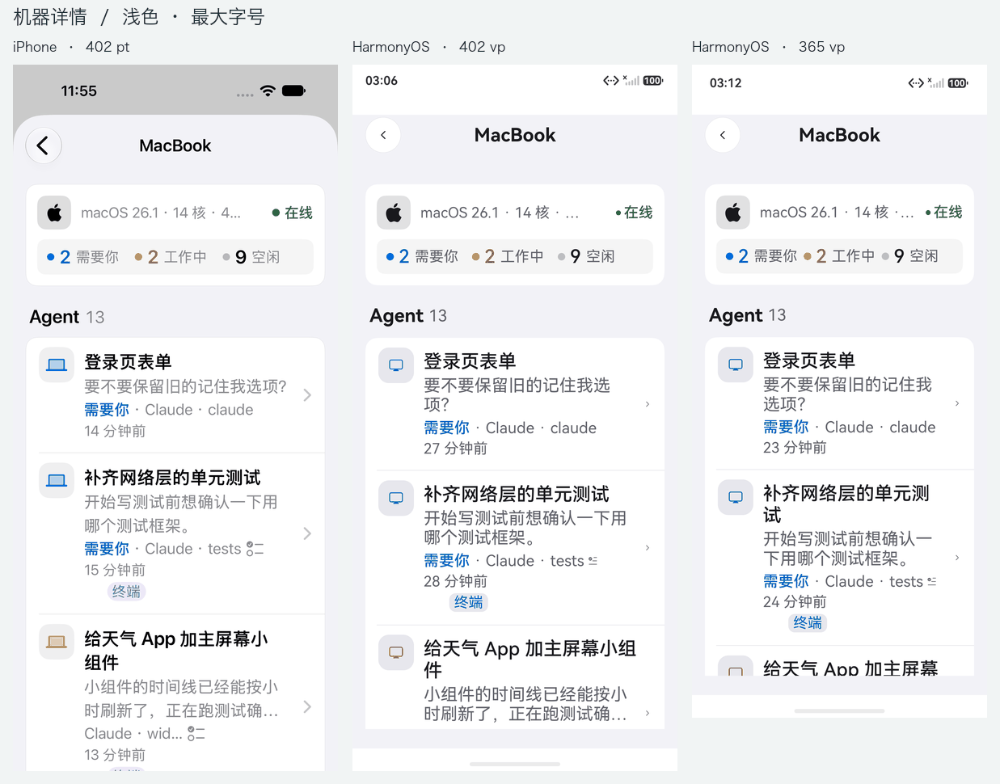

# 机器详情 · Machine details

[返回全部页面 · All pages](../README.md)

进入同一台测试 MacBook 的详情。
Open the fixture MacBook from the machine directory and inspect its agents.

Three independent native captures, left to right: iPhone 402 pt, HarmonyOS 402 vp, HarmonyOS 365 vp. The complete screen, including system bars, is visible.

[Download all original screenshots and accessibility trees for this page](../originals/machine-detail.zip?raw=1) · [Source and capture method](../SOURCES.md)

Original archive SHA-256: 6f8372b1070641c56929f3f3a293ec4ec1d0dbfbf15b3766be3bd2b5d5e1c177

## 浅色 · 标准字号

| Device | Pixels | Captured at | PNG digest | Hierarchy digest |
| --- | --- | --- | --- | --- |
| iPhone 402 pt | 1206 × 2622 | 2026-11-23T03:47:18.644+00:00 | ded5c81ec82181c6 | 1ea8a946317302e6 |
| HarmonyOS 402 vp | 1206 × 2622 | 2026-11-23T15:06:12+08:00 | 5cd69c89b2de49ef | 98b78e129aaa0f7a |
| HarmonyOS 365 vp | 1280 × 2832 | 2026-11-23T15:12:24+08:00 | 7f2a7b83e3b4b15c | 6f89ba4594c264fe |

## 深色 · 标准字号

| Device | Pixels | Captured at | PNG digest | Hierarchy digest |
| --- | --- | --- | --- | --- |
| iPhone 402 pt | 1206 × 2622 | 2026-11-23T03:51:47.599+00:00 | 462155be5ba66055 | 28fef38f21418b2b |
| HarmonyOS 402 vp | 1206 × 2622 | 2026-11-23T15:06:16+08:00 | e8342bb53276bb9f | 99748671e4817ad2 |
| HarmonyOS 365 vp | 1280 × 2832 | 2026-11-23T15:12:27+08:00 | 8b8230f12d2373cd | e376d50c058de1a1 |

## 浅色 · 最大字号

| Device | Pixels | Captured at | PNG digest | Hierarchy digest |
| --- | --- | --- | --- | --- |
| iPhone 402 pt | 1206 × 2622 | 2026-11-23T03:55:48.707+00:00 | 22be2d412bd91dea | 68f103e140bf53c6 |
| HarmonyOS 402 vp | 1206 × 2622 | 2026-11-23T15:06:20+08:00 | 2b4d23656e6ddea4 | 85cd96445047ac46 |
| HarmonyOS 365 vp | 1280 × 2832 | 2026-11-23T15:12:31+08:00 | 8bf313b578cdf111 | 196e507c773f5288 |

Full 64-character digests and ZIP entry paths are under this page in the [manifest](../manifest.json).

[← 机器总览](machines.md)
[机器监控读数 →](machine-monitor.md)
