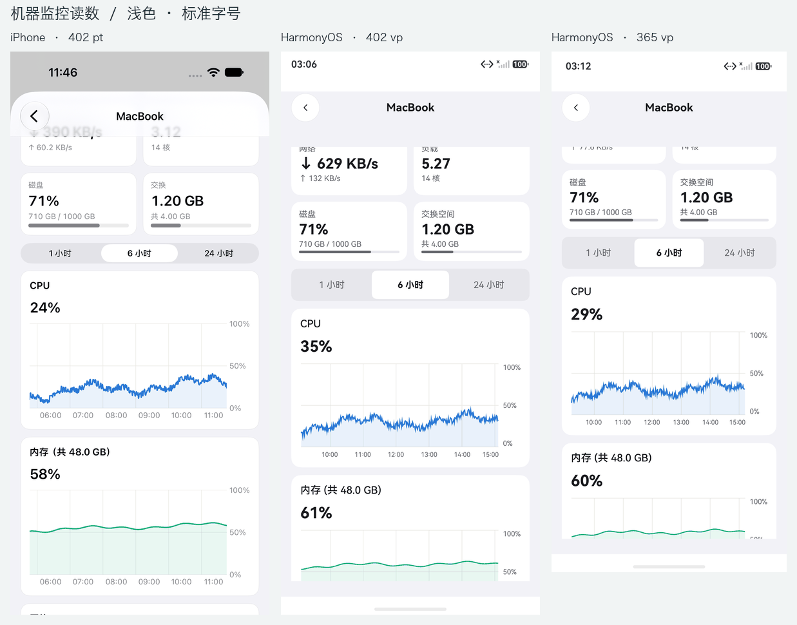
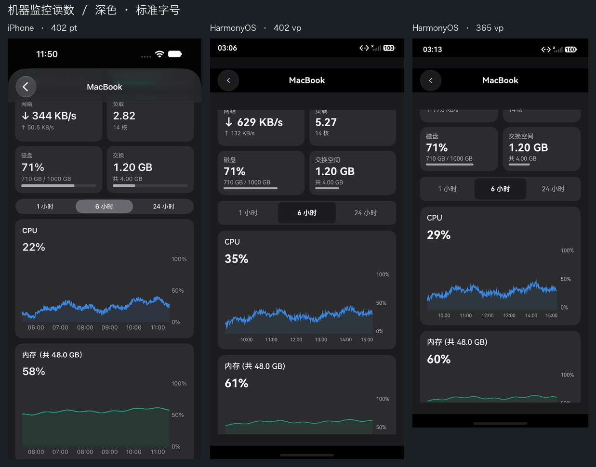
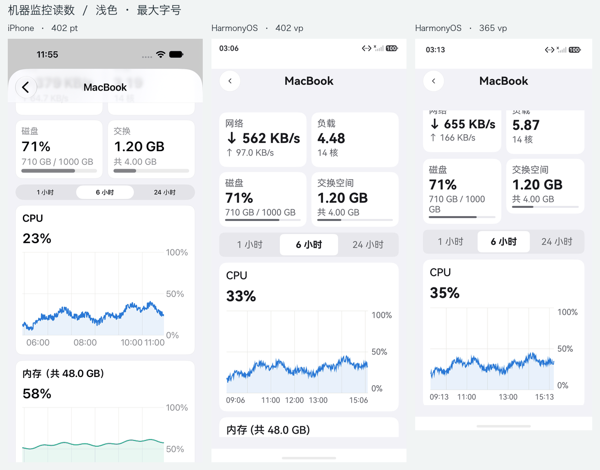

# 机器监控读数 · Machine metrics

[返回全部页面 · All pages](../README.md)

查看 MacBook 的 CPU 历史曲线及所选时间范围。
Inspect six hours of CPU history on the fixture MacBook. Each local Hub has its own sampling time and values.

Three independent native captures, left to right: iPhone 402 pt, HarmonyOS 402 vp, HarmonyOS 365 vp. The complete screen, including system bars, is visible.

[Download all original screenshots and accessibility trees for this page](../originals/machine-monitor.zip?raw=1) · [Source and capture method](../SOURCES.md)

Original archive SHA-256: c06fb65a73c29ae15015956b81815937311367f27fa5bbc4d117dea98743e308

## 浅色 · 标准字号

| Device | Pixels | Captured at | PNG digest | Hierarchy digest |
| --- | --- | --- | --- | --- |
| iPhone 402 pt | 1206 × 2622 | 2026-11-23T03:46:13.790+00:00 | 94d0f9de787a6d9e | 06863e946a1e9d71 |
| HarmonyOS 402 vp | 1206 × 2622 | 2026-11-23T15:06:41+08:00 | 98da92ba3d228939 | c5e3b9163f399614 |
| HarmonyOS 365 vp | 1280 × 2832 | 2026-11-23T15:12:58+08:00 | f2899bbabb20d332 | 530ba391a1f60b2f |

## 深色 · 标准字号

| Device | Pixels | Captured at | PNG digest | Hierarchy digest |
| --- | --- | --- | --- | --- |
| iPhone 402 pt | 1206 × 2622 | 2026-11-23T03:50:47.259+00:00 | 03ca8d8cb6d0c6b9 | 5dee76907f08fb49 |
| HarmonyOS 402 vp | 1206 × 2622 | 2026-11-23T15:06:45+08:00 | 8f2f4fb93c370d82 | 9a6920f6fb4cf7c0 |
| HarmonyOS 365 vp | 1280 × 2832 | 2026-11-23T15:13:02+08:00 | af7f2f0134268733 | 6cf4da2fa6315288 |

## 浅色 · 最大字号

| Device | Pixels | Captured at | PNG digest | Hierarchy digest |
| --- | --- | --- | --- | --- |
| iPhone 402 pt | 1206 × 2622 | 2026-11-23T03:55:05.619+00:00 | b946da9726c8e08b | 5023d2be2713347d |
| HarmonyOS 402 vp | 1206 × 2622 | 2026-11-23T15:06:57+08:00 | 541e56787422cdca | 214ae40024f8bd44 |
| HarmonyOS 365 vp | 1280 × 2832 | 2026-11-23T15:13:14+08:00 | b70ffcc3e26abc7e | ef750f1e06e8fcc0 |

Full 64-character digests and ZIP entry paths are under this page in the [manifest](../manifest.json).

[← 机器详情](machine-detail.md)
[侧栏 →](drawer.md)
