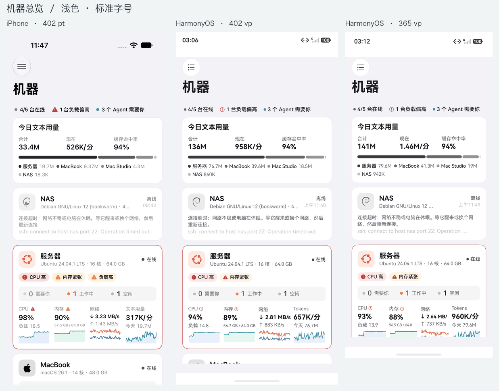
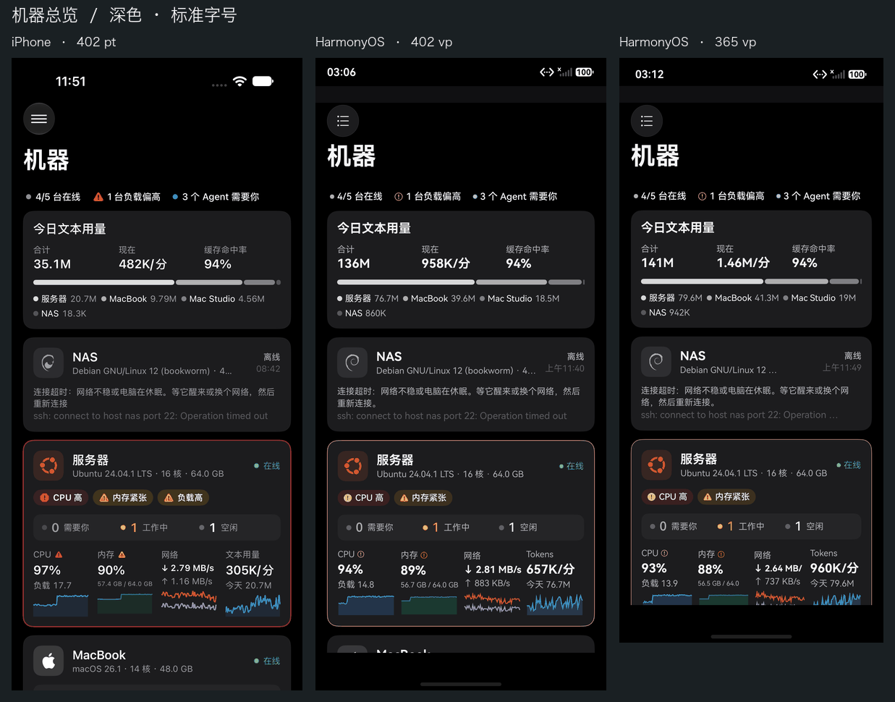
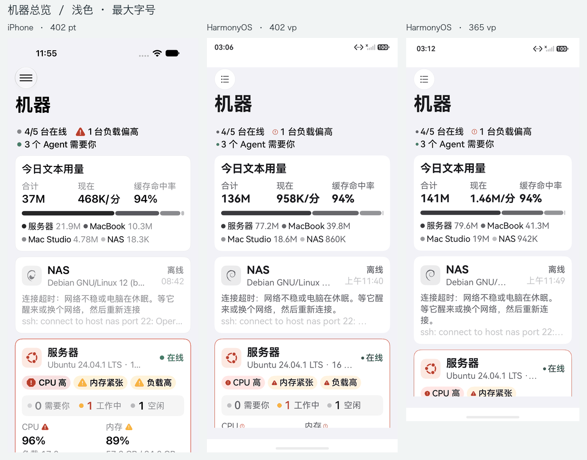

# 机器总览 · Machines

[返回全部页面 · All pages](../README.md)

比较机器的在线状态、负载与使用量。

Three independent native captures, left to right: iPhone 402 pt, HarmonyOS 402 vp, HarmonyOS 365 vp. The complete screen, including system bars, is visible.

[Download all original screenshots and accessibility trees for this page](../originals/machines.zip?raw=1) · [Source and capture method](../SOURCES.md)

Original archive SHA-256: 5ef219a078c722de6c42d9d565dac4c98249e7852432be55ccbc693d97ba40df

## 浅色 · 标准字号

| Device | Pixels | Captured at | PNG digest | Hierarchy digest |
| --- | --- | --- | --- | --- |
| iPhone 402 pt | 1206 × 2622 | 2026-11-23T03:47:31.633+00:00 | 4a22ad4036597628 | c47ae7eb5612b306 |
| HarmonyOS 402 vp | 1206 × 2622 | 2026-11-23T15:06:00+08:00 | 27ad827a4a2004db | 91126fbe17a8fef0 |
| HarmonyOS 365 vp | 1280 × 2832 | 2026-11-23T15:12:07+08:00 | 9399b6ea3764ea32 | af79b25b16b7d389 |

## 深色 · 标准字号

| Device | Pixels | Captured at | PNG digest | Hierarchy digest |
| --- | --- | --- | --- | --- |
| iPhone 402 pt | 1206 × 2622 | 2026-11-23T03:51:59.282+00:00 | 53384c30d517a64f | aad8f80389806184 |
| HarmonyOS 402 vp | 1206 × 2622 | 2026-11-23T15:06:04+08:00 | e3dce42aec92d6b0 | d40cf5e52385f2d5 |
| HarmonyOS 365 vp | 1280 × 2832 | 2026-11-23T15:12:11+08:00 | d2985298dc40d7eb | 12039582d88c2973 |

## 浅色 · 最大字号

| Device | Pixels | Captured at | PNG digest | Hierarchy digest |
| --- | --- | --- | --- | --- |
| iPhone 402 pt | 1206 × 2622 | 2026-11-23T03:55:59.611+00:00 | 78fc14144742a23e | aeddb58ded0e0bf9 |
| HarmonyOS 402 vp | 1206 × 2622 | 2026-11-23T15:06:08+08:00 | 49a25da4738f2a88 | 14bbae95c538b9d6 |
| HarmonyOS 365 vp | 1280 × 2832 | 2026-11-23T15:12:15+08:00 | a817f782edc497ed | c9f5c34880d87a65 |

Full 64-character digests and ZIP entry paths are under this page in the [manifest](../manifest.json).

[← Git 差异](git-diff.md)
[机器详情 →](machine-detail.md)
