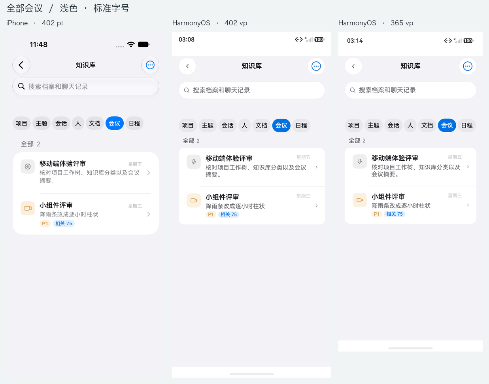
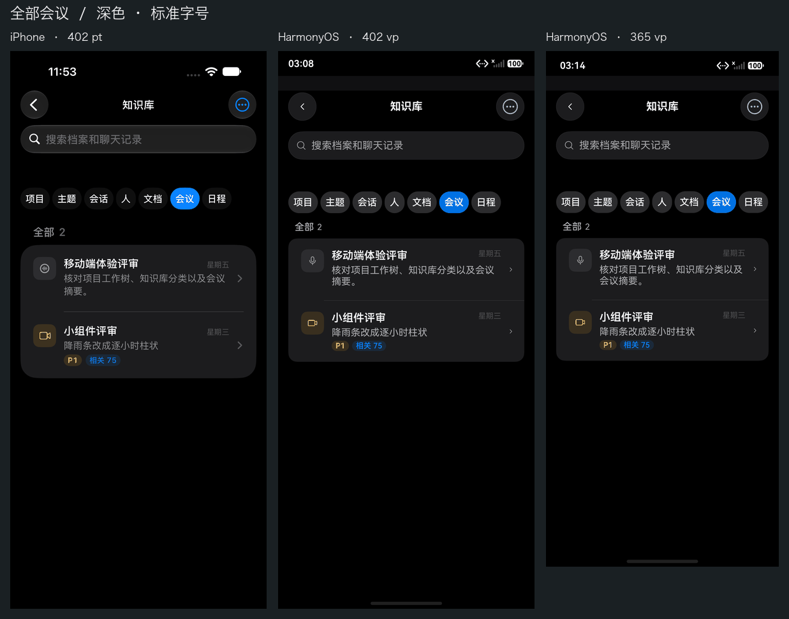
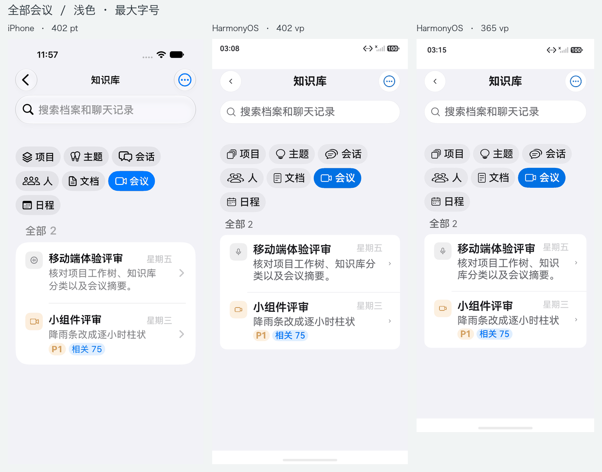

# 全部会议 · All meetings

[返回全部页面 · All pages](../README.md)

打开会议记录列表，找到移动端体验评审。

Three independent native captures, left to right: iPhone 402 pt, HarmonyOS 402 vp, HarmonyOS 365 vp. The complete screen, including system bars, is visible.

[Download all original screenshots and accessibility trees for this page](../originals/meeting-list.zip?raw=1) · [Source and capture method](../SOURCES.md)

Original archive SHA-256: 53e58ec56bc67aa4748d8271b0cb6fccedb9795e36867c5d222dd6fee01a52b9

## 浅色 · 标准字号

| Device | Pixels | Captured at | PNG digest | Hierarchy digest |
| --- | --- | --- | --- | --- |
| iPhone 402 pt | 1206 × 2622 | 2026-11-23T03:48:42.938+00:00 | 5f31ec054da05b06 | ed79b9ecb2a41fa3 |
| HarmonyOS 402 vp | 1206 × 2622 | 2026-11-23T15:08:36+08:00 | e4871b9eb629a13a | 94fe6d47d00cadf3 |
| HarmonyOS 365 vp | 1280 × 2832 | 2026-11-23T15:14:53+08:00 | 023bf5cbdc15969b | a72bef4a7d64a368 |

## 深色 · 标准字号

| Device | Pixels | Captured at | PNG digest | Hierarchy digest |
| --- | --- | --- | --- | --- |
| iPhone 402 pt | 1206 × 2622 | 2026-11-23T03:53:06.011+00:00 | 7eb36882689a3901 | 63af27a19be6a647 |
| HarmonyOS 402 vp | 1206 × 2622 | 2026-11-23T15:08:39+08:00 | 9d4fa58dac7581e8 | 42488b9a5837d6a8 |
| HarmonyOS 365 vp | 1280 × 2832 | 2026-11-23T15:14:56+08:00 | d584bad720c157a4 | 0672b45fc575b316 |

## 浅色 · 最大字号

| Device | Pixels | Captured at | PNG digest | Hierarchy digest |
| --- | --- | --- | --- | --- |
| iPhone 402 pt | 1206 × 2622 | 2026-11-23T03:57:00.970+00:00 | 52b4cae6f63ec416 | c6a6e78a35b83e5a |
| HarmonyOS 402 vp | 1206 × 2622 | 2026-11-23T15:08:43+08:00 | c54963a48f312ce6 | f2663b04f46c2945 |
| HarmonyOS 365 vp | 1280 × 2832 | 2026-11-23T15:15:00+08:00 | df59f67212ead227 | c3fa1499d437b3e1 |

Full 64-character digests and ZIP entry paths are under this page in the [manifest](../manifest.json).

[← 会议](meetings.md)
[会议详情 →](meeting-detail.md)
