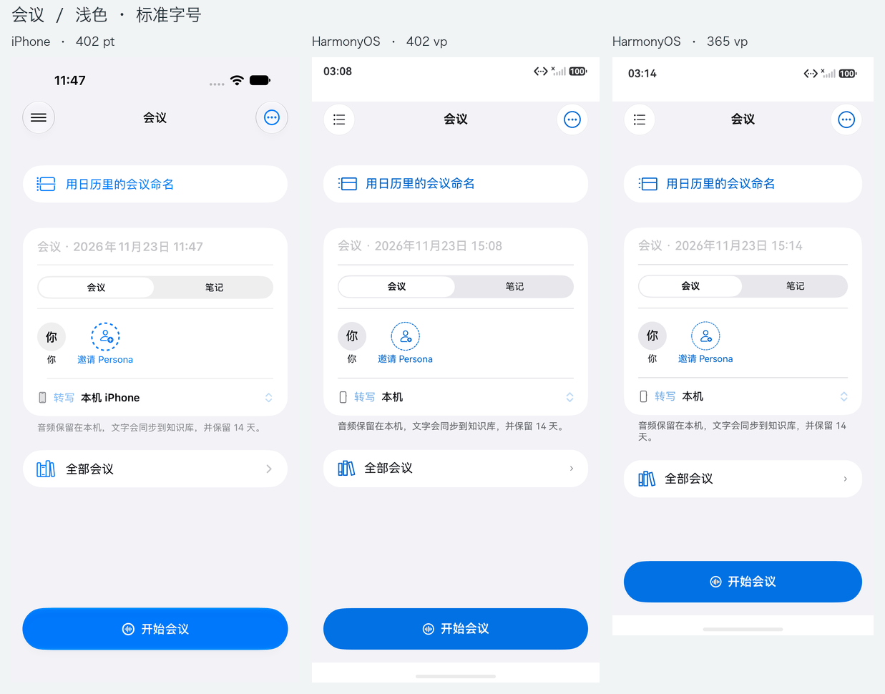
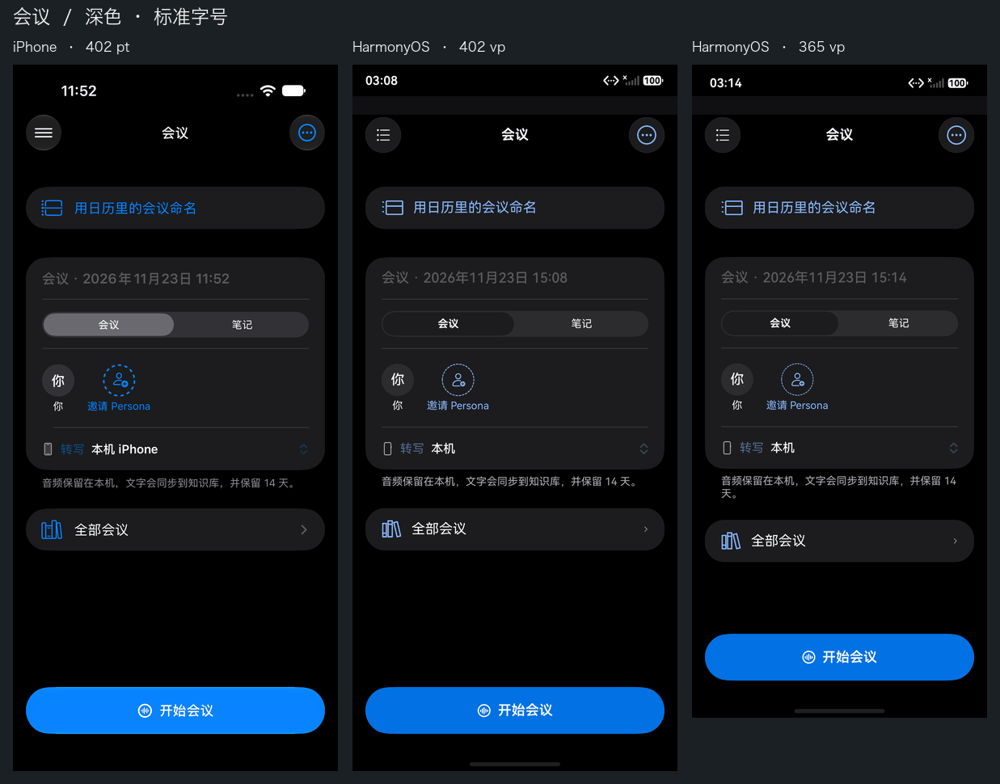
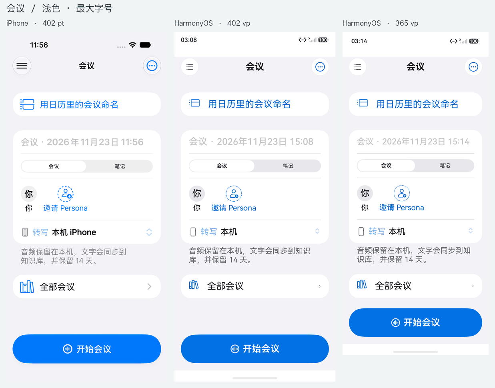

# 会议 · Meetings

[返回全部页面 · All pages](../README.md)

查看会议首页、录制入口及全部会议入口。
Compare the meeting and note setup, calendar naming, assistant invitation and start action.

Three independent native captures, left to right: iPhone 402 pt, HarmonyOS 402 vp, HarmonyOS 365 vp. The complete screen, including system bars, is visible.

[Download all original screenshots and accessibility trees for this page](../originals/meetings.zip?raw=1) · [Source and capture method](../SOURCES.md)

Original archive SHA-256: 0cafc9326f0400e3971aaea435af730f1207c031fe1d5b369cffc6a7fe0ec758

## 浅色 · 标准字号

| Device | Pixels | Captured at | PNG digest | Hierarchy digest |
| --- | --- | --- | --- | --- |
| iPhone 402 pt | 1206 × 2622 | 2026-11-23T03:47:44.729+00:00 | edf55a50b3ade862 | 0b524bdaa1ef05fb |
| HarmonyOS 402 vp | 1206 × 2622 | 2026-11-23T15:08:23+08:00 | 6a604c29157caacc | 55ba5a1e48cf3f91 |
| HarmonyOS 365 vp | 1280 × 2832 | 2026-11-23T15:14:40+08:00 | 2fcee3e957021df3 | 09b53c787030a449 |

## 深色 · 标准字号

| Device | Pixels | Captured at | PNG digest | Hierarchy digest |
| --- | --- | --- | --- | --- |
| iPhone 402 pt | 1206 × 2622 | 2026-11-23T03:52:10.781+00:00 | b8f617b9b2a75217 | af0e1647605184c1 |
| HarmonyOS 402 vp | 1206 × 2622 | 2026-11-23T15:08:27+08:00 | 5e35b2884b8a5dfe | 80770b759a891197 |
| HarmonyOS 365 vp | 1280 × 2832 | 2026-11-23T15:14:44+08:00 | 27f245fe5729043c | 86f2571bbe4e2cc4 |

## 浅色 · 最大字号

| Device | Pixels | Captured at | PNG digest | Hierarchy digest |
| --- | --- | --- | --- | --- |
| iPhone 402 pt | 1206 × 2622 | 2026-11-23T03:56:10.049+00:00 | 5e01c5cd2fd629af | ff708b27af6a201e |
| HarmonyOS 402 vp | 1206 × 2622 | 2026-11-23T15:08:31+08:00 | 9bf97f15ef4ef8c2 | 2b389d3eb1c12f12 |
| HarmonyOS 365 vp | 1280 × 2832 | 2026-11-23T15:14:48+08:00 | b037b65f3878a532 | acb4b94415f68397 |

Full 64-character digests and ZIP entry paths are under this page in the [manifest](../manifest.json).

[← 知识库](knowledge.md)
[全部会议 →](meeting-list.md)
