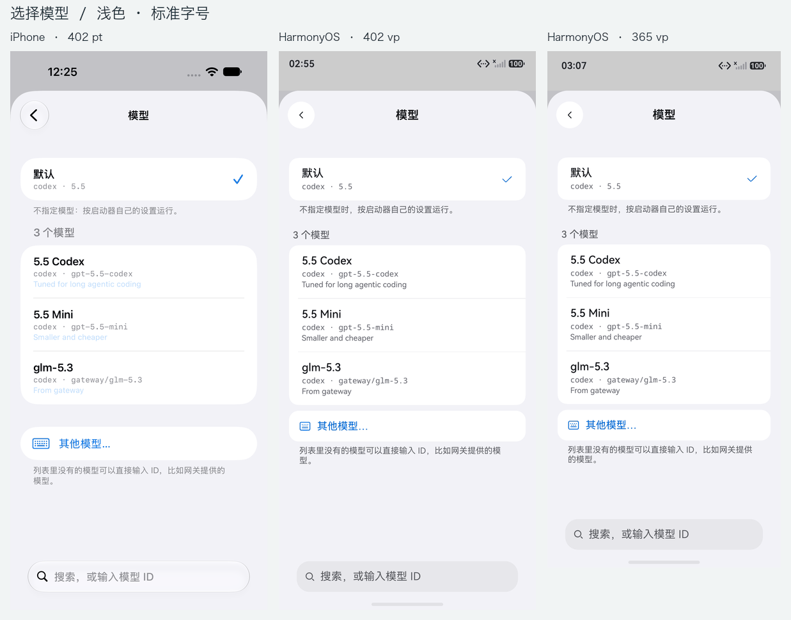
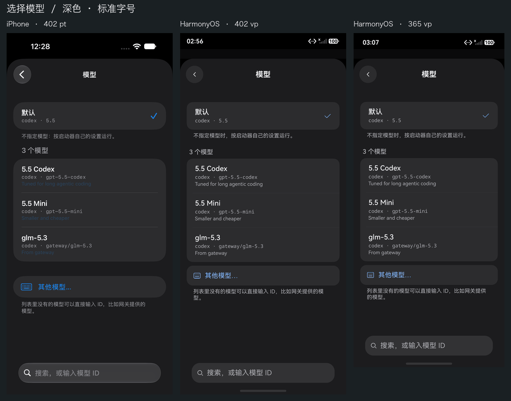
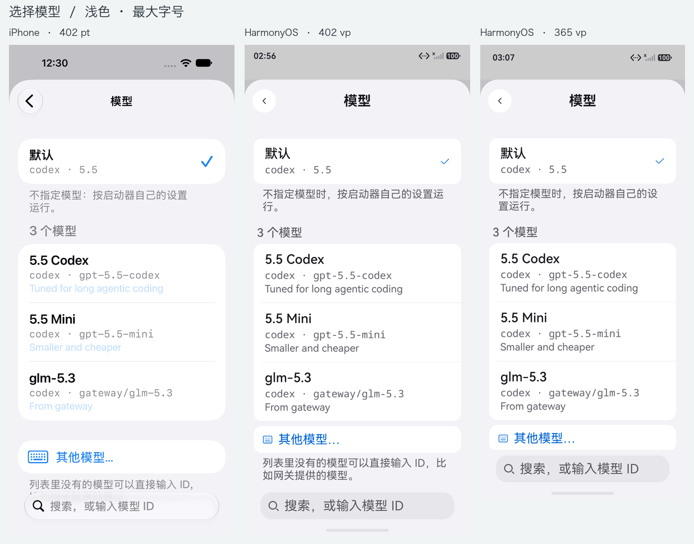

# 选择模型 · Choose a model

[返回全部页面 · All pages](../README.md)

打开所选启动器提供的模型列表。

Three independent native captures, left to right: iPhone 402 pt, HarmonyOS 402 vp, HarmonyOS 365 vp. The complete screen, including system bars, is visible.

[Download all original screenshots and accessibility trees for this page](../originals/models.zip?raw=1) · [Source and capture method](../SOURCES.md)

Original archive SHA-256: 00317312c77d7e929c4b22f3e3aa735cc3bda6b2d8f2547ac2e1c101b60cd9c9

## 浅色 · 标准字号

| Device | Pixels | Captured at | PNG digest | Hierarchy digest |
| --- | --- | --- | --- | --- |
| iPhone 402 pt | 1206 × 2622 | 2026-11-23T04:25:34.535+00:00 | 99227d5ac11eec17 | 5fd31307e22251ec |
| HarmonyOS 402 vp | 1206 × 2622 | 2026-11-23T14:55:58+08:00 | e7108f32a051b44e | aa32c25fd3ffe3cd |
| HarmonyOS 365 vp | 1280 × 2832 | 2026-11-23T15:07:07+08:00 | 6127da0ccaf01984 | 2b386f7e8d54ab85 |

## 深色 · 标准字号

| Device | Pixels | Captured at | PNG digest | Hierarchy digest |
| --- | --- | --- | --- | --- |
| iPhone 402 pt | 1206 × 2622 | 2026-11-23T04:28:03.946+00:00 | 035096e790c295e1 | c89dbb6bd871bb8b |
| HarmonyOS 402 vp | 1206 × 2622 | 2026-11-23T14:56:02+08:00 | 02ca7912a26f2148 | be264348c200bdfc |
| HarmonyOS 365 vp | 1280 × 2832 | 2026-11-23T15:07:11+08:00 | 2d2f3c14f0df4311 | dee46893dc8f0f5e |

## 浅色 · 最大字号

| Device | Pixels | Captured at | PNG digest | Hierarchy digest |
| --- | --- | --- | --- | --- |
| iPhone 402 pt | 1206 × 2622 | 2026-11-23T04:30:38.268+00:00 | f97284b38e930d5a | e789fd58bf206850 |
| HarmonyOS 402 vp | 1206 × 2622 | 2026-11-23T14:56:06+08:00 | 486ce7f670d4a9dc | 9a3f1391ca6bf096 |
| HarmonyOS 365 vp | 1280 × 2832 | 2026-11-23T15:07:15+08:00 | 234ae336b7d8921d | accf8c15616e841e |

Full 64-character digests and ZIP entry paths are under this page in the [manifest](../manifest.json).

[← 选择目录](folder-browser.md)
[提交 Agent 配置 →](start-ready.md)
