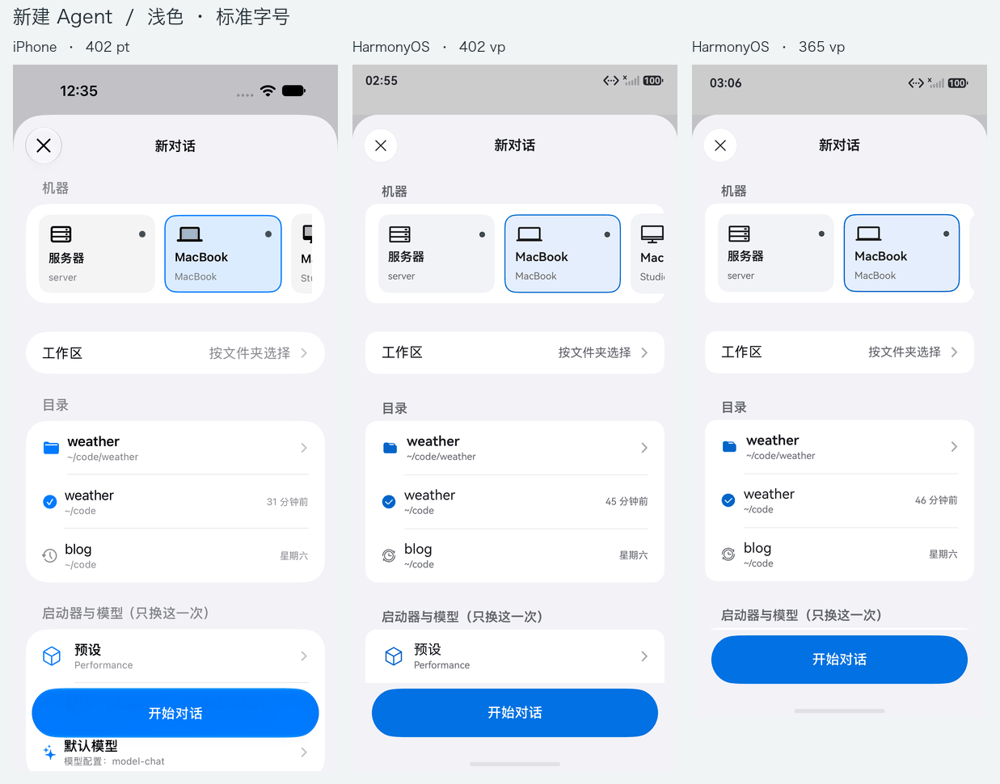
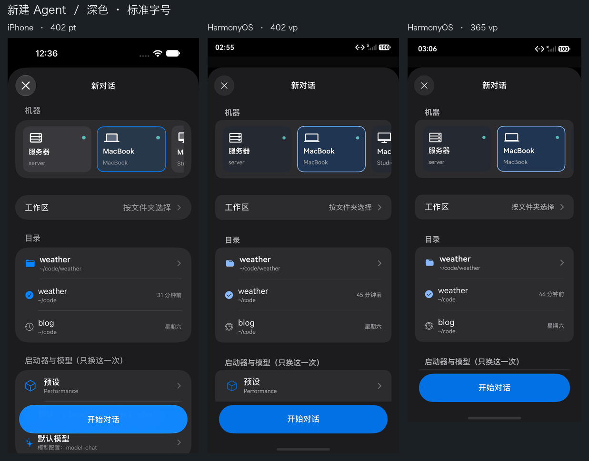
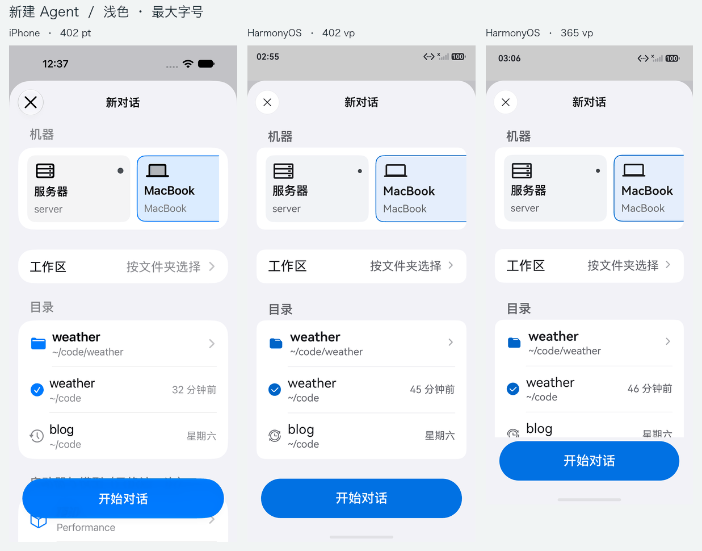

# 新建 Agent · New agent

[返回全部页面 · All pages](../README.md)

在启动表单选择机器、工作目录和启动器。
Compare the machine, directory, launcher and default model in the start form.

Three independent native captures, left to right: iPhone 402 pt, HarmonyOS 402 vp, HarmonyOS 365 vp. The complete screen, including system bars, is visible.

[Download all original screenshots and accessibility trees for this page](../originals/new-agent.zip?raw=1) · [Source and capture method](../SOURCES.md)

Original archive SHA-256: 4d22cbc8158b51c63f5c73b837b8e4b0cf4305992cfac380194150eb467730c9

## 浅色 · 标准字号

| Device | Pixels | Captured at | PNG digest | Hierarchy digest |
| --- | --- | --- | --- | --- |
| iPhone 402 pt | 1206 × 2622 | 2026-11-23T04:35:54.704+00:00 | 4385288e6abca5c3 | 259dbcd20a45a082 |
| HarmonyOS 402 vp | 1206 × 2622 | 2026-11-23T14:55:19+08:00 | b02e7220ddc65c35 | 6a2ecd41e652e88d |
| HarmonyOS 365 vp | 1280 × 2832 | 2026-11-23T15:06:28+08:00 | 9299f95a8365b600 | 30500d33886403f7 |

## 深色 · 标准字号

| Device | Pixels | Captured at | PNG digest | Hierarchy digest |
| --- | --- | --- | --- | --- |
| iPhone 402 pt | 1206 × 2622 | 2026-11-23T04:36:44.729+00:00 | 1777779bf887b88c | fc654f1d1351c4e2 |
| HarmonyOS 402 vp | 1206 × 2622 | 2026-11-23T14:55:23+08:00 | 081a426268b24f59 | a5d73245a68952c3 |
| HarmonyOS 365 vp | 1280 × 2832 | 2026-11-23T15:06:32+08:00 | aaaa0238fec0b8bb | 6b5b7fd017416187 |

## 浅色 · 最大字号

| Device | Pixels | Captured at | PNG digest | Hierarchy digest |
| --- | --- | --- | --- | --- |
| iPhone 402 pt | 1206 × 2622 | 2026-11-23T04:37:35.720+00:00 | 22223fe0cc49abde | 322baf6d8cbe2a77 |
| HarmonyOS 402 vp | 1206 × 2622 | 2026-11-23T14:55:27+08:00 | 7b5096edb31e53c4 | f8251fb869de5b31 |
| HarmonyOS 365 vp | 1280 × 2832 | 2026-11-23T15:06:35+08:00 | 7e7c5d0661eecc7a | ae6a746f36f22cc1 |

Full 64-character digests and ZIP entry paths are under this page in the [manifest](../manifest.json).

[← 工作树详情](worktree.md)
[选择目录 →](folder-browser.md)
