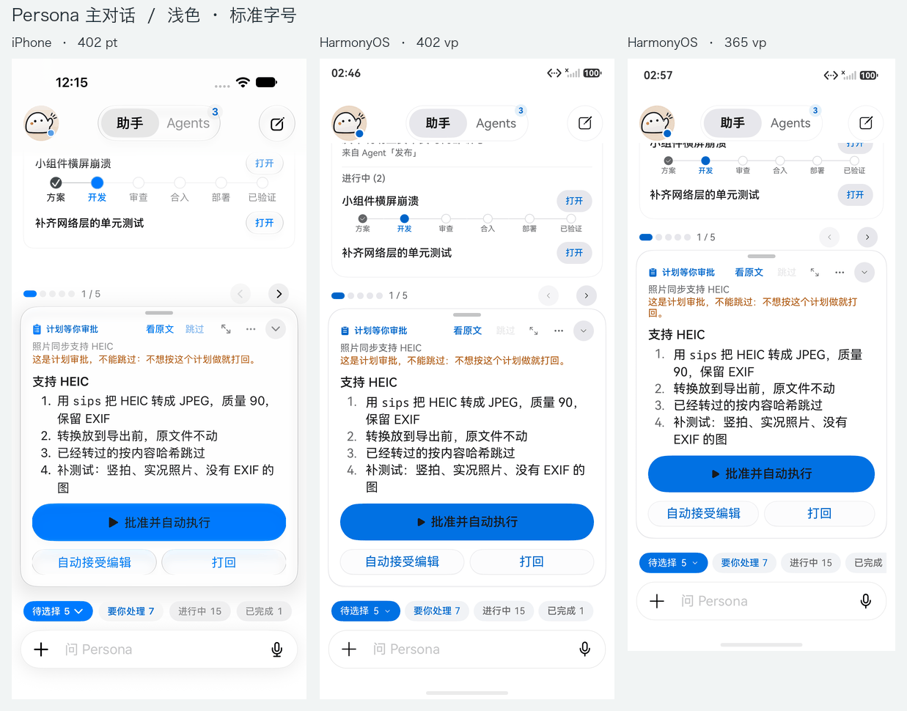
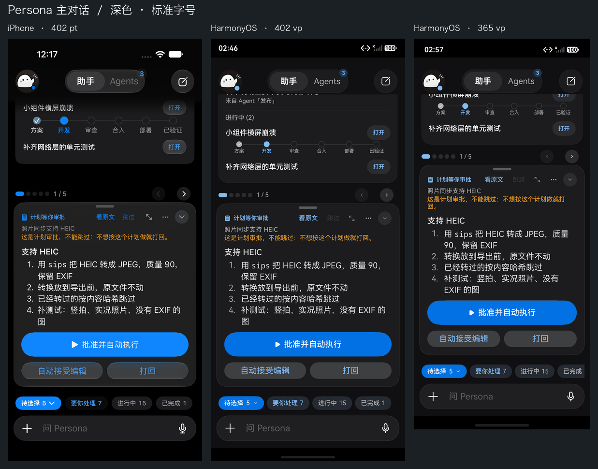
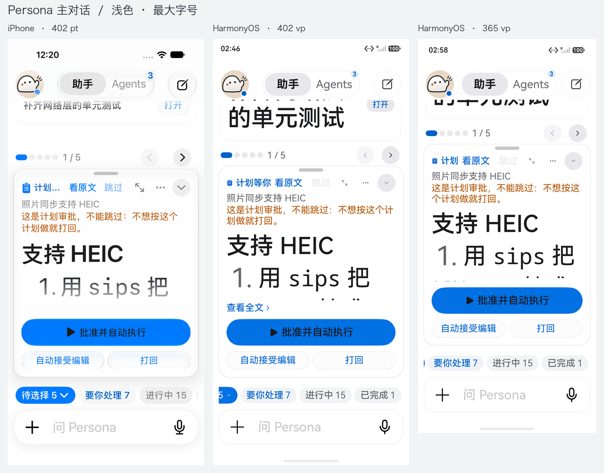

# Persona 主对话 · Main assistant conversation

[返回全部页面 · All pages](../README.md)

查看主助手的消息、任务卡和输入区。
Compare the assistant briefing, its progress links, the pending Agent plan and the composer.

Three independent native captures, left to right: iPhone 402 pt, HarmonyOS 402 vp, HarmonyOS 365 vp. The complete screen, including system bars, is visible.

[Download all original screenshots and accessibility trees for this page](../originals/persona.zip?raw=1) · [Source and capture method](../SOURCES.md)

Original archive SHA-256: 48531ebb782ede482f6d969d4527085175afb7fd5221767d37142042b497910a

## 浅色 · 标准字号

| Device | Pixels | Captured at | PNG digest | Hierarchy digest |
| --- | --- | --- | --- | --- |
| iPhone 402 pt | 1206 × 2622 | 2026-11-23T04:15:28.731+00:00 | 31aca5948db426cb | 2ecf5e9c2d2c8272 |
| HarmonyOS 402 vp | 1206 × 2622 | 2026-11-23T14:46:29+08:00 | 99f94e2d062c1332 | 66d61d63b4807986 |
| HarmonyOS 365 vp | 1280 × 2832 | 2026-11-23T14:57:45+08:00 | ecf0d2d3aa5b523c | 4955b9526c7ba211 |

## 深色 · 标准字号

| Device | Pixels | Captured at | PNG digest | Hierarchy digest |
| --- | --- | --- | --- | --- |
| iPhone 402 pt | 1206 × 2622 | 2026-11-23T04:17:49.186+00:00 | f2b0e9b67bbffd05 | 615792d294cd700a |
| HarmonyOS 402 vp | 1206 × 2622 | 2026-11-23T14:46:33+08:00 | 21719c62880cfabc | 8a0905e6c2be608e |
| HarmonyOS 365 vp | 1280 × 2832 | 2026-11-23T14:57:49+08:00 | 95e6a43f78600f2d | fa1e617cfcc1306a |

## 浅色 · 最大字号

| Device | Pixels | Captured at | PNG digest | Hierarchy digest |
| --- | --- | --- | --- | --- |
| iPhone 402 pt | 1206 × 2622 | 2026-11-23T04:20:26.036+00:00 | dc8872d7be255734 | c360c3ab8e91c588 |
| HarmonyOS 402 vp | 1206 × 2622 | 2026-11-23T14:46:58+08:00 | 3acd0db3d6dcb6ee | 249c0c224b49145d |
| HarmonyOS 365 vp | 1280 × 2832 | 2026-11-23T14:58:15+08:00 | 0fb79a17e7c8cfd0 | e6836b364c3b8516 |

Full 64-character digests and ZIP entry paths are under this page in the [manifest](../manifest.json).

[← 会话小结详情](recap-detail.md)
[展开会话输入框 →](composer.md)
