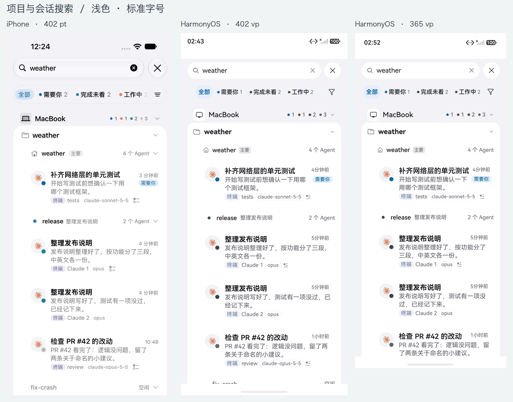
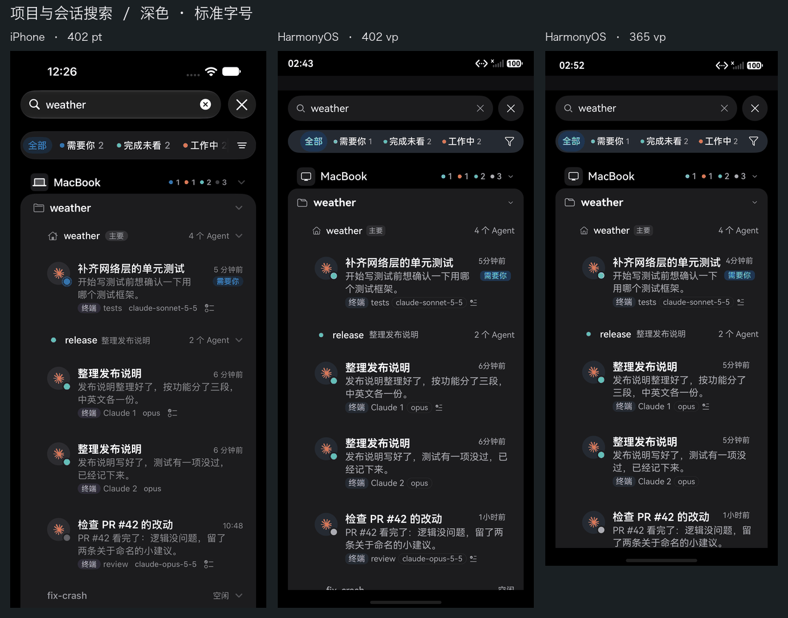
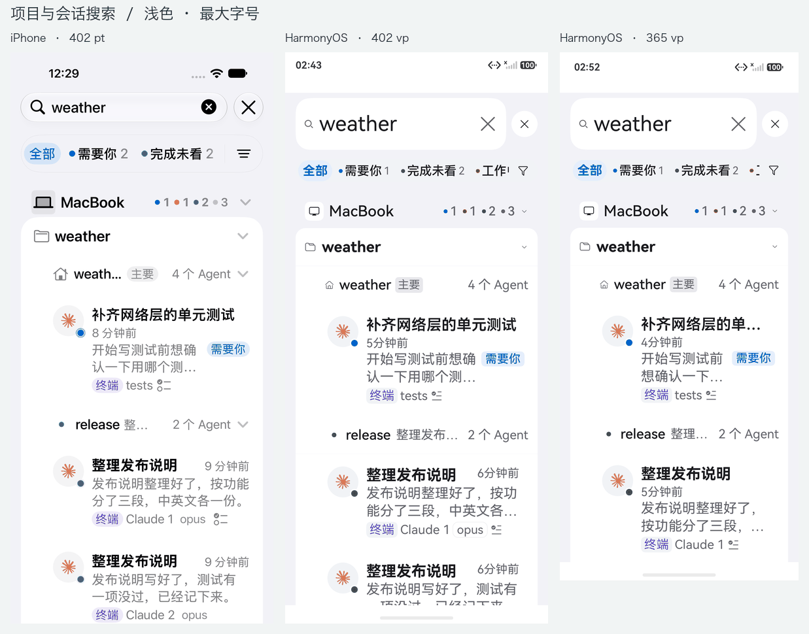

# 项目与会话搜索 · Search projects and sessions

[返回全部页面 · All pages](../README.md)

按仓库或会话关键词筛选项目，再读取匹配项。
Search for weather in the repository outline and compare its activity filters and matching rows.

Three independent native captures, left to right: iPhone 402 pt, HarmonyOS 402 vp, HarmonyOS 365 vp. The complete screen, including system bars, is visible.

[Download all original screenshots and accessibility trees for this page](../originals/project-search.zip?raw=1) · [Source and capture method](../SOURCES.md)

Original archive SHA-256: a7ba511e52aadadad6924d205a6a8b2fb20d730c74a19ec949a0a0d349f4ae36

## 浅色 · 标准字号

| Device | Pixels | Captured at | PNG digest | Hierarchy digest |
| --- | --- | --- | --- | --- |
| iPhone 402 pt | 1206 × 2622 | 2026-11-23T04:24:17.965+00:00 | 548246fd8afa0ef8 | 49bc9aca80a7eb61 |
| HarmonyOS 402 vp | 1206 × 2622 | 2026-11-23T14:43:32+08:00 | 1ea22af71e8b7c5a | f12d485cba9ad925 |
| HarmonyOS 365 vp | 1280 × 2832 | 2026-11-23T14:52:14+08:00 | 0cf4b85d685d2141 | aff4642edbec5564 |

## 深色 · 标准字号

| Device | Pixels | Captured at | PNG digest | Hierarchy digest |
| --- | --- | --- | --- | --- |
| iPhone 402 pt | 1206 × 2622 | 2026-11-23T04:26:49.250+00:00 | a9175cbea18509b0 | 540925f8d8e3a58b |
| HarmonyOS 402 vp | 1206 × 2622 | 2026-11-23T14:43:36+08:00 | b4de519726bd1768 | d71fab6ecbe7abdb |
| HarmonyOS 365 vp | 1280 × 2832 | 2026-11-23T14:52:18+08:00 | a09c0f0289fdd1f8 | a6a3f680c953e173 |

## 浅色 · 最大字号

| Device | Pixels | Captured at | PNG digest | Hierarchy digest |
| --- | --- | --- | --- | --- |
| iPhone 402 pt | 1206 × 2622 | 2026-11-23T04:29:19.205+00:00 | a9db613c39ea356a | 67e1abe20cb185a9 |
| HarmonyOS 402 vp | 1206 × 2622 | 2026-11-23T14:43:40+08:00 | d04fe242df0e61b8 | 9ea1458897c66990 |
| HarmonyOS 365 vp | 1280 × 2832 | 2026-11-23T14:52:22+08:00 | be4af8c1c7d84f24 | aabfbe11e0116182 |

Full 64-character digests and ZIP entry paths are under this page in the [manifest](../manifest.json).

[← 折叠 release 标签](release-collapsed.md)
[仓库详情 →](project.md)
