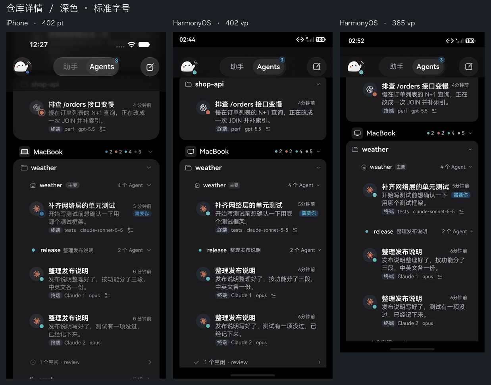

# 仓库详情 · Repository details

[返回全部页面 · All pages](../README.md)

查看 weather 仓库包含的工作树和会话。
Expand weather in place and inspect the worktrees and sessions inside this repository.

Three independent native captures, left to right: iPhone 402 pt, HarmonyOS 402 vp, HarmonyOS 365 vp. The complete screen, including system bars, is visible.

[Download all original screenshots and accessibility trees for this page](../originals/project.zip?raw=1) · [Source and capture method](../SOURCES.md)

Original archive SHA-256: 10914d6bac7b4e5acc9aa73337a166180df8c51d8e9442541a37790fa6fa2fde

## 浅色 · 标准字号

| Device | Pixels | Captured at | PNG digest | Hierarchy digest |
| --- | --- | --- | --- | --- |
| iPhone 402 pt | 1206 × 2622 | 2026-11-23T04:24:33.830+00:00 | 12ec58ebf9a15395 | f4728ef7cd50add4 |
| HarmonyOS 402 vp | 1206 × 2622 | 2026-11-23T14:44:00+08:00 | ca1cace3088282e8 | 0a73a14a19fa77dc |
| HarmonyOS 365 vp | 1280 × 2832 | 2026-11-23T14:52:43+08:00 | ff7512d03e56ea5f | 4c8ac8379c281177 |

## 深色 · 标准字号

| Device | Pixels | Captured at | PNG digest | Hierarchy digest |
| --- | --- | --- | --- | --- |
| iPhone 402 pt | 1206 × 2622 | 2026-11-23T04:27:04.560+00:00 | f664c4cf86120bcb | 82782f6b520f8fc5 |
| HarmonyOS 402 vp | 1206 × 2622 | 2026-11-23T14:44:05+08:00 | 898f35f5e18a696b | 5b0f86bce22ce8e3 |
| HarmonyOS 365 vp | 1280 × 2832 | 2026-11-23T14:52:49+08:00 | a860811d20202abc | 9f88bec0bfb400c8 |

## 浅色 · 最大字号

| Device | Pixels | Captured at | PNG digest | Hierarchy digest |
| --- | --- | --- | --- | --- |
| iPhone 402 pt | 1206 × 2622 | 2026-11-23T04:29:38.393+00:00 | 372f653bf252e9a9 | 55944b535da6a98c |
| HarmonyOS 402 vp | 1206 × 2622 | 2026-11-23T14:44:15+08:00 | acab2076cc1115d2 | 60bf8421064f198c |
| HarmonyOS 365 vp | 1280 × 2832 | 2026-11-23T14:52:58+08:00 | 2293a0d515b15564 | b7c2d1b0579fba19 |

Full 64-character digests and ZIP entry paths are under this page in the [manifest](../manifest.json).

[← 项目与会话搜索](project-search.md)
[工作树详情 →](worktree.md)
