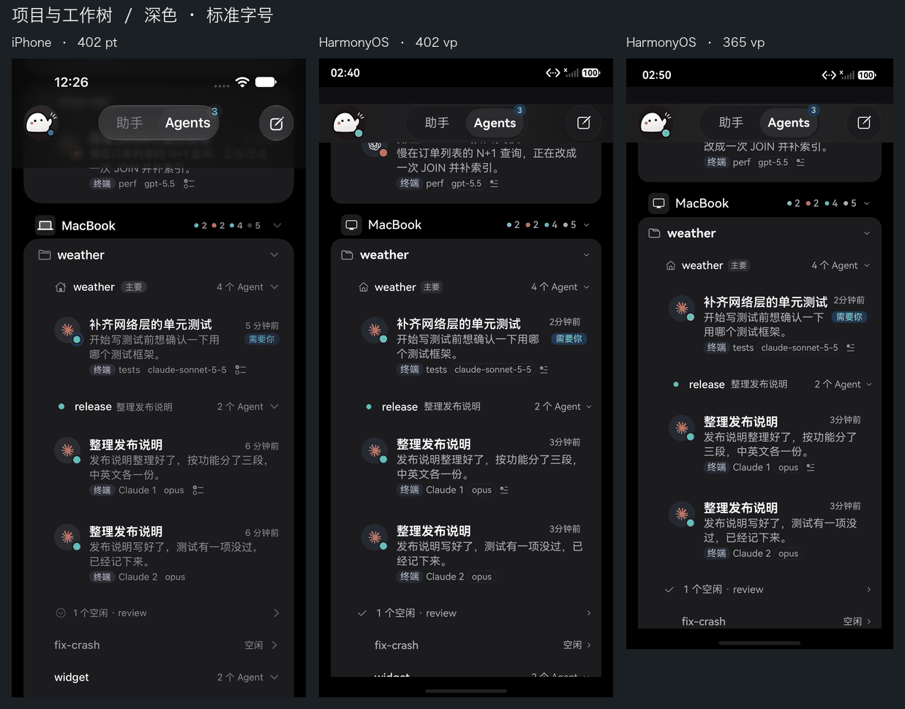

# 项目与工作树 · Project tree

[返回全部页面 · All pages](../README.md)

查看 weather 仓库、工作树和各自的 Agent。
Open the repository grouping in Agents and expand the same machine.

Three independent native captures, left to right: iPhone 402 pt, HarmonyOS 402 vp, HarmonyOS 365 vp. The complete screen, including system bars, is visible.

[Download all original screenshots and accessibility trees for this page](../originals/projects.zip?raw=1) · [Source and capture method](../SOURCES.md)

Original archive SHA-256: b5ffefbfde6d1c9b80b3996f86b13cf837f4c2843b38c2c192b48a59d1d519b1

## 浅色 · 标准字号

| Device | Pixels | Captured at | PNG digest | Hierarchy digest |
| --- | --- | --- | --- | --- |
| iPhone 402 pt | 1206 × 2622 | 2026-11-23T04:24:00.868+00:00 | b91dd22515beb866 | 35eff61ecea8a60c |
| HarmonyOS 402 vp | 1206 × 2622 | 2026-11-23T14:40:44+08:00 | 8bba410f511f5ef4 | 4bcd857320701f3e |
| HarmonyOS 365 vp | 1280 × 2832 | 2026-11-23T14:50:15+08:00 | 801bb3a19e2e5160 | a178cf74bcaca89d |

## 深色 · 标准字号

| Device | Pixels | Captured at | PNG digest | Hierarchy digest |
| --- | --- | --- | --- | --- |
| iPhone 402 pt | 1206 × 2622 | 2026-11-23T04:26:31.393+00:00 | 673f134222c48eb8 | 4e70df7924a5150a |
| HarmonyOS 402 vp | 1206 × 2622 | 2026-11-23T14:40:49+08:00 | f5507bd918c12ec3 | 9328650bbc22a7ae |
| HarmonyOS 365 vp | 1280 × 2832 | 2026-11-23T14:50:21+08:00 | c2810e0e4772489a | 869d3c28ffa26a67 |

## 浅色 · 最大字号

| Device | Pixels | Captured at | PNG digest | Hierarchy digest |
| --- | --- | --- | --- | --- |
| iPhone 402 pt | 1206 × 2622 | 2026-11-23T04:29:03.041+00:00 | 93f1444372e37e3c | dfdbf584bc7cc37f |
| HarmonyOS 402 vp | 1206 × 2622 | 2026-11-23T14:41:00+08:00 | c4c9c0f71e5ae32f | 1eba44f97f74385f |
| HarmonyOS 365 vp | 1280 × 2832 | 2026-11-23T14:50:30+08:00 | 476037e515d3f4a9 | a158c388d560f848 |

Full 64-character digests and ZIP entry paths are under this page in the [manifest](../manifest.json).

[折叠 release 标签 →](release-collapsed.md)
