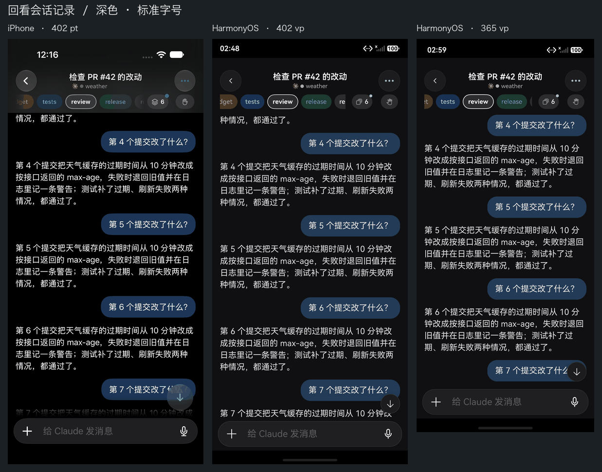

# 回看会话记录 · Read earlier messages

[返回全部页面 · All pages](../README.md)

回到较早的消息，再通过向下箭头跳至最新内容。

Three independent native captures, left to right: iPhone 402 pt, HarmonyOS 402 vp, HarmonyOS 365 vp. The complete screen, including system bars, is visible.

[Download all original screenshots and accessibility trees for this page](../originals/reading-history.zip?raw=1) · [Source and capture method](../SOURCES.md)

Original archive SHA-256: 76d582bdb92025a66c58f37a8a02d5115b8c45341f22420893b927fb1ab79a9d

## 浅色 · 标准字号

| Device | Pixels | Captured at | PNG digest | Hierarchy digest |
| --- | --- | --- | --- | --- |
| iPhone 402 pt | 1206 × 2622 | 2026-11-23T04:14:03.061+00:00 | 16c2ee59b57698d9 | dce06e9a1f344920 |
| HarmonyOS 402 vp | 1206 × 2622 | 2026-11-23T14:48:43+08:00 | 38a5c1e14491c66c | 18ecc29f80582ecb |
| HarmonyOS 365 vp | 1280 × 2832 | 2026-11-23T14:59:52+08:00 | 9565869fc40cc5d6 | 30074f2e7a4b97c3 |

## 深色 · 标准字号

| Device | Pixels | Captured at | PNG digest | Hierarchy digest |
| --- | --- | --- | --- | --- |
| iPhone 402 pt | 1206 × 2622 | 2026-11-23T04:16:23.610+00:00 | ac14fa659b4a8654 | 9d9c0f5d370eb876 |
| HarmonyOS 402 vp | 1206 × 2622 | 2026-11-23T14:48:51+08:00 | c7d18494a2693cf1 | 76a5cbcf95a02cd6 |
| HarmonyOS 365 vp | 1280 × 2832 | 2026-11-23T14:59:59+08:00 | 602a1c2dc3e63831 | 6c69cd7d714bf4cc |

## 浅色 · 最大字号

| Device | Pixels | Captured at | PNG digest | Hierarchy digest |
| --- | --- | --- | --- | --- |
| iPhone 402 pt | 1206 × 2622 | 2026-11-23T04:19:00.451+00:00 | bce1a6c7e2c597f8 | 594b0bd8e1b0d50c |
| HarmonyOS 402 vp | 1206 × 2622 | 2026-11-23T14:50:53+08:00 | 4553a5b5f65e7c92 | fd5180ca0ae7d588 |
| HarmonyOS 365 vp | 1280 × 2832 | 2026-11-23T15:02:24+08:00 | a388880cc249bb5a | f138d4adb11377eb |

Full 64-character digests and ZIP entry paths are under this page in the [manifest](../manifest.json).

[← 展开会话输入框](composer.md)
[文件 →](files.md)
