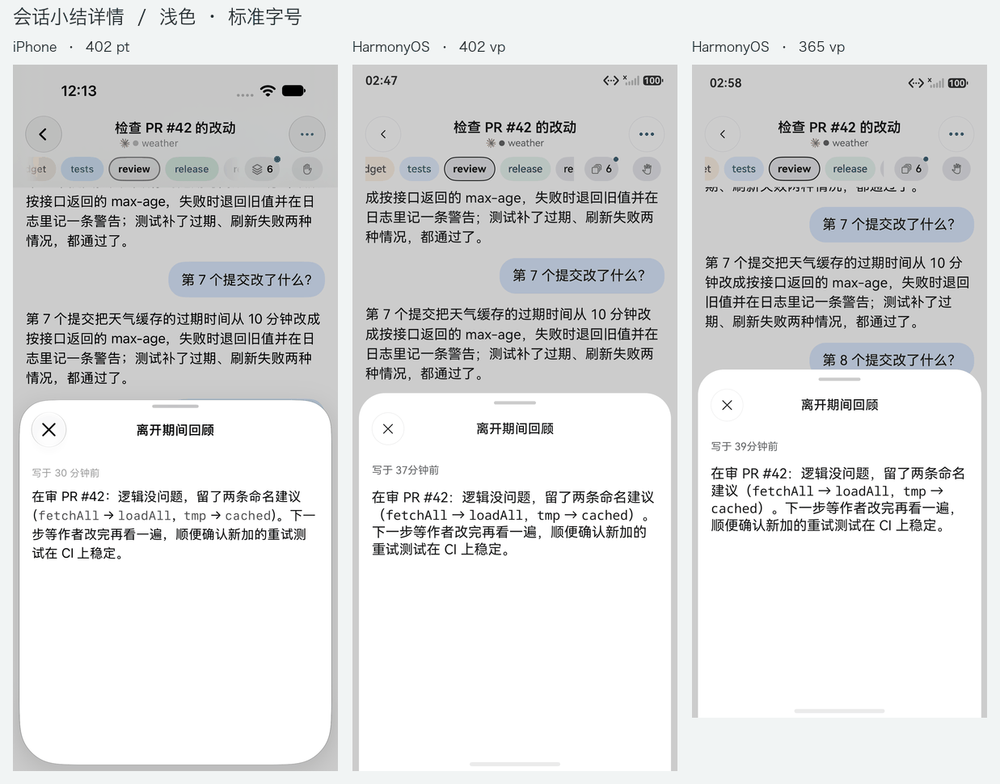
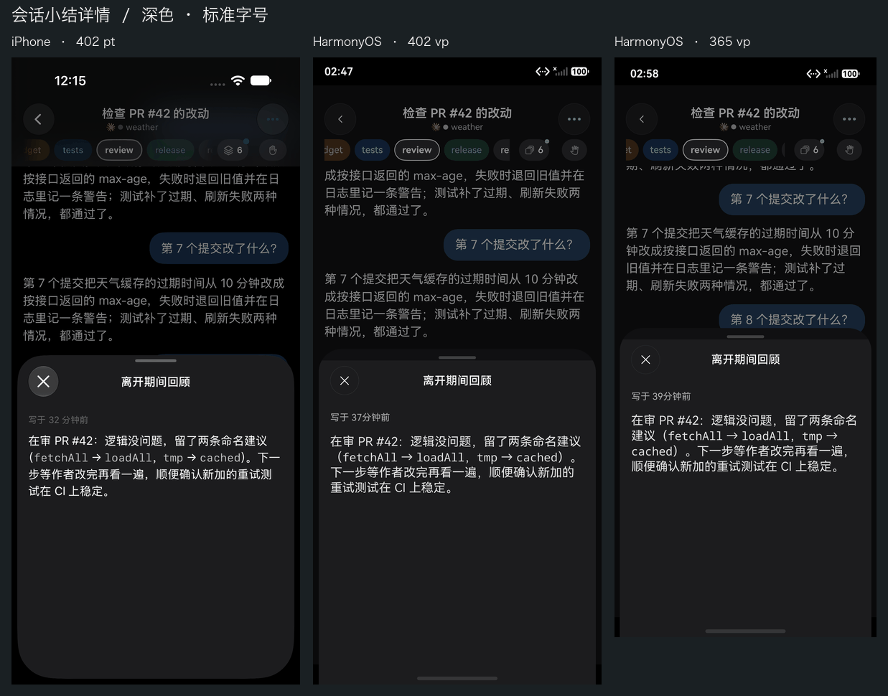
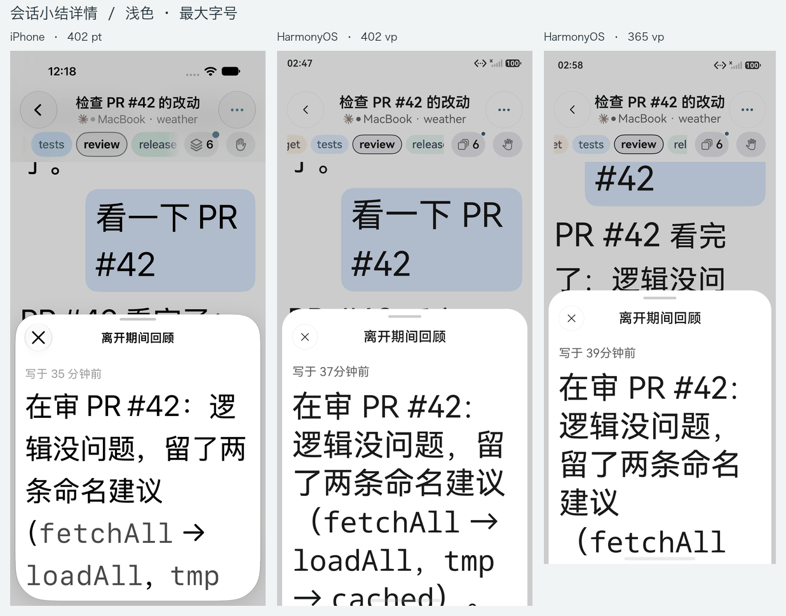

# 会话小结详情 · Conversation recap

[返回全部页面 · All pages](../README.md)

从「离开期间回顾」标记打开完整回顾。

Three independent native captures, left to right: iPhone 402 pt, HarmonyOS 402 vp, HarmonyOS 365 vp. The complete screen, including system bars, is visible.

[Download all original screenshots and accessibility trees for this page](../originals/recap-detail.zip?raw=1) · [Source and capture method](../SOURCES.md)

Original archive SHA-256: c3fba2281db37a8911d07fd768046c2d99c6ca920b76626f2ed60634ec34c2ea

## 浅色 · 标准字号

| Device | Pixels | Captured at | PNG digest | Hierarchy digest |
| --- | --- | --- | --- | --- |
| iPhone 402 pt | 1206 × 2622 | 2026-11-23T04:13:29.278+00:00 | 0818a8bf35a489b6 | 1dedb3e561c9487e |
| HarmonyOS 402 vp | 1206 × 2622 | 2026-11-23T14:47:28+08:00 | aaf1e7bf83b5e296 | fe5583e550025cfe |
| HarmonyOS 365 vp | 1280 × 2832 | 2026-11-23T14:58:42+08:00 | 3d855728892b4b01 | 0dc3df71f2ec29a7 |

## 深色 · 标准字号

| Device | Pixels | Captured at | PNG digest | Hierarchy digest |
| --- | --- | --- | --- | --- |
| iPhone 402 pt | 1206 × 2622 | 2026-11-23T04:15:49.815+00:00 | e57250d20f5422a8 | ba73e4a33e06e7cc |
| HarmonyOS 402 vp | 1206 × 2622 | 2026-11-23T14:47:32+08:00 | e292704d4df14e13 | d9cdc1e16f1958ba |
| HarmonyOS 365 vp | 1280 × 2832 | 2026-11-23T14:58:45+08:00 | 6a3d22becf8f0bc7 | 65df735cb1d75f71 |

## 浅色 · 最大字号

| Device | Pixels | Captured at | PNG digest | Hierarchy digest |
| --- | --- | --- | --- | --- |
| iPhone 402 pt | 1206 × 2622 | 2026-11-23T04:18:09.720+00:00 | 4581a0b4e243b55c | 44613a75935242fd |
| HarmonyOS 402 vp | 1206 × 2622 | 2026-11-23T14:47:37+08:00 | 7be0707215af82bb | a3bd27758c4002e3 |
| HarmonyOS 365 vp | 1280 × 2832 | 2026-11-23T14:58:49+08:00 | 18cfc069666fff33 | ed552763a46703e4 |

Full 64-character digests and ZIP entry paths are under this page in the [manifest](../manifest.json).

[← Agent 会话](agent-chat.md)
[Persona 主对话 →](persona.md)
