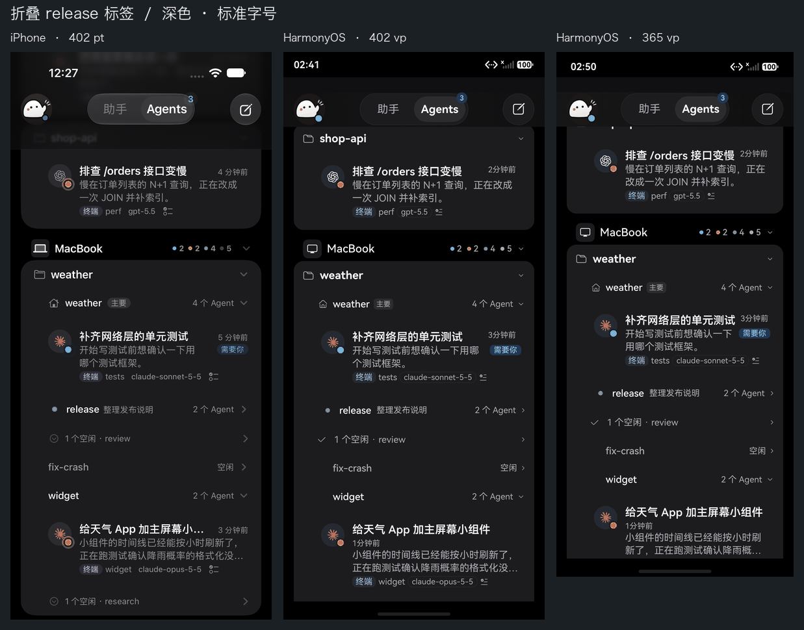

# 折叠 release 标签 · Collapse a terminal tab

[返回全部页面 · All pages](../README.md)

折叠 weather 下的 release 标签，查看分组和折叠状态。
Collapse the release terminal group in the weather project tree.

Three independent native captures, left to right: iPhone 402 pt, HarmonyOS 402 vp, HarmonyOS 365 vp. The complete screen, including system bars, is visible.

[Download all original screenshots and accessibility trees for this page](../originals/release-collapsed.zip?raw=1) · [Source and capture method](../SOURCES.md)

Original archive SHA-256: 0155a3873ae504d789a1d2ef0eba5d9c15132de4dd4600f7c5c2d99ec1ff0cf4

## 浅色 · 标准字号

| Device | Pixels | Captured at | PNG digest | Hierarchy digest |
| --- | --- | --- | --- | --- |
| iPhone 402 pt | 1206 × 2622 | 2026-11-23T04:24:38.267+00:00 | e5a61720e6da34db | db469b7c1bb2dcfa |
| HarmonyOS 402 vp | 1206 × 2622 | 2026-11-23T14:41:39+08:00 | c14821d45861245c | 850f6bfba9b882ba |
| HarmonyOS 365 vp | 1280 × 2832 | 2026-11-23T14:50:44+08:00 | 92be3735ea147f9d | f00704626e447b53 |

## 深色 · 标准字号

| Device | Pixels | Captured at | PNG digest | Hierarchy digest |
| --- | --- | --- | --- | --- |
| iPhone 402 pt | 1206 × 2622 | 2026-11-23T04:27:08.775+00:00 | 5b5bf8534c69ba04 | 55a3da3d8d0b8c18 |
| HarmonyOS 402 vp | 1206 × 2622 | 2026-11-23T14:41:44+08:00 | e0ad0a62f2074ec5 | 414463925c7ec015 |
| HarmonyOS 365 vp | 1280 × 2832 | 2026-11-23T14:50:50+08:00 | c7daf09711a1025e | a79071fc268c7d04 |

## 浅色 · 最大字号

| Device | Pixels | Captured at | PNG digest | Hierarchy digest |
| --- | --- | --- | --- | --- |
| iPhone 402 pt | 1206 × 2622 | 2026-11-23T04:29:42.336+00:00 | 32cabbbcccaa373b | 83231e69e0b77d64 |
| HarmonyOS 402 vp | 1206 × 2622 | 2026-11-23T14:41:52+08:00 | 8d4591461c3dd08b | 8fc878bfecaa1b44 |
| HarmonyOS 365 vp | 1280 × 2832 | 2026-11-23T14:51:00+08:00 | 927ee92eee936fd6 | 4bb9a0aa42640534 |

Full 64-character digests and ZIP entry paths are under this page in the [manifest](../manifest.json).

[← 项目与工作树](projects.md)
[项目与会话搜索 →](project-search.md)
