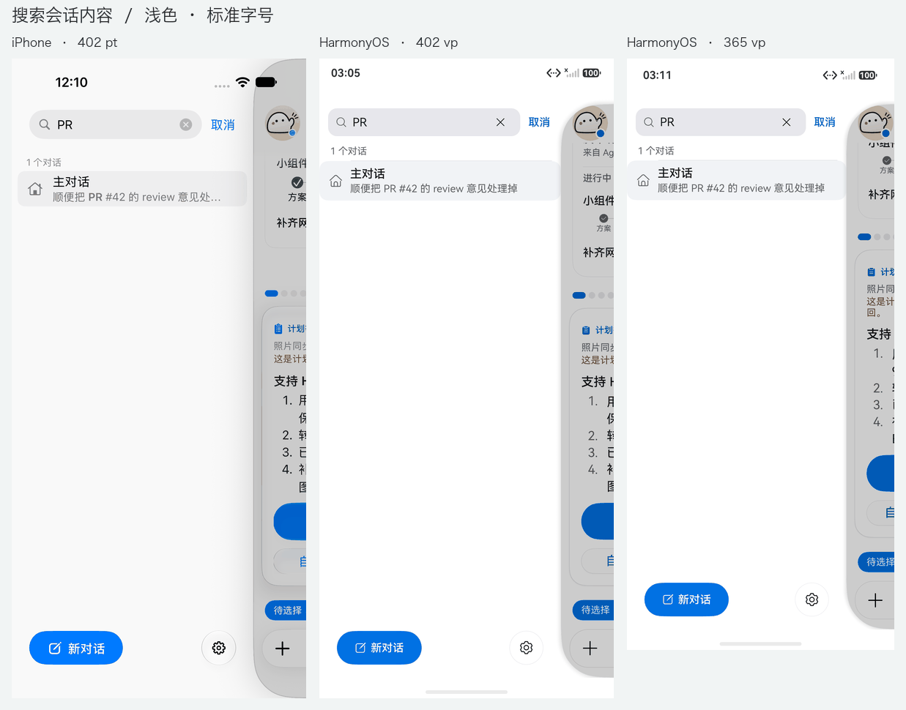
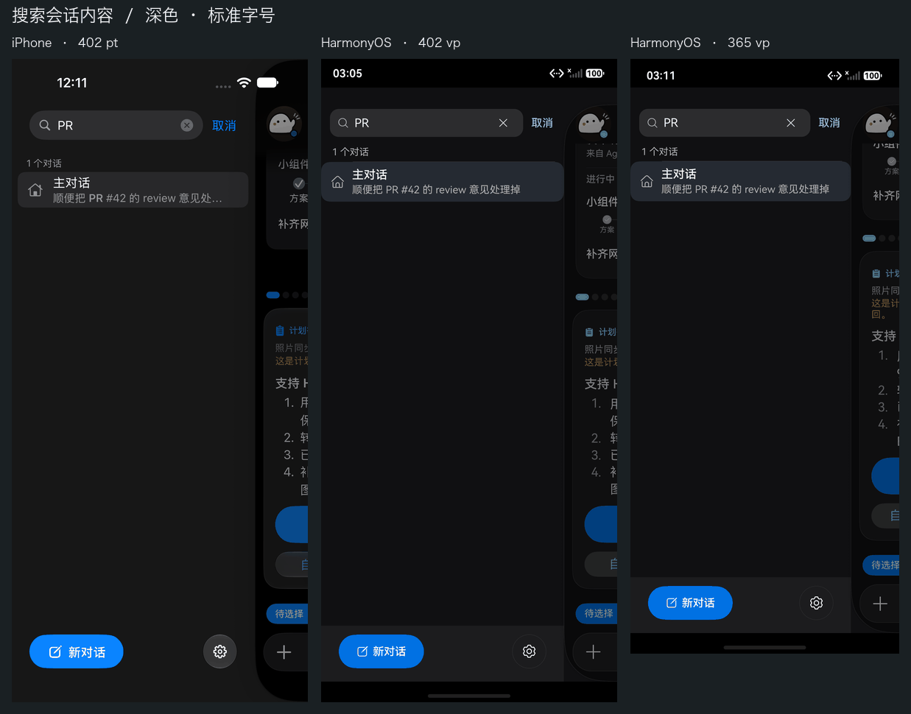
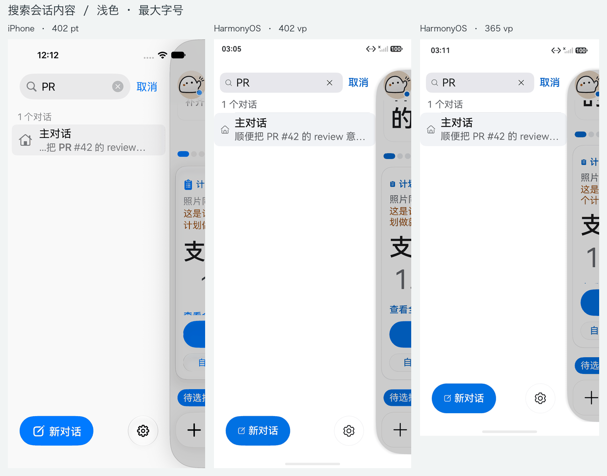

# 搜索会话内容 · Search conversations

[返回全部页面 · All pages](../README.md)

用 PR 搜索会话内容并查看匹配结果。

Three independent native captures, left to right: iPhone 402 pt, HarmonyOS 402 vp, HarmonyOS 365 vp. The complete screen, including system bars, is visible.

[Download all original screenshots and accessibility trees for this page](../originals/search.zip?raw=1) · [Source and capture method](../SOURCES.md)

Original archive SHA-256: 2607e3485738e9502ecad28bbdd74cf855957de074d0776f2eda08a5c9cb6a96

## 浅色 · 标准字号

| Device | Pixels | Captured at | PNG digest | Hierarchy digest |
| --- | --- | --- | --- | --- |
| iPhone 402 pt | 1206 × 2622 | 2026-11-23T04:10:35.326+00:00 | bf84af4def600bf5 | 967b70dc96d5ab91 |
| HarmonyOS 402 vp | 1206 × 2622 | 2026-11-23T15:05:40+08:00 | df97dea39b93bc92 | ee076ad821bab7a9 |
| HarmonyOS 365 vp | 1280 × 2832 | 2026-11-23T15:11:46+08:00 | facf96c1685c13a5 | 8cd8c61c2cb61d6b |

## 深色 · 标准字号

| Device | Pixels | Captured at | PNG digest | Hierarchy digest |
| --- | --- | --- | --- | --- |
| iPhone 402 pt | 1206 × 2622 | 2026-11-23T04:11:23.705+00:00 | bcaaa26e78173f08 | b3367303d544dfad |
| HarmonyOS 402 vp | 1206 × 2622 | 2026-11-23T15:05:44+08:00 | 9432b46edf768d65 | 5875deb2122307d1 |
| HarmonyOS 365 vp | 1280 × 2832 | 2026-11-23T15:11:50+08:00 | 0bfb2061d998a3a1 | a07901551ecd2ee6 |

## 浅色 · 最大字号

| Device | Pixels | Captured at | PNG digest | Hierarchy digest |
| --- | --- | --- | --- | --- |
| iPhone 402 pt | 1206 × 2622 | 2026-11-23T04:12:26.362+00:00 | 8d75db65eba4b1f5 | 29adf9cabcbb2219 |
| HarmonyOS 402 vp | 1206 × 2622 | 2026-11-23T15:05:48+08:00 | 891d77b29d70e467 | 8f9ae0c1db90504e |
| HarmonyOS 365 vp | 1280 × 2832 | 2026-11-23T15:11:54+08:00 | 8902da53e585e732 | 11049e149afa9d92 |

Full 64-character digests and ZIP entry paths are under this page in the [manifest](../manifest.json).

[← Agent 偏好](agent-preferences.md)
[收件箱 →](inbox.md)
