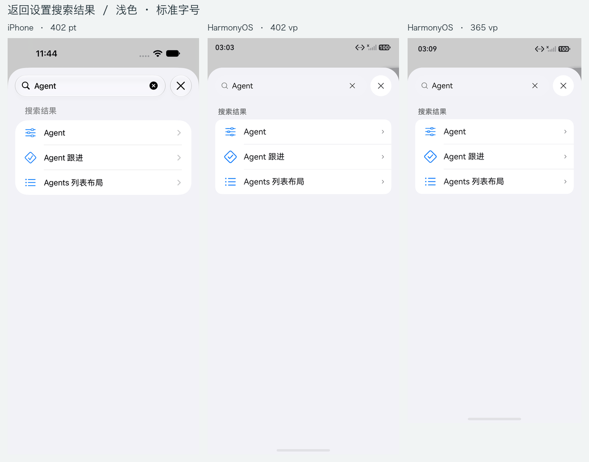
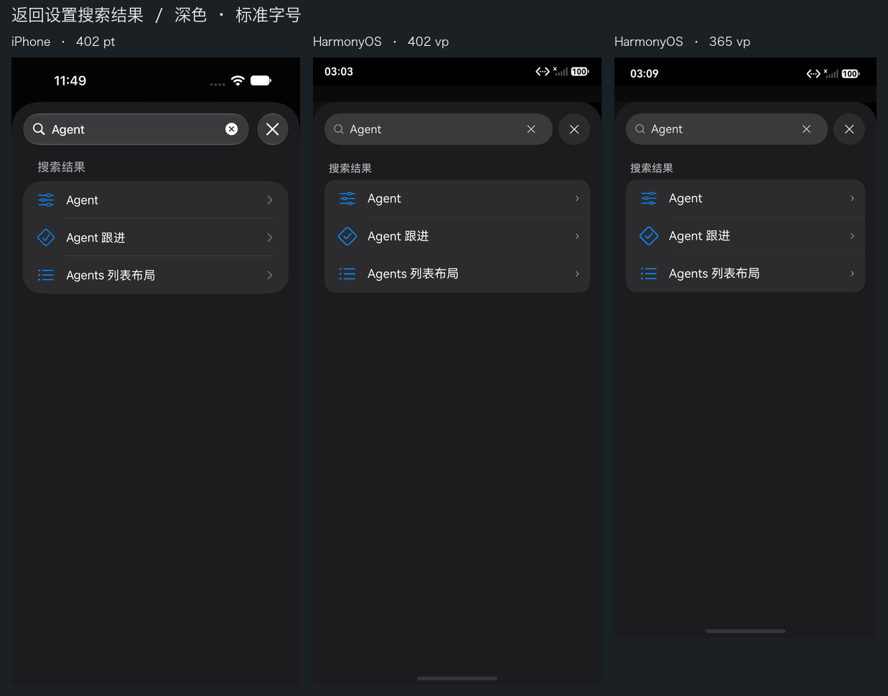
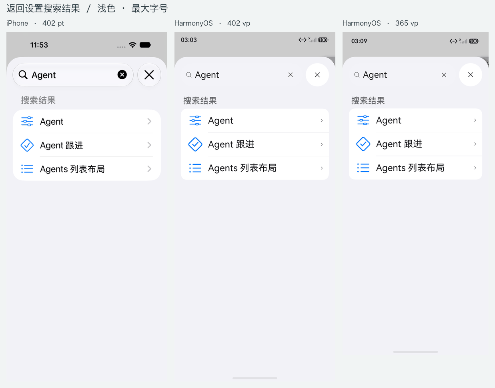

# 返回设置搜索结果 · Restore settings search

[返回全部页面 · All pages](../README.md)

搜索 Agent，打开偏好项，再返回已保留的搜索结果。

Three independent native captures, left to right: iPhone 402 pt, HarmonyOS 402 vp, HarmonyOS 365 vp. The complete screen, including system bars, is visible.

[Download all original screenshots and accessibility trees for this page](../originals/settings-search-restored.zip?raw=1) · [Source and capture method](../SOURCES.md)

Original archive SHA-256: 03ce50c884ef42226af599c7c47873de08b9dc09c21969e7e873b7848f3fea52

## 浅色 · 标准字号

| Device | Pixels | Captured at | PNG digest | Hierarchy digest |
| --- | --- | --- | --- | --- |
| iPhone 402 pt | 1206 × 2622 | 2026-11-23T03:44:53.728+00:00 | d853e80eb78937ca | 3be965d8934b6ddb |
| HarmonyOS 402 vp | 1206 × 2622 | 2026-11-23T15:03:50+08:00 | 7d78c91a0d364047 | b9af195371c459fc |
| HarmonyOS 365 vp | 1280 × 2832 | 2026-11-23T15:09:18+08:00 | 40768095fdd7921c | 9379f7f923dfe534 |

## 深色 · 标准字号

| Device | Pixels | Captured at | PNG digest | Hierarchy digest |
| --- | --- | --- | --- | --- |
| iPhone 402 pt | 1206 × 2622 | 2026-11-23T03:49:33.573+00:00 | e4cd8533d731e787 | b5480d5899d8f3fc |
| HarmonyOS 402 vp | 1206 × 2622 | 2026-11-23T15:03:53+08:00 | 4ca75e5a446e54ab | 7235d52922310303 |
| HarmonyOS 365 vp | 1280 × 2832 | 2026-11-23T15:09:22+08:00 | 437e3334136a4917 | 31c2d2b1b128bef5 |

## 浅色 · 最大字号

| Device | Pixels | Captured at | PNG digest | Hierarchy digest |
| --- | --- | --- | --- | --- |
| iPhone 402 pt | 1206 × 2622 | 2026-11-23T03:53:51.705+00:00 | c5dad4e6267b3bc7 | 3a905c33127ac86a |
| HarmonyOS 402 vp | 1206 × 2622 | 2026-11-23T15:03:58+08:00 | 98d38449eb7bfaf2 | 1c3c341ff179faf3 |
| HarmonyOS 365 vp | 1280 × 2832 | 2026-11-23T15:09:26+08:00 | b322c8afd73e5fd1 | 3aea21fbc7918bee |

Full 64-character digests and ZIP entry paths are under this page in the [manifest](../manifest.json).

[← 设置](settings.md)
[语言 →](language.md)
