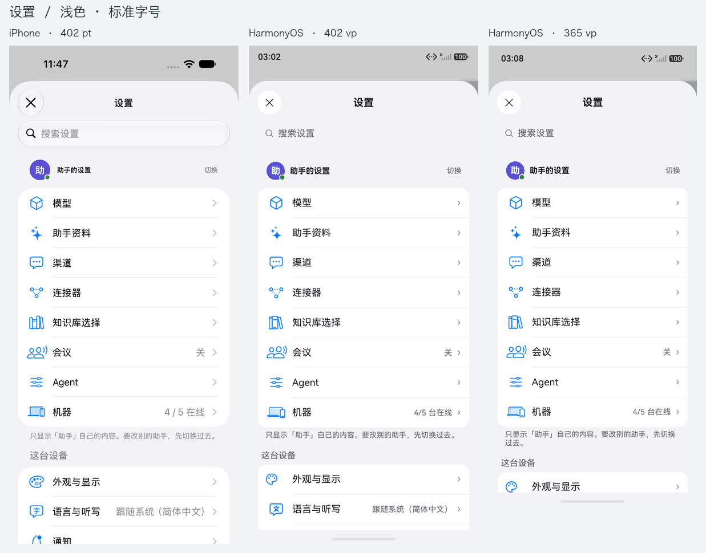
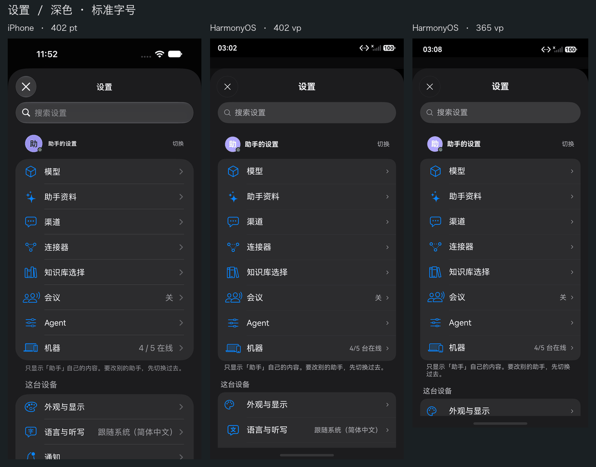
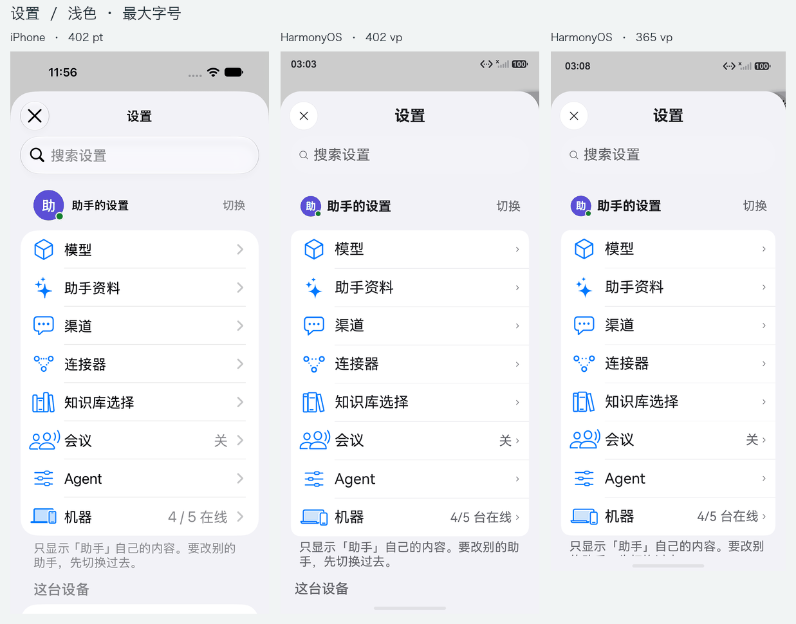

# 设置 · Settings

[返回全部页面 · All pages](../README.md)

查看设置分组和搜索入口。

Three independent native captures, left to right: iPhone 402 pt, HarmonyOS 402 vp, HarmonyOS 365 vp. The complete screen, including system bars, is visible.

[Download all original screenshots and accessibility trees for this page](../originals/settings.zip?raw=1) · [Source and capture method](../SOURCES.md)

Original archive SHA-256: b2cb526c661b3e488adf0e063305c8041f07fb458952e79525ea42212f3c6b28

## 浅色 · 标准字号

| Device | Pixels | Captured at | PNG digest | Hierarchy digest |
| --- | --- | --- | --- | --- |
| iPhone 402 pt | 1206 × 2622 | 2026-11-23T03:47:57.604+00:00 | a79919c776499bc2 | 32d281f5e21742c1 |
| HarmonyOS 402 vp | 1206 × 2622 | 2026-11-23T15:02:54+08:00 | dfa7f179e2b4a3a6 | 14a2eaca5e189c8f |
| HarmonyOS 365 vp | 1280 × 2832 | 2026-11-23T15:08:23+08:00 | 06795d5c95148557 | e5ba96fbb885d55e |

## 深色 · 标准字号

| Device | Pixels | Captured at | PNG digest | Hierarchy digest |
| --- | --- | --- | --- | --- |
| iPhone 402 pt | 1206 × 2622 | 2026-11-23T03:52:22.371+00:00 | 340c8f68165e561f | 126794ad58d3660f |
| HarmonyOS 402 vp | 1206 × 2622 | 2026-11-23T15:02:57+08:00 | 17ced393a2f8d54c | f2097cf2b32e3911 |
| HarmonyOS 365 vp | 1280 × 2832 | 2026-11-23T15:08:26+08:00 | a64c7aa18954f433 | 69ea29e50b399c57 |

## 浅色 · 最大字号

| Device | Pixels | Captured at | PNG digest | Hierarchy digest |
| --- | --- | --- | --- | --- |
| iPhone 402 pt | 1206 × 2622 | 2026-11-23T03:56:20.853+00:00 | 44c74c48000f397c | c57f449f18925583 |
| HarmonyOS 402 vp | 1206 × 2622 | 2026-11-23T15:03:01+08:00 | 907126da0e4e06aa | 2008c84ebbf7ab18 |
| HarmonyOS 365 vp | 1280 × 2832 | 2026-11-23T15:08:31+08:00 | 371b29ee8edaf43b | cbf597363a5a3c8d |

Full 64-character digests and ZIP entry paths are under this page in the [manifest](../manifest.json).

[← 切换助手](assistant-menu.md)
[返回设置搜索结果 →](settings-search-restored.md)
