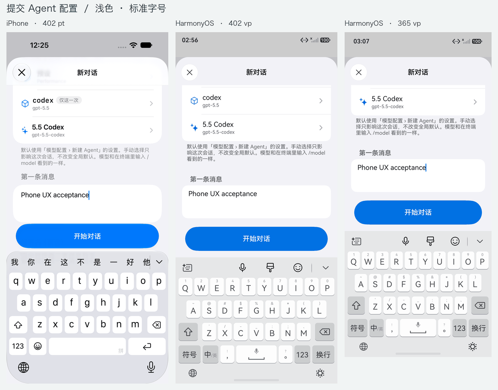
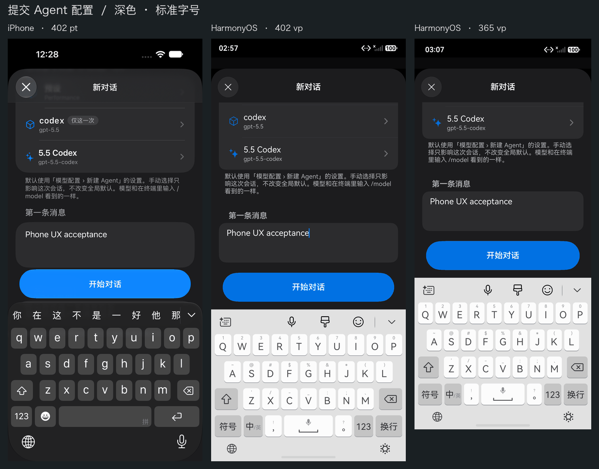
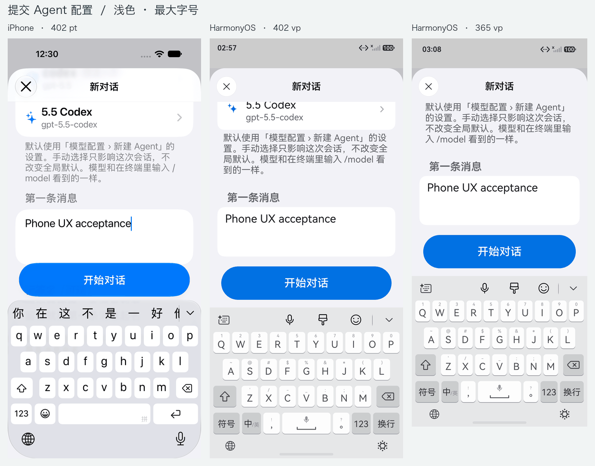

# 提交 Agent 配置 · Agent ready to start

[返回全部页面 · All pages](../README.md)

核对工作目录、启动器、模型和首条提示。
Enter the first message and inspect the start action above the keyboard.

Three independent native captures, left to right: iPhone 402 pt, HarmonyOS 402 vp, HarmonyOS 365 vp. The complete screen, including system bars, is visible.

[Download all original screenshots and accessibility trees for this page](../originals/start-ready.zip?raw=1) · [Source and capture method](../SOURCES.md)

Original archive SHA-256: 2285d2cb71c396a5b12b147b74da9a78ca37f2dd6659e722df42a93e4ad1253b

## 浅色 · 标准字号

| Device | Pixels | Captured at | PNG digest | Hierarchy digest |
| --- | --- | --- | --- | --- |
| iPhone 402 pt | 1206 × 2622 | 2026-11-23T04:25:43.929+00:00 | 9be87f920140e8b2 | 3ee0478c9f3f2108 |
| HarmonyOS 402 vp | 1206 × 2622 | 2026-11-23T14:56:43+08:00 | 9bfe4823794e0389 | 05e57ebc5057c041 |
| HarmonyOS 365 vp | 1280 × 2832 | 2026-11-23T15:07:38+08:00 | 1c6f0ac7a5ecf2f1 | 769882ba04b7c818 |

## 深色 · 标准字号

| Device | Pixels | Captured at | PNG digest | Hierarchy digest |
| --- | --- | --- | --- | --- |
| iPhone 402 pt | 1206 × 2622 | 2026-11-23T04:28:13.527+00:00 | b228105aed296f26 | 358daa9ee1893251 |
| HarmonyOS 402 vp | 1206 × 2622 | 2026-11-23T14:57:04+08:00 | e11eda591c5a7d14 | 57ad27b12f936550 |
| HarmonyOS 365 vp | 1280 × 2832 | 2026-11-23T15:07:52+08:00 | 39e0fc50b702c608 | 54b289d66c4baeff |

## 浅色 · 最大字号

| Device | Pixels | Captured at | PNG digest | Hierarchy digest |
| --- | --- | --- | --- | --- |
| iPhone 402 pt | 1206 × 2622 | 2026-11-23T04:30:49.063+00:00 | 164f8412556f2ed6 | 78bd7075e1ac9fbc |
| HarmonyOS 402 vp | 1206 × 2622 | 2026-11-23T14:57:21+08:00 | 341306c46f6ca5cd | 6829b107a3784dd0 |
| HarmonyOS 365 vp | 1280 × 2832 | 2026-11-23T15:08:06+08:00 | aeedbd89247b486f | cf8bee71975dcdde |

Full 64-character digests and ZIP entry paths are under this page in the [manifest](../manifest.json).

[← 选择模型](models.md)
[Agents 列表 →](agents.md)
