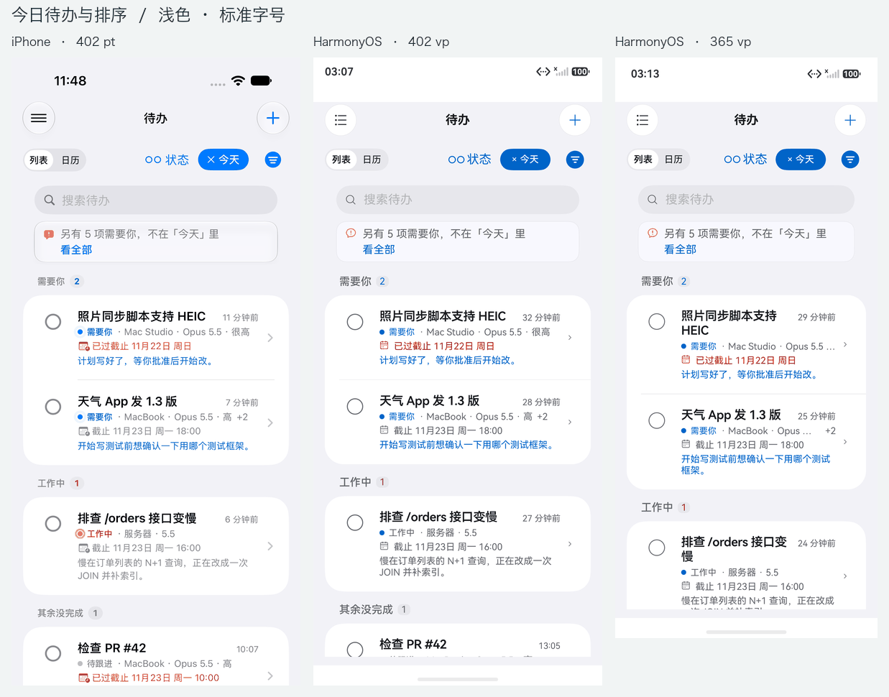
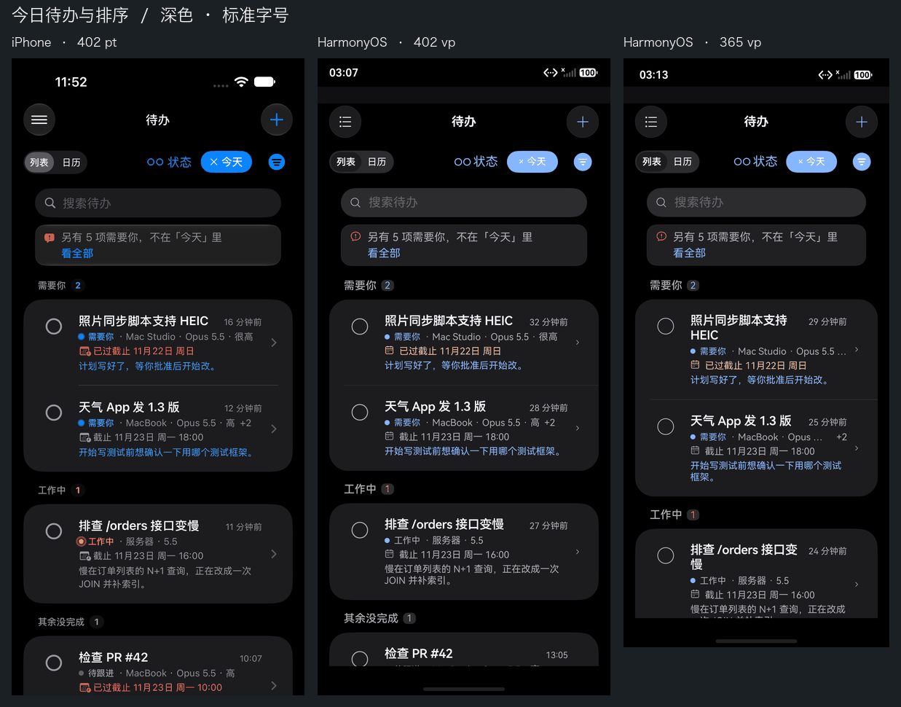
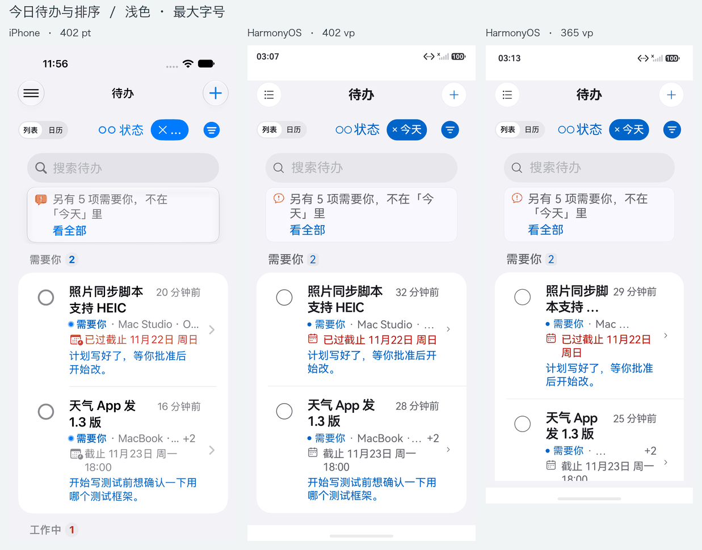

# 今日待办与排序 · Due today and priority

[返回全部页面 · All pages](../README.md)

筛选今天的待办，并查看优先级排序。

Three independent native captures, left to right: iPhone 402 pt, HarmonyOS 402 vp, HarmonyOS 365 vp. The complete screen, including system bars, is visible.

[Download all original screenshots and accessibility trees for this page](../originals/todo-due.zip?raw=1) · [Source and capture method](../SOURCES.md)

Original archive SHA-256: 6b921525ce115089c162499916527a44a0a32ac0d7228245f7533d1c239f58d2

## 浅色 · 标准字号

| Device | Pixels | Captured at | PNG digest | Hierarchy digest |
| --- | --- | --- | --- | --- |
| iPhone 402 pt | 1206 × 2622 | 2026-11-23T03:48:30.700+00:00 | e69b918c362bf4a1 | 2504de11a87447dc |
| HarmonyOS 402 vp | 1206 × 2622 | 2026-11-23T15:07:32+08:00 | 479714b14a12591d | 06149f1f33b74077 |
| HarmonyOS 365 vp | 1280 × 2832 | 2026-11-23T15:13:49+08:00 | cabfe36547212475 | 8bfa969c6a2aa624 |

## 深色 · 标准字号

| Device | Pixels | Captured at | PNG digest | Hierarchy digest |
| --- | --- | --- | --- | --- |
| iPhone 402 pt | 1206 × 2622 | 2026-11-23T03:52:55.127+00:00 | 20cdc518accff096 | 0c403aa7036c0d00 |
| HarmonyOS 402 vp | 1206 × 2622 | 2026-11-23T15:07:36+08:00 | 5890a3683a0e13d0 | d2ab486898e92216 |
| HarmonyOS 365 vp | 1280 × 2832 | 2026-11-23T15:13:53+08:00 | baf874ccc26a8cd7 | 42c0443c02a2765f |

## 浅色 · 最大字号

| Device | Pixels | Captured at | PNG digest | Hierarchy digest |
| --- | --- | --- | --- | --- |
| iPhone 402 pt | 1206 × 2622 | 2026-11-23T03:56:51.192+00:00 | f846715fc69ed3ba | 8e5365798700d2e1 |
| HarmonyOS 402 vp | 1206 × 2622 | 2026-11-23T15:07:40+08:00 | 5f9e29ab3a15fddb | 5cd52fd26d14a107 |
| HarmonyOS 365 vp | 1280 × 2832 | 2026-11-23T15:13:57+08:00 | 15161eb606a5e719 | 22884fe43b4b8aaa |

Full 64-character digests and ZIP entry paths are under this page in the [manifest](../manifest.json).

[← 待办](todo.md)
[知识库 →](knowledge.md)
