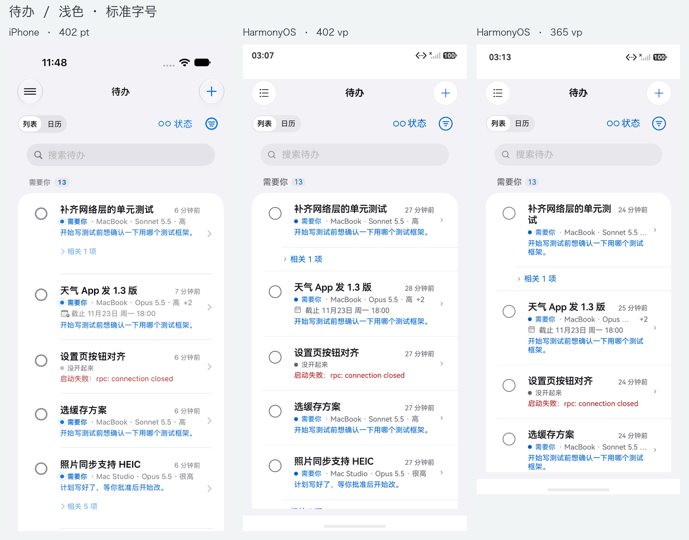
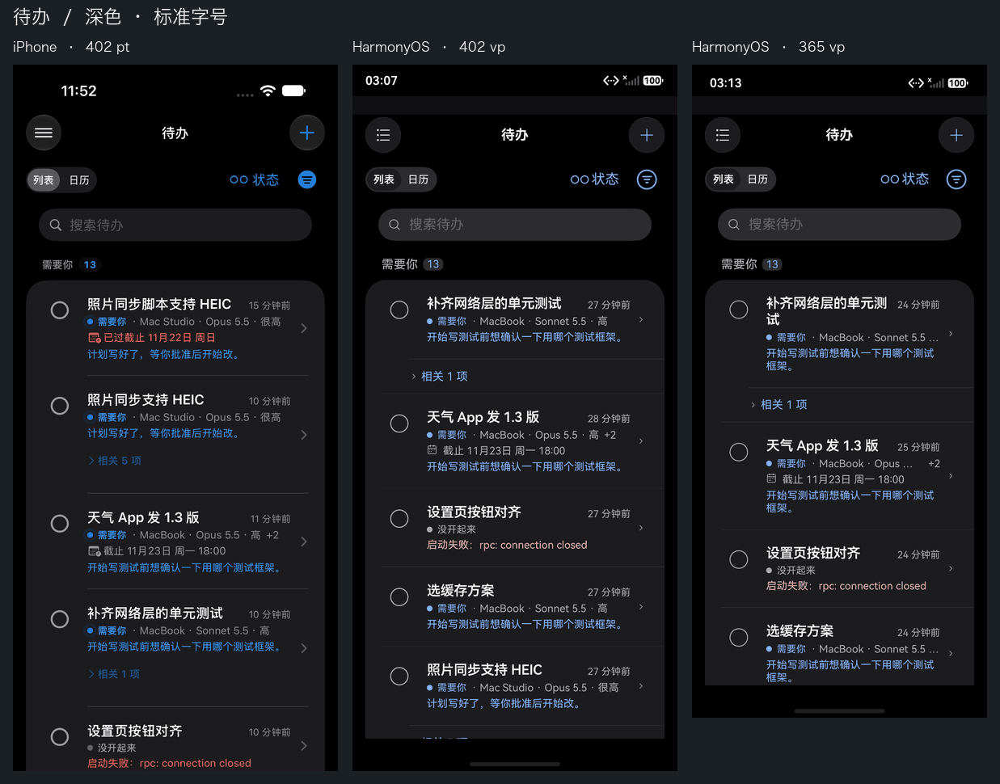
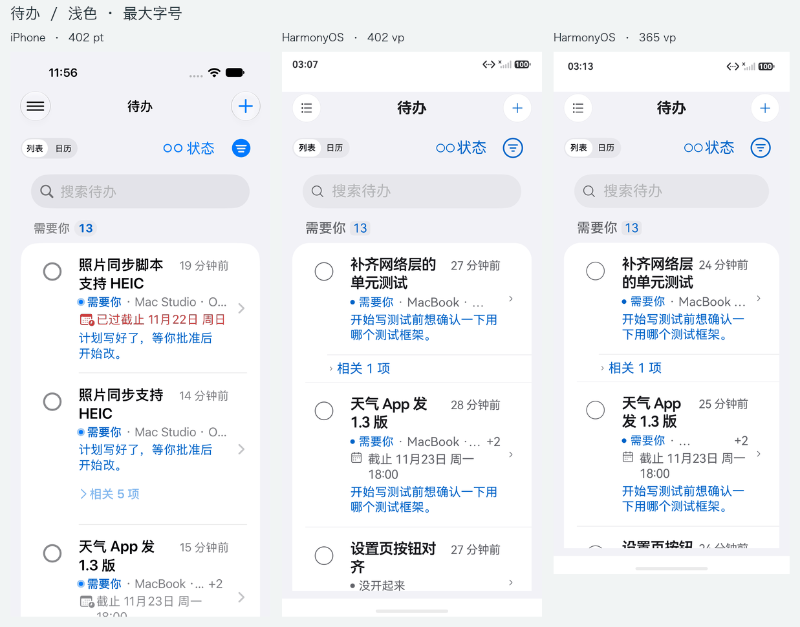

# 待办 · To-dos

[返回全部页面 · All pages](../README.md)

浏览待办清单及其状态。

Three independent native captures, left to right: iPhone 402 pt, HarmonyOS 402 vp, HarmonyOS 365 vp. The complete screen, including system bars, is visible.

[Download all original screenshots and accessibility trees for this page](../originals/todo.zip?raw=1) · [Source and capture method](../SOURCES.md)

Original archive SHA-256: 38923b8e37b3f76be8b5f93577830c18d56ea60a2671b3b1fb6cc967ac04262a

## 浅色 · 标准字号

| Device | Pixels | Captured at | PNG digest | Hierarchy digest |
| --- | --- | --- | --- | --- |
| iPhone 402 pt | 1206 × 2622 | 2026-11-23T03:48:09.679+00:00 | a91075fa4744fb6f | 1a1cb449dc8caed7 |
| HarmonyOS 402 vp | 1206 × 2622 | 2026-11-23T15:07:14+08:00 | 8f254ad2404014f5 | 0f05829749bde60d |
| HarmonyOS 365 vp | 1280 × 2832 | 2026-11-23T15:13:31+08:00 | e12e1bacd6a5ef48 | 09b68953c24ee09c |

## 深色 · 标准字号

| Device | Pixels | Captured at | PNG digest | Hierarchy digest |
| --- | --- | --- | --- | --- |
| iPhone 402 pt | 1206 × 2622 | 2026-11-23T03:52:34.656+00:00 | ff2e471ab74bfe0c | ddbf78a503eb3412 |
| HarmonyOS 402 vp | 1206 × 2622 | 2026-11-23T15:07:18+08:00 | f9bb6781cbf42ea3 | c8f2bff09a04af30 |
| HarmonyOS 365 vp | 1280 × 2832 | 2026-11-23T15:13:35+08:00 | a535cd255a408d50 | 02ac9dffe9104f30 |

## 浅色 · 最大字号

| Device | Pixels | Captured at | PNG digest | Hierarchy digest |
| --- | --- | --- | --- | --- |
| iPhone 402 pt | 1206 × 2622 | 2026-11-23T03:56:32.261+00:00 | 135f563a75d26d06 | cefab0542d1192e4 |
| HarmonyOS 402 vp | 1206 × 2622 | 2026-11-23T15:07:22+08:00 | df3fd82d00645229 | d1039e01fdceb3e2 |
| HarmonyOS 365 vp | 1280 × 2832 | 2026-11-23T15:13:39+08:00 | 1b0fc9675ed7ec2e | 94de3d35a4c92900 |

Full 64-character digests and ZIP entry paths are under this page in the [manifest](../manifest.json).

[← 收件箱](inbox.md)
[今日待办与排序 →](todo-due.md)
