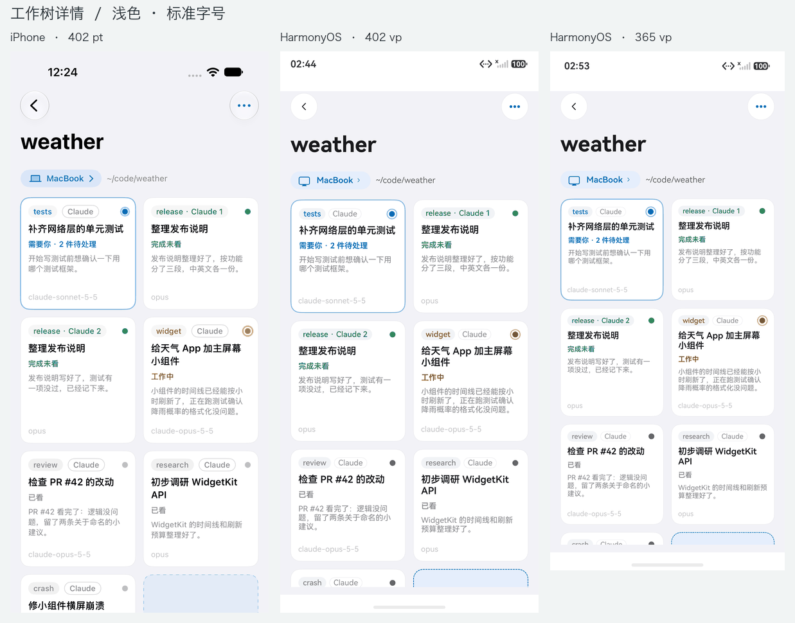
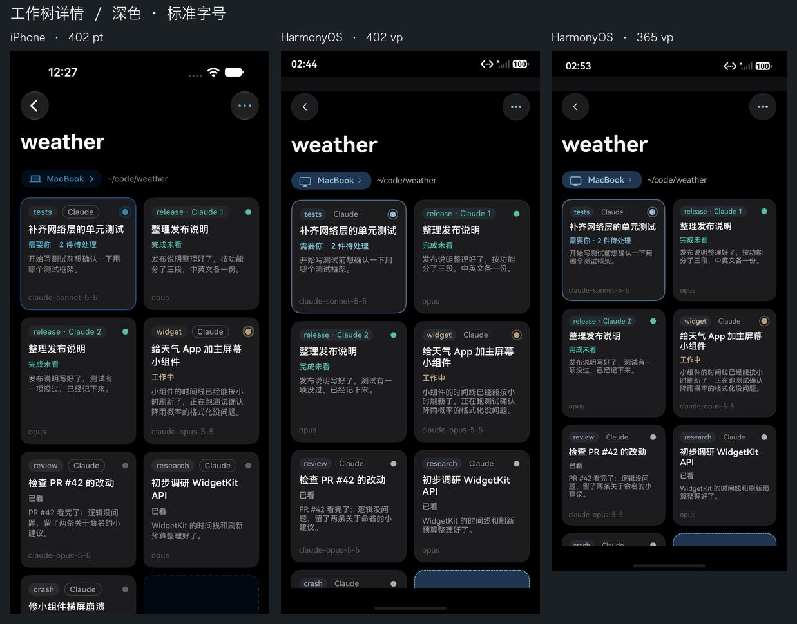
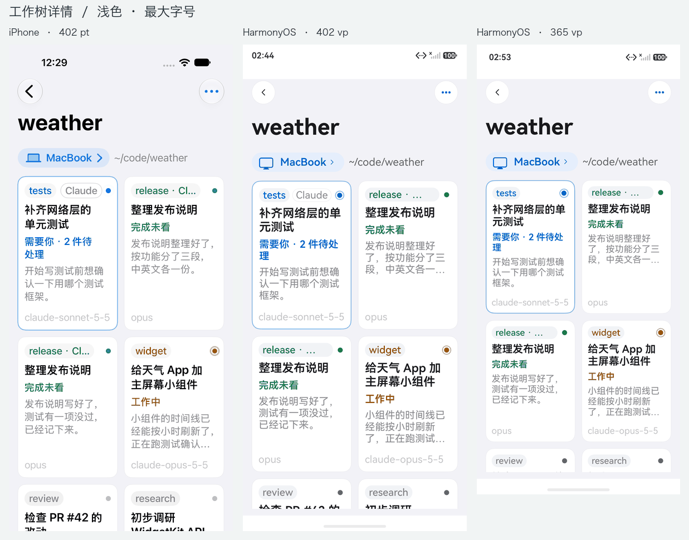

# 工作树详情 · Worktree details

[返回全部页面 · All pages](../README.md)

在选中的开发目录下查看会话和所属机器。
Open the weather terminal space and browse its agents across Git checkouts.

Three independent native captures, left to right: iPhone 402 pt, HarmonyOS 402 vp, HarmonyOS 365 vp. The complete screen, including system bars, is visible.

[Download all original screenshots and accessibility trees for this page](../originals/worktree.zip?raw=1) · [Source and capture method](../SOURCES.md)

Original archive SHA-256: d25460bacb8d8f33659cb915146438fb6a9e7e03cd9b153e82a740ca64a90aa7

## 浅色 · 标准字号

| Device | Pixels | Captured at | PNG digest | Hierarchy digest |
| --- | --- | --- | --- | --- |
| iPhone 402 pt | 1206 × 2622 | 2026-11-23T04:24:53.269+00:00 | e0b93c023b1bc6bb | 76c8727f315ea3a2 |
| HarmonyOS 402 vp | 1206 × 2622 | 2026-11-23T14:44:30+08:00 | d32b6e5d07ff2017 | be551bd209b54b14 |
| HarmonyOS 365 vp | 1280 × 2832 | 2026-11-23T14:53:13+08:00 | 1b22be9bbe5cfc3f | 436d9dc0c33c76b9 |

## 深色 · 标准字号

| Device | Pixels | Captured at | PNG digest | Hierarchy digest |
| --- | --- | --- | --- | --- |
| iPhone 402 pt | 1206 × 2622 | 2026-11-23T04:27:23.515+00:00 | a09e75e7afc4ba63 | a1bf277ccdeeee0f |
| HarmonyOS 402 vp | 1206 × 2622 | 2026-11-23T14:44:34+08:00 | 9720b83de5905ce0 | 9ca3637ac83ad44c |
| HarmonyOS 365 vp | 1280 × 2832 | 2026-11-23T14:53:17+08:00 | 7ec851b9a82d3a33 | 18e097702a3a949c |

## 浅色 · 最大字号

| Device | Pixels | Captured at | PNG digest | Hierarchy digest |
| --- | --- | --- | --- | --- |
| iPhone 402 pt | 1206 × 2622 | 2026-11-23T04:29:56.882+00:00 | a6aaa7c831462e37 | 2640722dffa2bac1 |
| HarmonyOS 402 vp | 1206 × 2622 | 2026-11-23T14:44:38+08:00 | 92dadc2ab6543603 | bff549f2218a4b55 |
| HarmonyOS 365 vp | 1280 × 2832 | 2026-11-23T14:53:21+08:00 | efc79cd0dac1449e | 0d54f03e78715526 |

Full 64-character digests and ZIP entry paths are under this page in the [manifest](../manifest.json).

[← 仓库详情](project.md)
[新建 Agent →](new-agent.md)
