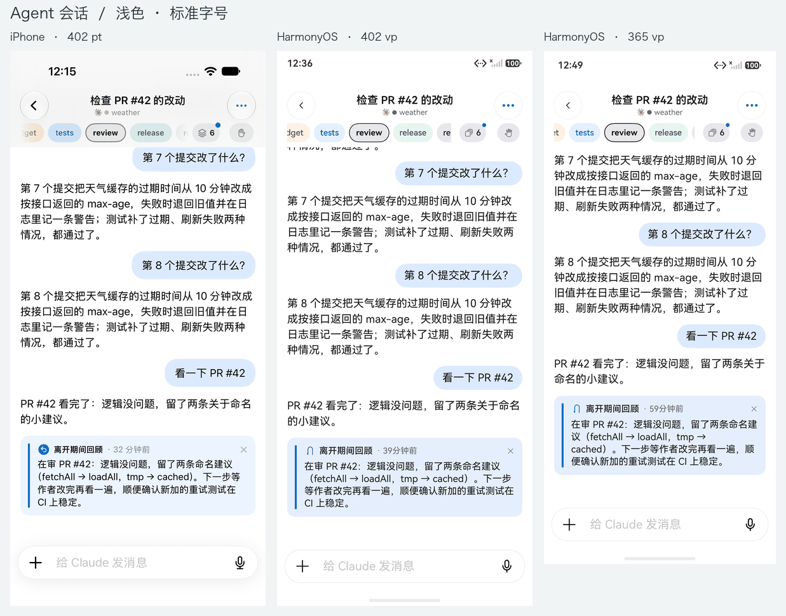
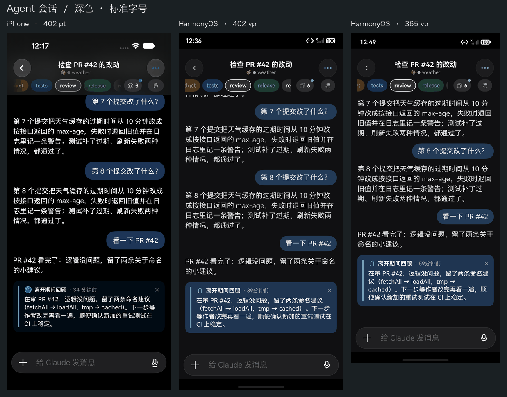
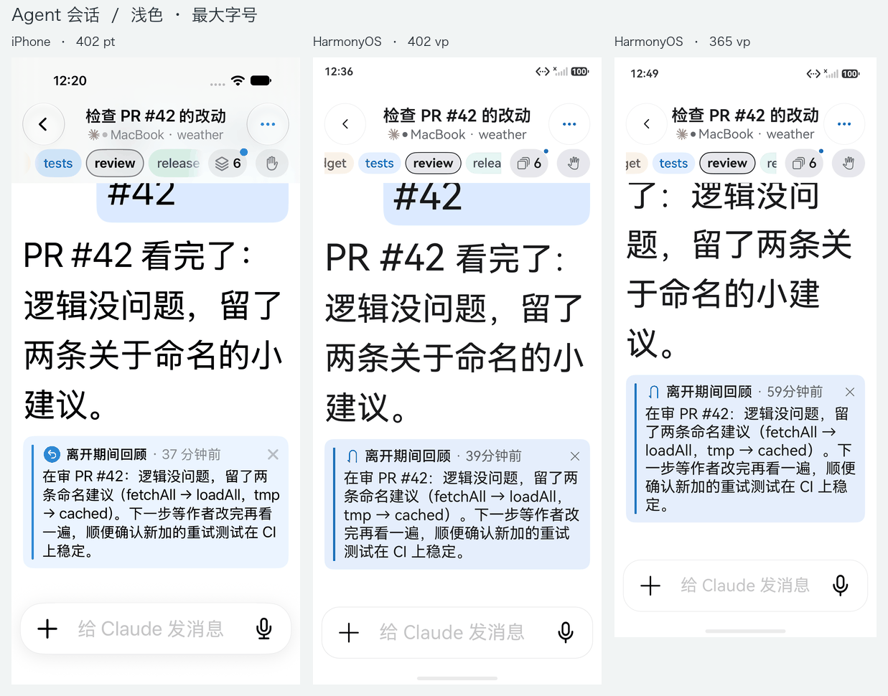

# Agent 会话 · Agent conversation

[返回全部页面 · All pages](../README.md)

打开 weather 的 PR #42 会话，核对用户消息、回复与回顾。
Open the PR #42 conversation with the seeded review history.

Three independent native captures, left to right: iPhone 402 pt, HarmonyOS 402 vp, HarmonyOS 365 vp. The complete screen, including system bars, is visible.

[Download all original screenshots and accessibility trees for this page](../originals/agent-chat.zip?raw=1) · [Source and capture method](../SOURCES.md)

Original archive SHA-256: f0631b05effbddf0bfcdbf5215b81e4797763397d8525d266ec3dfe4982c3866

## 浅色 · 标准字号

| Device | Pixels | Captured at | PNG digest | Hierarchy digest |
| --- | --- | --- | --- | --- |
| iPhone 402 pt | 1206 × 2622 | 2026-11-23T04:15:14.838+00:00 | bdb84262e2ab081e | ce4ae0e6d0b944e4 |
| HarmonyOS 402 vp | 1206 × 2622 | 2026-11-23T12:36:20+08:00 | 27f4d9c203c765bb | e625e846c2120a82 |
| HarmonyOS 365 vp | 1280 × 2832 | 2026-11-23T12:49:21+08:00 | 58cd38df5f131317 | cd6719ad6cbef3f6 |

## 深色 · 标准字号

| Device | Pixels | Captured at | PNG digest | Hierarchy digest |
| --- | --- | --- | --- | --- |
| iPhone 402 pt | 1206 × 2622 | 2026-11-23T04:17:35.199+00:00 | f0bdbbca55c5c57b | 29420290cd3e636a |
| HarmonyOS 402 vp | 1206 × 2622 | 2026-11-23T12:36:24+08:00 | 7211b381dd7a148b | e625e846c2120a82 |
| HarmonyOS 365 vp | 1280 × 2832 | 2026-11-23T12:49:24+08:00 | 762c72aa59c389d1 | 2bac9a53b75a3df5 |

## 浅色 · 最大字号

| Device | Pixels | Captured at | PNG digest | Hierarchy digest |
| --- | --- | --- | --- | --- |
| iPhone 402 pt | 1206 × 2622 | 2026-11-23T04:20:11.655+00:00 | 03307a2c285f2897 | 0d94f885e7a8d706 |
| HarmonyOS 402 vp | 1206 × 2622 | 2026-11-23T12:36:29+08:00 | ca4430778ad62636 | e3ebeb24c86d29cf |
| HarmonyOS 365 vp | 1280 × 2832 | 2026-11-23T12:49:28+08:00 | 03c64a8171355a3c | 3bb22705665119a5 |

Full 64-character digests and ZIP entry paths are under this page in the [manifest](../manifest.json).

[← Agents 列表](agents.md)
[会话小结详情 →](recap-detail.md)
