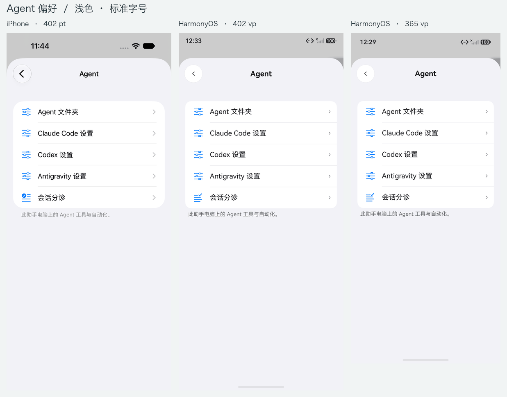
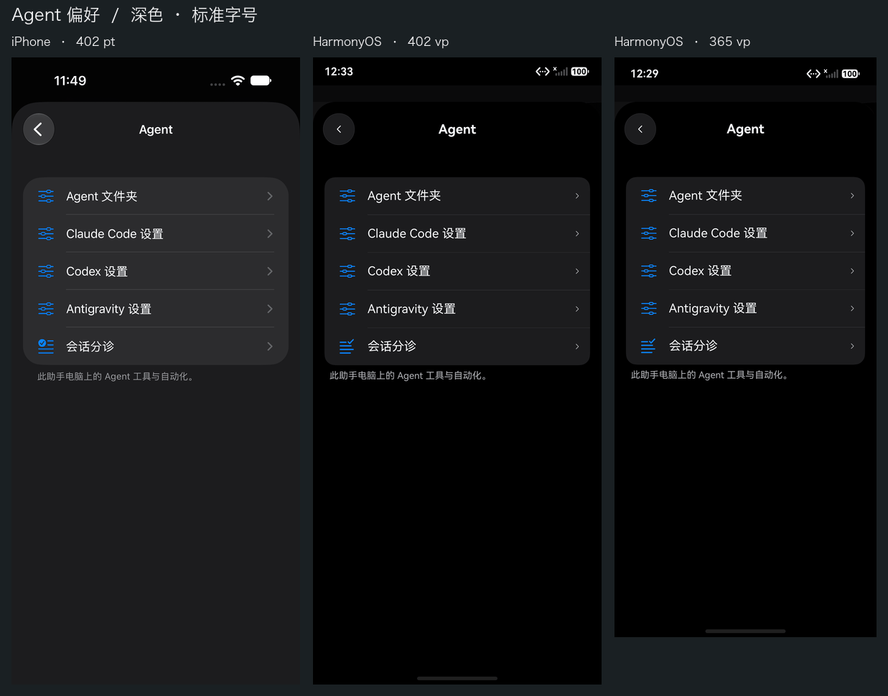
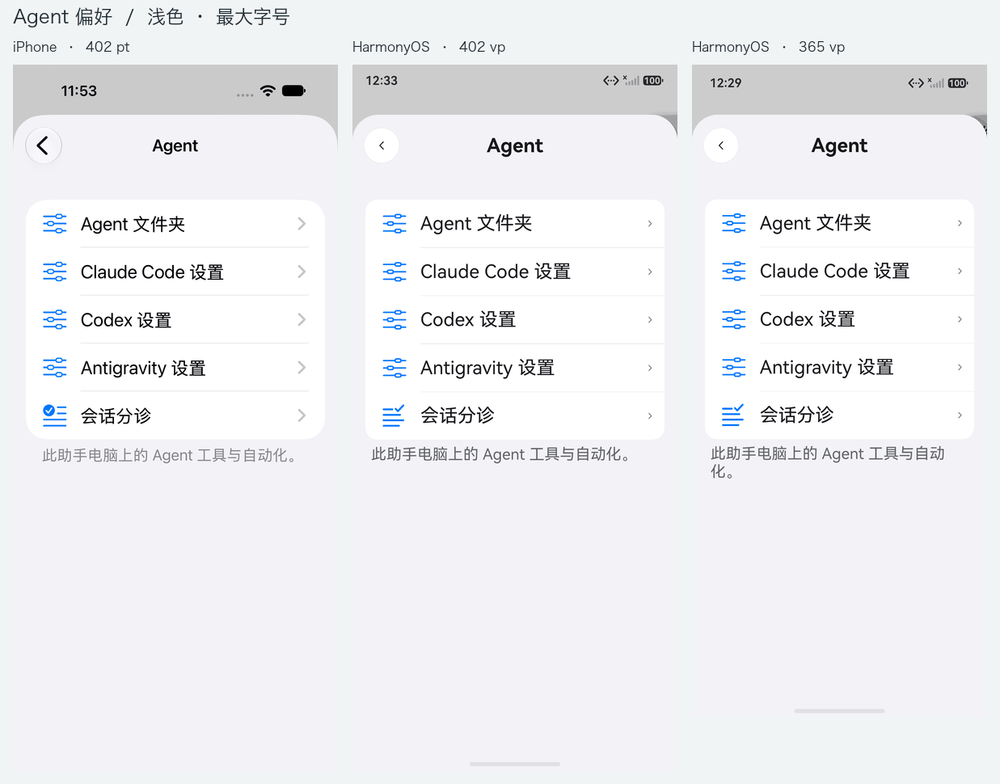

# Agent 偏好 · Agent preferences

[返回全部页面 · All pages](../README.md)

从设置进入 Agent 选项。
Open Agent preferences from Settings search and return to the same query.

Three independent native captures, left to right: iPhone 402 pt, HarmonyOS 402 vp, HarmonyOS 365 vp. The complete screen, including system bars, is visible.

[Download all original screenshots and accessibility trees for this page](../originals/agent-preferences.zip?raw=1) · [Source and capture method](../SOURCES.md)

Original archive SHA-256: c30730f10d782bedcaaee858a3f0fbb7ea7813f45e94d9df1eafb000d9883bfa

## 浅色 · 标准字号

| Device | Pixels | Captured at | PNG digest | Hierarchy digest |
| --- | --- | --- | --- | --- |
| iPhone 402 pt | 1206 × 2622 | 2026-11-23T03:44:49.291+00:00 | f8554286d96fff85 | 224931192c25a414 |
| HarmonyOS 402 vp | 1206 × 2622 | 2026-11-23T12:33:20+08:00 | 6dc608ae90ea2b86 | 04eeb850ed0c37b1 |
| HarmonyOS 365 vp | 1280 × 2832 | 2026-11-23T12:29:49+08:00 | 16c2f3e604c52602 | 9e955fdd092a0f5b |

## 深色 · 标准字号

| Device | Pixels | Captured at | PNG digest | Hierarchy digest |
| --- | --- | --- | --- | --- |
| iPhone 402 pt | 1206 × 2622 | 2026-11-23T03:49:29.583+00:00 | 44f11d3e00aff040 | 1c63083c1b1a15ba |
| HarmonyOS 402 vp | 1206 × 2622 | 2026-11-23T12:33:23+08:00 | cd6eedf918252bcf | 04eeb850ed0c37b1 |
| HarmonyOS 365 vp | 1280 × 2832 | 2026-11-23T12:29:53+08:00 | 3628ea74d6c97bf1 | 3043a93d0ed6304b |

## 浅色 · 最大字号

| Device | Pixels | Captured at | PNG digest | Hierarchy digest |
| --- | --- | --- | --- | --- |
| iPhone 402 pt | 1206 × 2622 | 2026-11-23T03:53:47.910+00:00 | 685aae4e5e0613d4 | 3498dc1d3bde22b2 |
| HarmonyOS 402 vp | 1206 × 2622 | 2026-11-23T12:33:28+08:00 | 8be67207c5458850 | 33d6f00016f9a143 |
| HarmonyOS 365 vp | 1280 × 2832 | 2026-11-23T12:29:57+08:00 | a279a9b139b29f23 | b442b92292e7d377 |

Full 64-character digests and ZIP entry paths are under this page in the [manifest](../manifest.json).

[← 语言](language.md)
[搜索会话内容 →](search.md)
