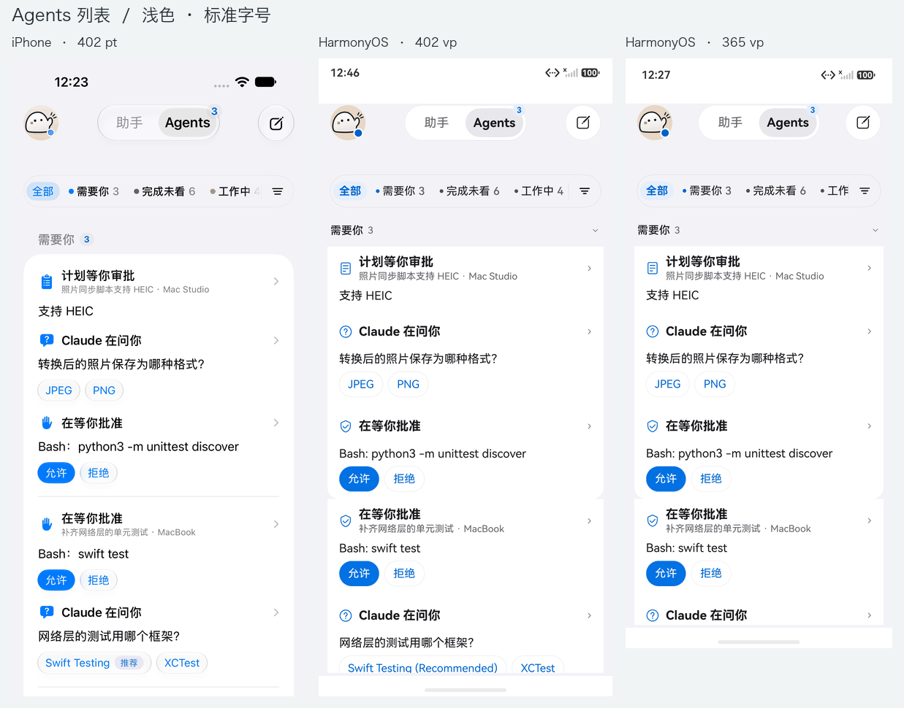
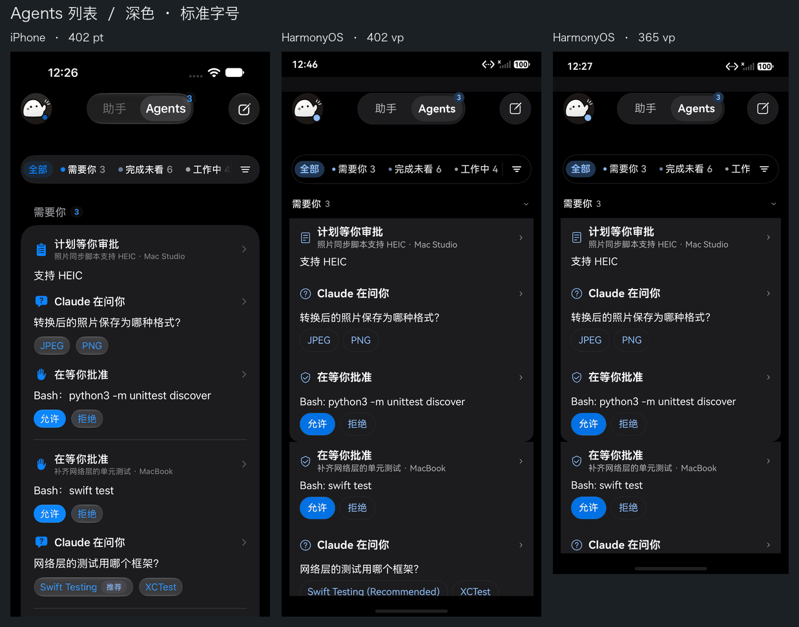
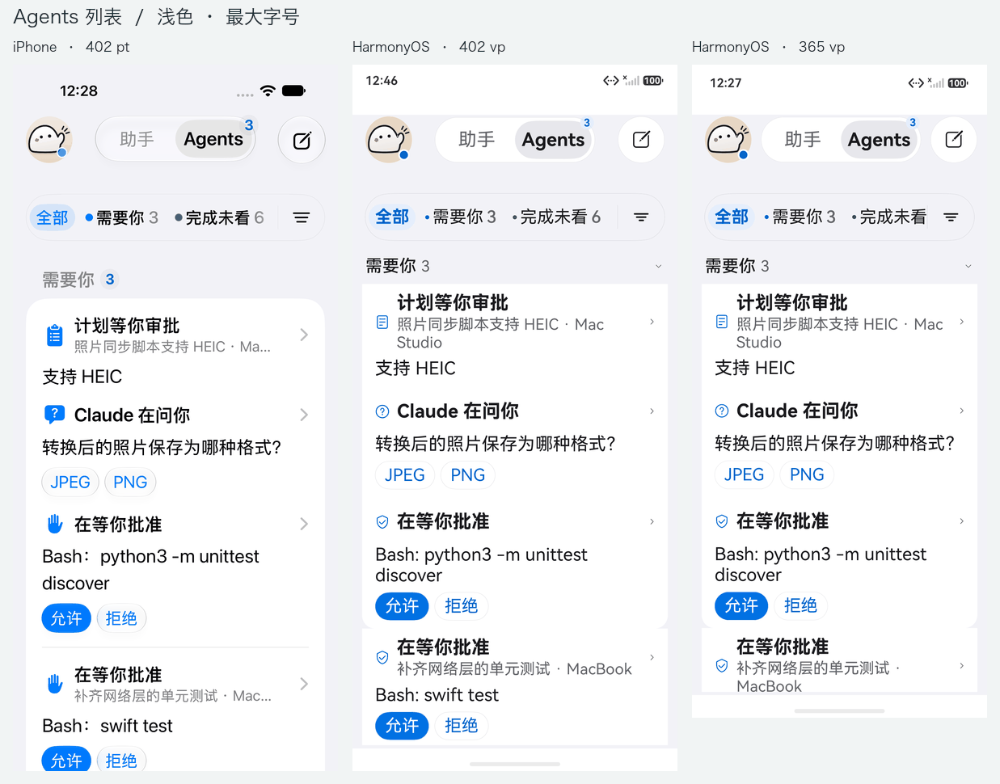

# Agents 列表 · Agent list

[返回全部页面 · All pages](../README.md)

按状态浏览 Agents，区分需要处理和正在工作的会话。

Three independent native captures, left to right: iPhone 402 pt, HarmonyOS 402 vp, HarmonyOS 365 vp. The complete screen, including system bars, is visible.

[Download all original screenshots and accessibility trees for this page](../originals/agents.zip?raw=1) · [Source and capture method](../SOURCES.md)

Original archive SHA-256: bfae4591a2c032e08bbcd0d5f94143bed215f821d5e4232124cbbc8a6a4a3909

## 浅色 · 标准字号

| Device | Pixels | Captured at | PNG digest | Hierarchy digest |
| --- | --- | --- | --- | --- |
| iPhone 402 pt | 1206 × 2622 | 2026-11-23T04:23:39.981+00:00 | 64267b766236325d | dddbd6b41d63ac4f |
| HarmonyOS 402 vp | 1206 × 2622 | 2026-11-23T12:46:39+08:00 | d7f2169aa385ac46 | cb81d96bb4a9a1e9 |
| HarmonyOS 365 vp | 1280 × 2832 | 2026-11-23T12:27:10+08:00 | 7fa32df804b57f82 | 832a83f97e3b1705 |

## 深色 · 标准字号

| Device | Pixels | Captured at | PNG digest | Hierarchy digest |
| --- | --- | --- | --- | --- |
| iPhone 402 pt | 1206 × 2622 | 2026-11-23T04:26:10.203+00:00 | ba323079ff920db8 | 2e0e8f3c5826bd37 |
| HarmonyOS 402 vp | 1206 × 2622 | 2026-11-23T12:46:44+08:00 | 82726e640e44cb1b | cb81d96bb4a9a1e9 |
| HarmonyOS 365 vp | 1280 × 2832 | 2026-11-23T12:27:14+08:00 | d179055733c58217 | 9a7f5a4848fbbc37 |

## 浅色 · 最大字号

| Device | Pixels | Captured at | PNG digest | Hierarchy digest |
| --- | --- | --- | --- | --- |
| iPhone 402 pt | 1206 × 2622 | 2026-11-23T04:28:39.445+00:00 | 0f8b83ce8f970c13 | caf727465f70d7bd |
| HarmonyOS 402 vp | 1206 × 2622 | 2026-11-23T12:46:48+08:00 | 81d2759c0770796e | 94e49727fb97ed56 |
| HarmonyOS 365 vp | 1280 × 2832 | 2026-11-23T12:27:18+08:00 | 60a4878bb8efc0d7 | cf89f7bf78b6d04e |

Full 64-character digests and ZIP entry paths are under this page in the [manifest](../manifest.json).

[← 提交 Agent 配置](start-ready.md)
[Agent 会话 →](agent-chat.md)
