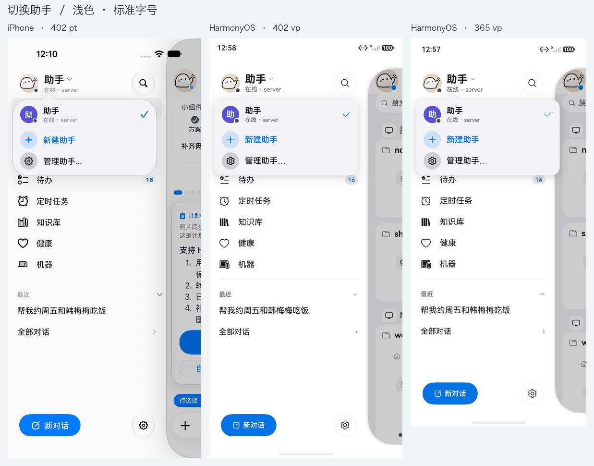
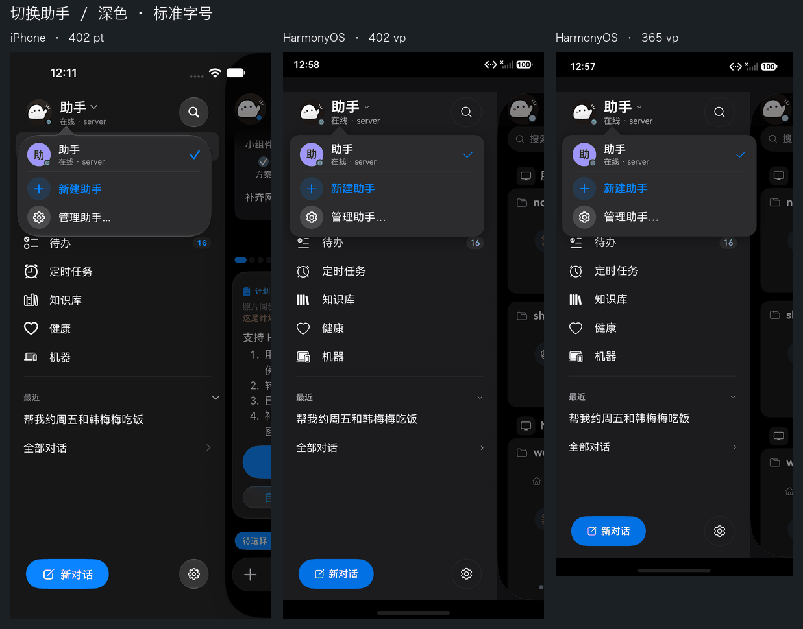
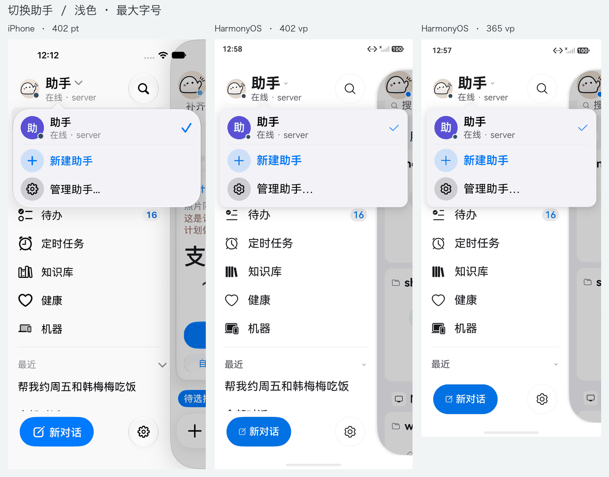

# 切换助手 · Switch assistants

[返回全部页面 · All pages](../README.md)

从当前助手打开助手切换菜单。

Three independent native captures, left to right: iPhone 402 pt, HarmonyOS 402 vp, HarmonyOS 365 vp. The complete screen, including system bars, is visible.

[Download all original screenshots and accessibility trees for this page](../originals/assistant-menu.zip?raw=1) · [Source and capture method](../SOURCES.md)

Original archive SHA-256: a6527c1c784c53e64ab565dacd412bbad7aa43dd21bbb918b4569687d664a590

## 浅色 · 标准字号

| Device | Pixels | Captured at | PNG digest | Hierarchy digest |
| --- | --- | --- | --- | --- |
| iPhone 402 pt | 1206 × 2622 | 2026-11-23T04:10:21.131+00:00 | 6228f17ec6b1a711 | 17f8619c260b7d01 |
| HarmonyOS 402 vp | 1206 × 2622 | 2026-11-23T12:58:39+08:00 | c1a78c2a3af5bcd9 | 4455f4bbf2e73993 |
| HarmonyOS 365 vp | 1280 × 2832 | 2026-11-23T12:57:50+08:00 | 7e78062e32a005ef | 72cd72d3f4b3c9cf |

## 深色 · 标准字号

| Device | Pixels | Captured at | PNG digest | Hierarchy digest |
| --- | --- | --- | --- | --- |
| iPhone 402 pt | 1206 × 2622 | 2026-11-23T04:11:09.917+00:00 | 009df4c3496f03b0 | 4aa69ca13a1bd2a2 |
| HarmonyOS 402 vp | 1206 × 2622 | 2026-11-23T12:58:44+08:00 | 1b8de4f316a57fb7 | 4455f4bbf2e73993 |
| HarmonyOS 365 vp | 1280 × 2832 | 2026-11-23T12:57:54+08:00 | c21dc190301fb636 | 2dc2e2ff8c4796db |

## 浅色 · 最大字号

| Device | Pixels | Captured at | PNG digest | Hierarchy digest |
| --- | --- | --- | --- | --- |
| iPhone 402 pt | 1206 × 2622 | 2026-11-23T04:12:11.740+00:00 | 9771400b01f357d6 | 040cda1812ad792b |
| HarmonyOS 402 vp | 1206 × 2622 | 2026-11-23T12:58:49+08:00 | af2b16075842cd9e | 764f22281d48061d |
| HarmonyOS 365 vp | 1280 × 2832 | 2026-11-23T12:57:59+08:00 | fdaf9444205b4a23 | 8459cb3cfc19695b |

Full 64-character digests and ZIP entry paths are under this page in the [manifest](../manifest.json).

[← 侧栏](drawer.md)
[设置 →](settings.md)
