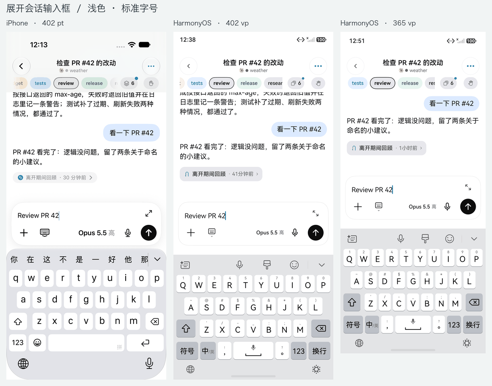
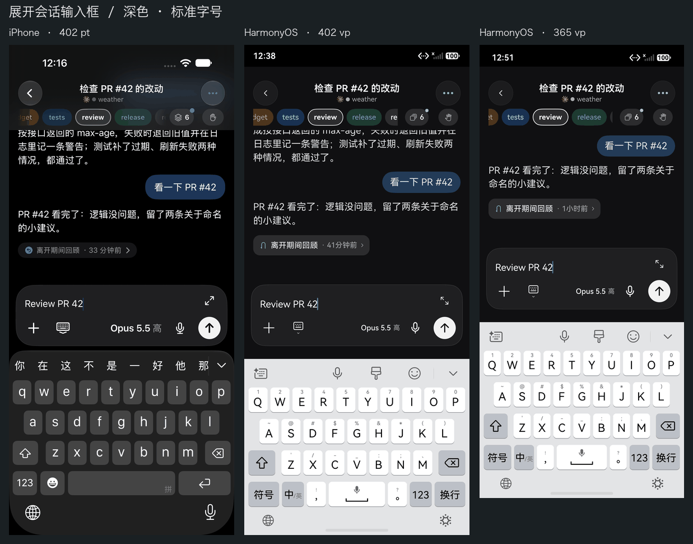
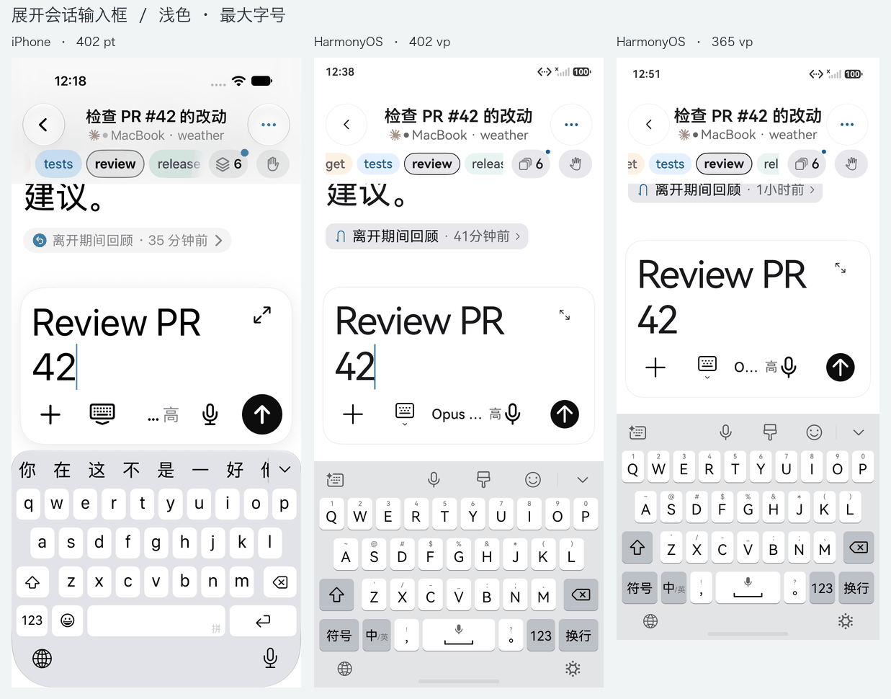

# 展开会话输入框 · Focused composer

[返回全部页面 · All pages](../README.md)

聚焦 PR #42 的输入框，核对草稿、键盘和发送控件的位置。
Focus the PR #42 composer and return from its full-screen editor to the same draft.

Three independent native captures, left to right: iPhone 402 pt, HarmonyOS 402 vp, HarmonyOS 365 vp. The complete screen, including system bars, is visible.

[Download all original screenshots and accessibility trees for this page](../originals/composer.zip?raw=1) · [Source and capture method](../SOURCES.md)

Original archive SHA-256: 306e3953341c783452860734f59bdb8b061ad41d364f2a72e8ae92dc28bd7a6b

## 浅色 · 标准字号

| Device | Pixels | Captured at | PNG digest | Hierarchy digest |
| --- | --- | --- | --- | --- |
| iPhone 402 pt | 1206 × 2622 | 2026-11-23T04:13:42.916+00:00 | c83196b5c7b221ea | 310947d108f0df1f |
| HarmonyOS 402 vp | 1206 × 2622 | 2026-11-23T12:38:47+08:00 | 0fc1753d5311ff75 | 43459f917fe5ef98 |
| HarmonyOS 365 vp | 1280 × 2832 | 2026-11-23T12:51:43+08:00 | 3cf223c6dfb0226f | 498b2e02b1b917e7 |

## 深色 · 标准字号

| Device | Pixels | Captured at | PNG digest | Hierarchy digest |
| --- | --- | --- | --- | --- |
| iPhone 402 pt | 1206 × 2622 | 2026-11-23T04:16:01.683+00:00 | 07a12fec1b0c6a4e | ed1c4484a1704a96 |
| HarmonyOS 402 vp | 1206 × 2622 | 2026-11-23T12:38:51+08:00 | d46a87310cf8d3e6 | 07091212ff2cc0ce |
| HarmonyOS 365 vp | 1280 × 2832 | 2026-11-23T12:51:46+08:00 | 15b93e07fbdb41b3 | 4f44cb2d3c466f33 |

## 浅色 · 最大字号

| Device | Pixels | Captured at | PNG digest | Hierarchy digest |
| --- | --- | --- | --- | --- |
| iPhone 402 pt | 1206 × 2622 | 2026-11-23T04:18:22.858+00:00 | e3d8ae1bc2767cea | 1fb350e4ea05ff55 |
| HarmonyOS 402 vp | 1206 × 2622 | 2026-11-23T12:38:56+08:00 | 983a6866ecf30cc0 | ef953e86b9a54e3d |
| HarmonyOS 365 vp | 1280 × 2832 | 2026-11-23T12:51:50+08:00 | c4c59b6d33975f13 | 0c42989925299c4a |

Full 64-character digests and ZIP entry paths are under this page in the [manifest](../manifest.json).

[← Persona 主对话](persona.md)
[回看会话记录 →](reading-history.md)
