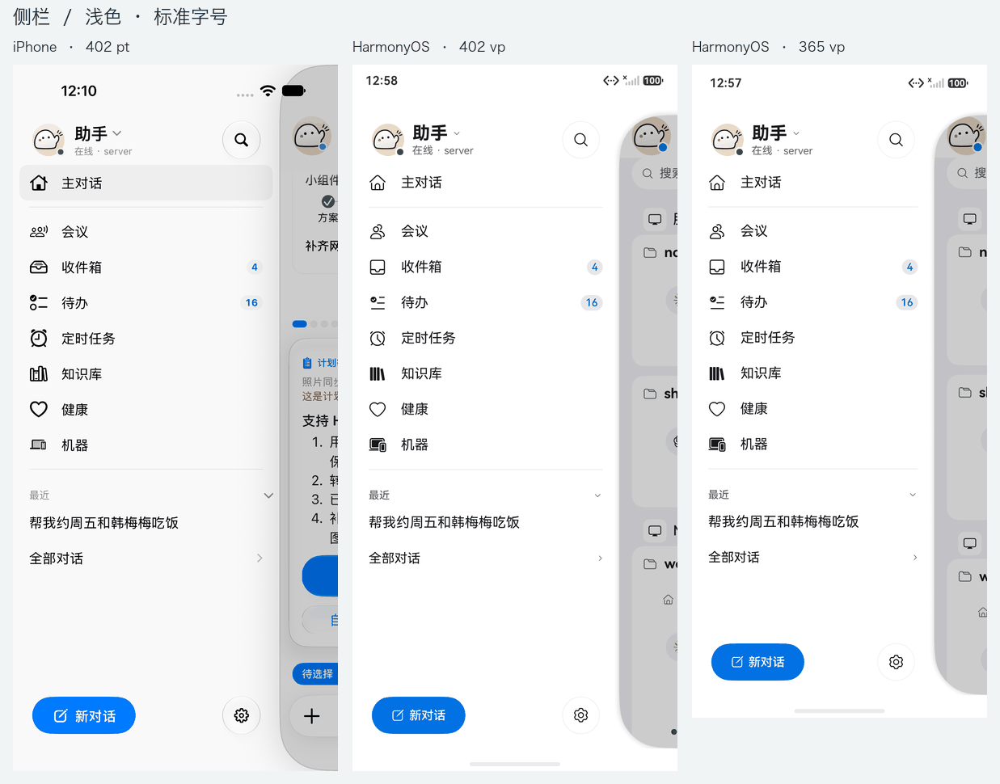
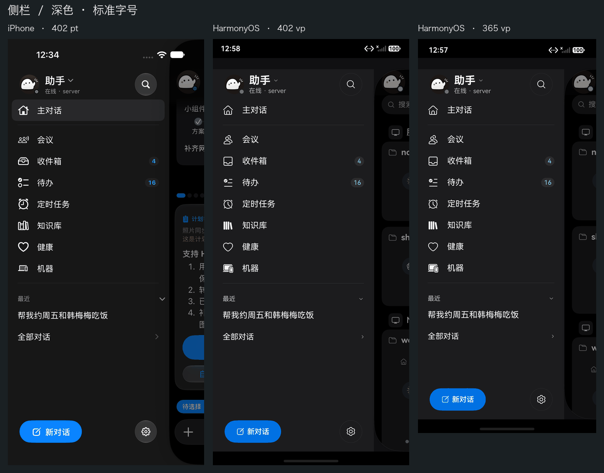
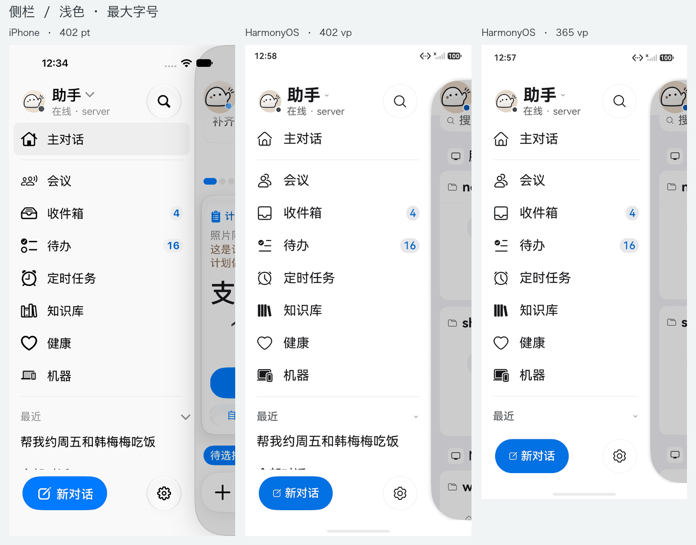

# 侧栏 · Navigation drawer

[返回全部页面 · All pages](../README.md)

在侧栏查找主对话、工作空间和设置入口。

Three independent native captures, left to right: iPhone 402 pt, HarmonyOS 402 vp, HarmonyOS 365 vp. The complete screen, including system bars, is visible.

[Download all original screenshots and accessibility trees for this page](../originals/drawer.zip?raw=1) · [Source and capture method](../SOURCES.md)

Original archive SHA-256: 5fb28350d416b12ae57d76e72c14cf9f249b94bd4e589571329c22b27ff24eb2

## 浅色 · 标准字号

| Device | Pixels | Captured at | PNG digest | Hierarchy digest |
| --- | --- | --- | --- | --- |
| iPhone 402 pt | 1206 × 2622 | 2026-11-23T04:10:47.812+00:00 | ce3893d4f80ea3ef | b698869812e8a467 |
| HarmonyOS 402 vp | 1206 × 2622 | 2026-11-23T12:58:25+08:00 | 8fb3f193ea098881 | d92e3e9334291218 |
| HarmonyOS 365 vp | 1280 × 2832 | 2026-11-23T12:57:36+08:00 | 49ae44d25f7794ed | 4b6b621f1648e264 |

## 深色 · 标准字号

| Device | Pixels | Captured at | PNG digest | Hierarchy digest |
| --- | --- | --- | --- | --- |
| iPhone 402 pt | 1206 × 2622 | 2026-11-23T04:34:14.617+00:00 | ed105bb76319bbdf | 83d2a07dc327e6dd |
| HarmonyOS 402 vp | 1206 × 2622 | 2026-11-23T12:58:29+08:00 | bd5fc93fa1f9ee34 | d92e3e9334291218 |
| HarmonyOS 365 vp | 1280 × 2832 | 2026-11-23T12:57:40+08:00 | f2dfc9a82f816d8e | 82d0ba8142f9c21c |

## 浅色 · 最大字号

| Device | Pixels | Captured at | PNG digest | Hierarchy digest |
| --- | --- | --- | --- | --- |
| iPhone 402 pt | 1206 × 2622 | 2026-11-23T04:34:34.057+00:00 | e4d7a3f89bce4337 | e3e131ab16ded319 |
| HarmonyOS 402 vp | 1206 × 2622 | 2026-11-23T12:58:34+08:00 | 5a6c8b94b231140f | 425a089e683791ea |
| HarmonyOS 365 vp | 1280 × 2832 | 2026-11-23T12:57:45+08:00 | 564f39582fcd1dd5 | 2b19633dd69fcc9d |

Full 64-character digests and ZIP entry paths are under this page in the [manifest](../manifest.json).

[← 机器监控读数](machine-monitor.md)
[切换助手 →](assistant-menu.md)
