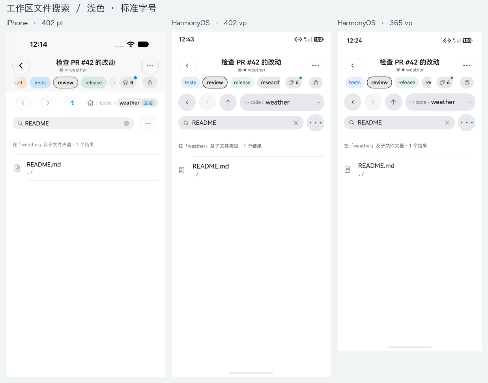
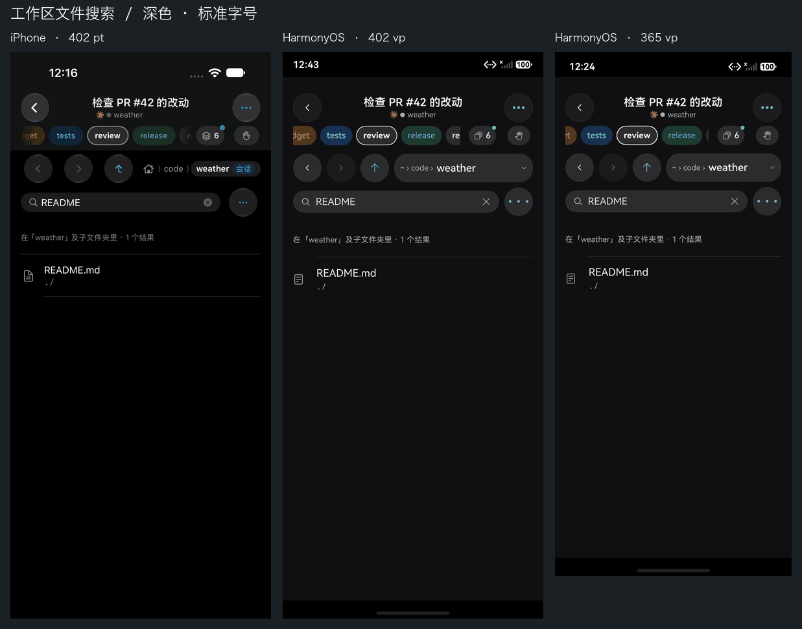
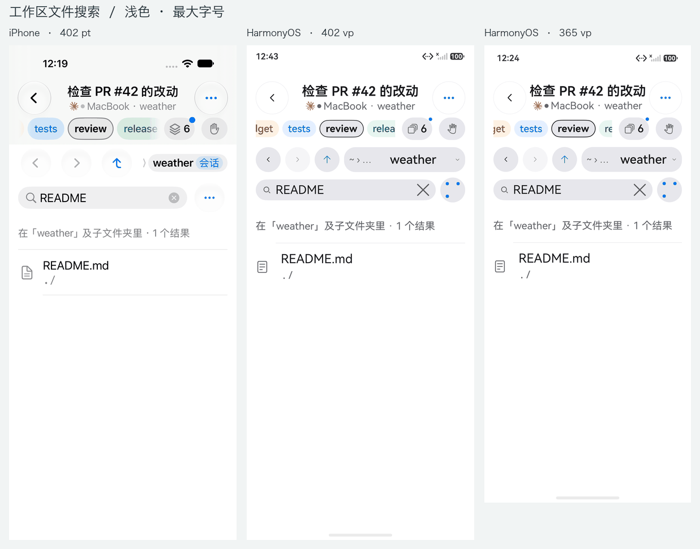

# 工作区文件搜索 · Find a file

[返回全部页面 · All pages](../README.md)

在当前工作目录及子目录搜索 README。

Three independent native captures, left to right: iPhone 402 pt, HarmonyOS 402 vp, HarmonyOS 365 vp. The complete screen, including system bars, is visible.

[Download all original screenshots and accessibility trees for this page](../originals/file-search.zip?raw=1) · [Source and capture method](../SOURCES.md)

Original archive SHA-256: fed7af81c90d93aef84fd1d79ce5f6b50a9610391c7bb134a454977a04d372ee

## 浅色 · 标准字号

| Device | Pixels | Captured at | PNG digest | Hierarchy digest |
| --- | --- | --- | --- | --- |
| iPhone 402 pt | 1206 × 2622 | 2026-11-23T04:14:22.146+00:00 | 6815fbbf2e1c7616 | 8731e6576d38b531 |
| HarmonyOS 402 vp | 1206 × 2622 | 2026-11-23T12:43:07+08:00 | 0f003ea51d4a7c40 | d6562982de12c7ff |
| HarmonyOS 365 vp | 1280 × 2832 | 2026-11-23T12:24:31+08:00 | 3ab72f4855b8bbbe | f4f20b3de33fcfb3 |

## 深色 · 标准字号

| Device | Pixels | Captured at | PNG digest | Hierarchy digest |
| --- | --- | --- | --- | --- |
| iPhone 402 pt | 1206 × 2622 | 2026-11-23T04:16:42.088+00:00 | 625e79e63b78a815 | c12a9ed477431baa |
| HarmonyOS 402 vp | 1206 × 2622 | 2026-11-23T12:43:17+08:00 | 15e3a77d3e1e2e42 | 127c07f4b95e12f6 |
| HarmonyOS 365 vp | 1280 × 2832 | 2026-11-23T12:24:35+08:00 | 6a997320966416d7 | e3639f195f81ebe0 |

## 浅色 · 最大字号

| Device | Pixels | Captured at | PNG digest | Hierarchy digest |
| --- | --- | --- | --- | --- |
| iPhone 402 pt | 1206 × 2622 | 2026-11-23T04:19:19.150+00:00 | dbbd1541d4f6a1d2 | 196b98f71fddba8c |
| HarmonyOS 402 vp | 1206 × 2622 | 2026-11-23T12:43:23+08:00 | 3621b8387c6cbc85 | cbbdfe1b1115b583 |
| HarmonyOS 365 vp | 1280 × 2832 | 2026-11-23T12:24:39+08:00 | 4f3b9af7e2aa9c32 | aa34c53076165bad |

Full 64-character digests and ZIP entry paths are under this page in the [manifest](../manifest.json).

[← 文件](files.md)
[Git 工作区 →](git.md)
