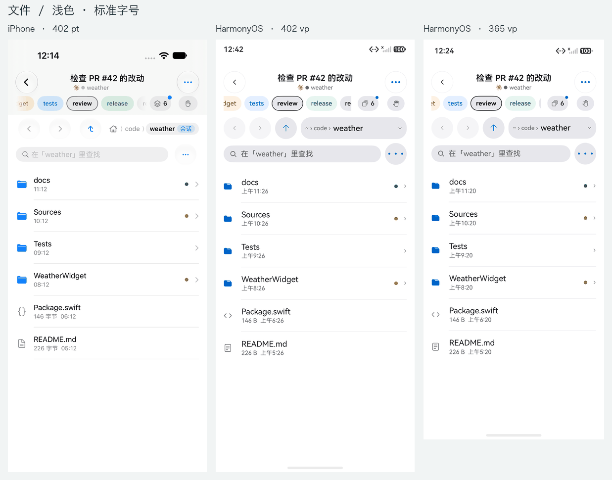
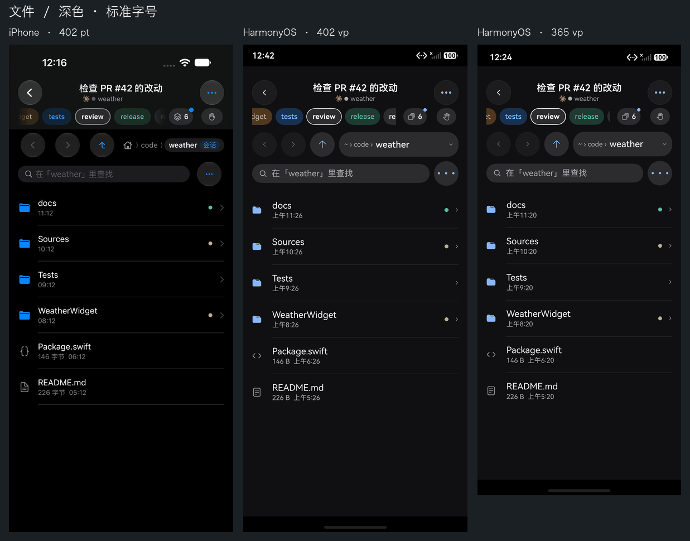
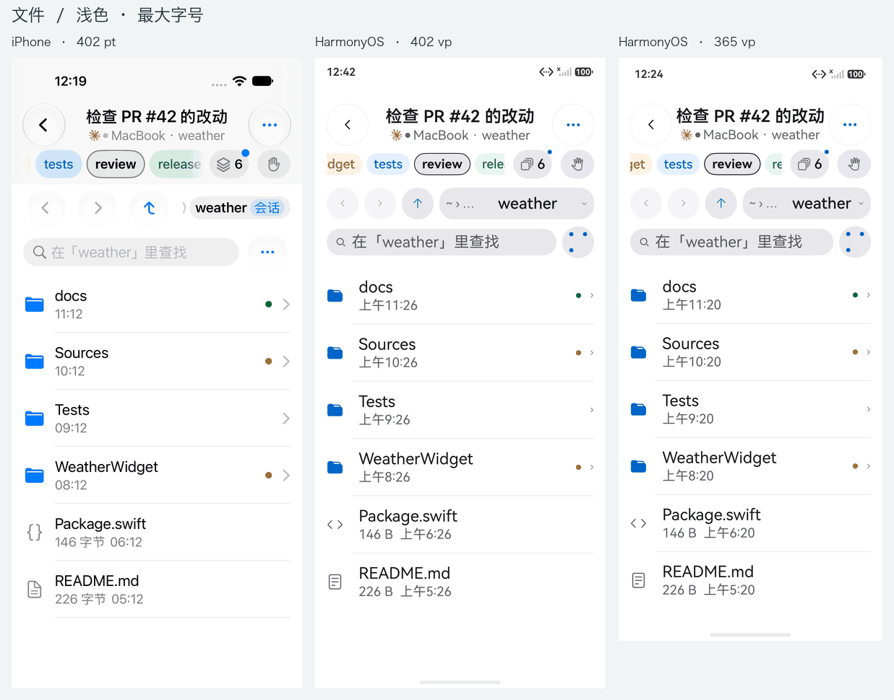

# 文件 · Workspace files

[返回全部页面 · All pages](../README.md)

浏览 weather 目录的文件与文件夹。
Open Files from the More menu of the PR #42 conversation. Its title, space and sibling tabs stay visible.

Three independent native captures, left to right: iPhone 402 pt, HarmonyOS 402 vp, HarmonyOS 365 vp. The complete screen, including system bars, is visible.

[Download all original screenshots and accessibility trees for this page](../originals/files.zip?raw=1) · [Source and capture method](../SOURCES.md)

Original archive SHA-256: c917192b23a74f3e4fde77fa3136f1260aa333f843f5523c7a06184751aa6ef7

## 浅色 · 标准字号

| Device | Pixels | Captured at | PNG digest | Hierarchy digest |
| --- | --- | --- | --- | --- |
| iPhone 402 pt | 1206 × 2622 | 2026-11-23T04:14:13.776+00:00 | 739507b9dfe63ca8 | 9123c7565f3c7b55 |
| HarmonyOS 402 vp | 1206 × 2622 | 2026-11-23T12:42:25+08:00 | 488e997de249e4da | 6d699da4a71df4c7 |
| HarmonyOS 365 vp | 1280 × 2832 | 2026-11-23T12:24:13+08:00 | 748f1df8a2385c29 | befebdbe35f10fdb |

## 深色 · 标准字号

| Device | Pixels | Captured at | PNG digest | Hierarchy digest |
| --- | --- | --- | --- | --- |
| iPhone 402 pt | 1206 × 2622 | 2026-11-23T04:16:33.840+00:00 | 37523a326742a79a | 4e3a7e27f55a7c3a |
| HarmonyOS 402 vp | 1206 × 2622 | 2026-11-23T12:42:29+08:00 | fa15e426aef6c691 | 6d699da4a71df4c7 |
| HarmonyOS 365 vp | 1280 × 2832 | 2026-11-23T12:24:16+08:00 | 057078f1eb46a8b8 | f9a1c0618952c3ac |

## 浅色 · 最大字号

| Device | Pixels | Captured at | PNG digest | Hierarchy digest |
| --- | --- | --- | --- | --- |
| iPhone 402 pt | 1206 × 2622 | 2026-11-23T04:19:10.806+00:00 | a845e0ed41ab1637 | 25d4bdbcb8b76099 |
| HarmonyOS 402 vp | 1206 × 2622 | 2026-11-23T12:42:33+08:00 | 2b3b7177735ec791 | b8396375973d5b95 |
| HarmonyOS 365 vp | 1280 × 2832 | 2026-11-23T12:24:21+08:00 | 11ed06ad8b84f68e | f67fdd131171b87e |

Full 64-character digests and ZIP entry paths are under this page in the [manifest](../manifest.json).

[← 回看会话记录](reading-history.md)
[工作区文件搜索 →](file-search.md)
