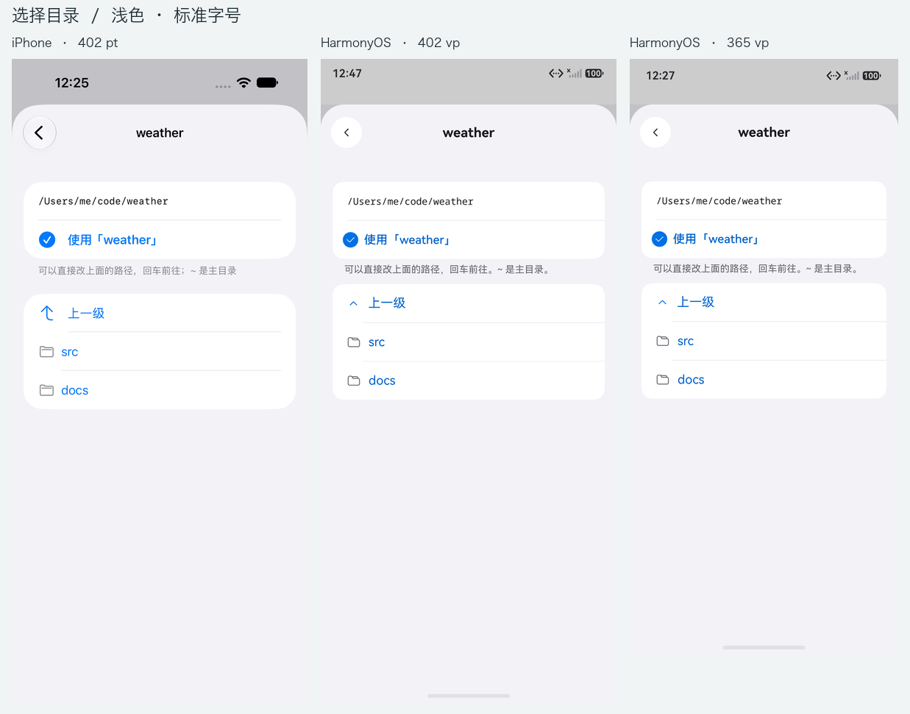
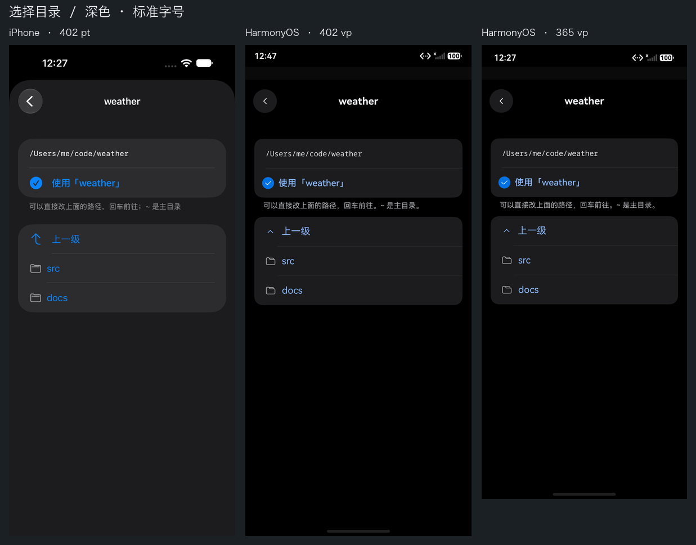
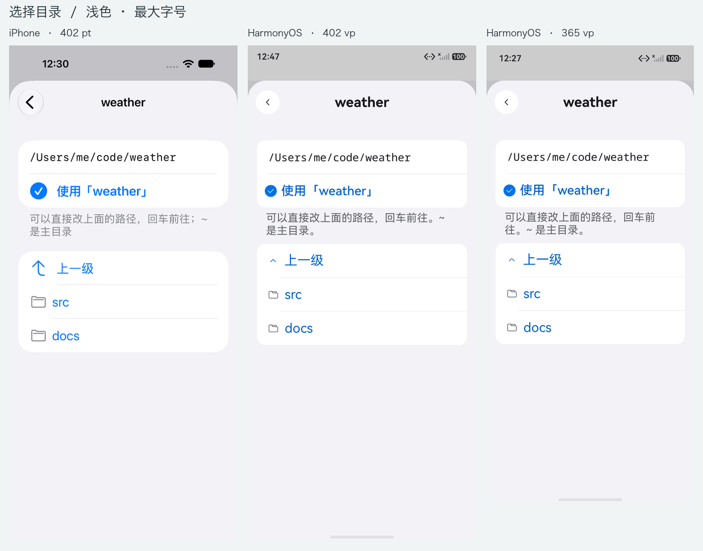

# 选择目录 · Choose a working directory

[返回全部页面 · All pages](../README.md)

浏览目录，并将所选目录交给新会话。
Open the weather directory picker and compare the parent, children and the action to use that directory.

Three independent native captures, left to right: iPhone 402 pt, HarmonyOS 402 vp, HarmonyOS 365 vp. The complete screen, including system bars, is visible.

[Download all original screenshots and accessibility trees for this page](../originals/folder-browser.zip?raw=1) · [Source and capture method](../SOURCES.md)

Original archive SHA-256: 6f07846f0469210f784c55dbb33171612fca0aa37a7558c6a82e333e627ce11b

## 浅色 · 标准字号

| Device | Pixels | Captured at | PNG digest | Hierarchy digest |
| --- | --- | --- | --- | --- |
| iPhone 402 pt | 1206 × 2622 | 2026-11-23T04:25:13.383+00:00 | aa0b662dcdf406b2 | 8d7106fb8a0599c2 |
| HarmonyOS 402 vp | 1206 × 2622 | 2026-11-23T12:47:13+08:00 | ecabff0c48c6f9a9 | 3a4f6a06c873e19e |
| HarmonyOS 365 vp | 1280 × 2832 | 2026-11-23T12:27:42+08:00 | 479e01585e73fbbe | 903a342c7828654b |

## 深色 · 标准字号

| Device | Pixels | Captured at | PNG digest | Hierarchy digest |
| --- | --- | --- | --- | --- |
| iPhone 402 pt | 1206 × 2622 | 2026-11-23T04:27:43.026+00:00 | 2c3c90bb7a654510 | 45228fe374371d41 |
| HarmonyOS 402 vp | 1206 × 2622 | 2026-11-23T12:47:17+08:00 | b44058b222007387 | 3a4f6a06c873e19e |
| HarmonyOS 365 vp | 1280 × 2832 | 2026-11-23T12:27:46+08:00 | 7173c4e48db5321e | 5ab771c8b4032eb4 |

## 浅色 · 最大字号

| Device | Pixels | Captured at | PNG digest | Hierarchy digest |
| --- | --- | --- | --- | --- |
| iPhone 402 pt | 1206 × 2622 | 2026-11-23T04:30:16.339+00:00 | cc4b9b6a7f4e81b8 | d5ed7373d90186ab |
| HarmonyOS 402 vp | 1206 × 2622 | 2026-11-23T12:47:21+08:00 | bb2f489212caeb47 | d0efa7f75835a7db |
| HarmonyOS 365 vp | 1280 × 2832 | 2026-11-23T12:27:50+08:00 | de1c07532b5ba9e2 | 35b941871c415968 |

Full 64-character digests and ZIP entry paths are under this page in the [manifest](../manifest.json).

[← 新建 Agent](new-agent.md)
[选择模型 →](models.md)
