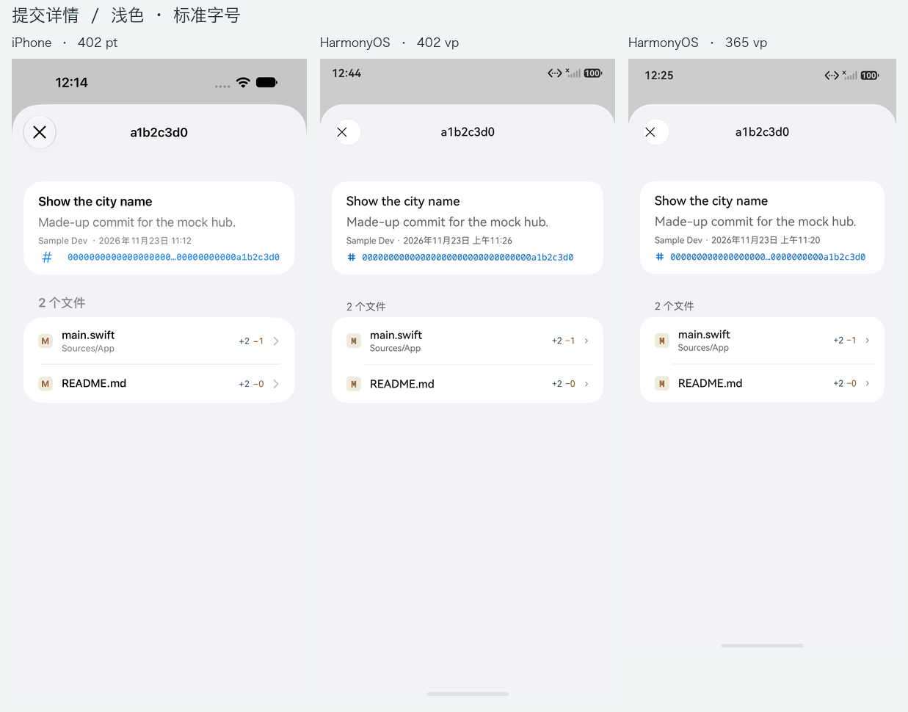
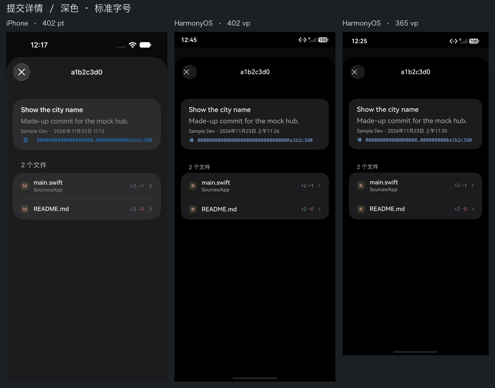
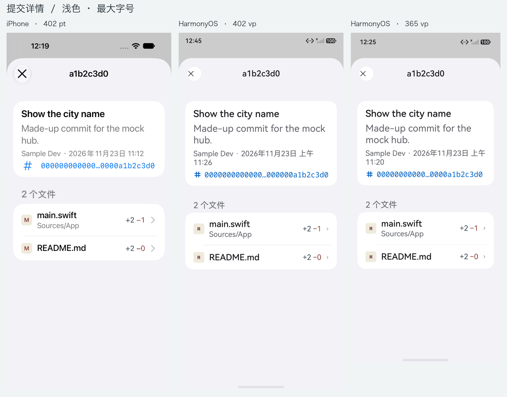

# 提交详情 · Commit details

[返回全部页面 · All pages](../README.md)

查看 Show the city name 提交、作者、短哈希和改动文件。

Three independent native captures, left to right: iPhone 402 pt, HarmonyOS 402 vp, HarmonyOS 365 vp. The complete screen, including system bars, is visible.

[Download all original screenshots and accessibility trees for this page](../originals/git-commit.zip?raw=1) · [Source and capture method](../SOURCES.md)

Original archive SHA-256: 73172a10a5dcff72d43d8af29c8f42ef68744ad3ef01f27023fe25f8df6d39fb

## 浅色 · 标准字号

| Device | Pixels | Captured at | PNG digest | Hierarchy digest |
| --- | --- | --- | --- | --- |
| iPhone 402 pt | 1206 × 2622 | 2026-11-23T04:14:51.048+00:00 | 47687b41ebb766b8 | 4b37707e1736ebcd |
| HarmonyOS 402 vp | 1206 × 2622 | 2026-11-23T12:44:47+08:00 | dd6e5e1f4fae4e4a | 242cd60321f8fdcd |
| HarmonyOS 365 vp | 1280 × 2832 | 2026-11-23T12:25:47+08:00 | 9211eb95038f0571 | ebe64637a63bf361 |

## 深色 · 标准字号

| Device | Pixels | Captured at | PNG digest | Hierarchy digest |
| --- | --- | --- | --- | --- |
| iPhone 402 pt | 1206 × 2622 | 2026-11-23T04:17:10.909+00:00 | aa79dc4ca5d006e5 | 72a7fc6d06f88d4e |
| HarmonyOS 402 vp | 1206 × 2622 | 2026-11-23T12:45:23+08:00 | 93128cf6584eb493 | 2454080eaf5cc861 |
| HarmonyOS 365 vp | 1280 × 2832 | 2026-11-23T12:25:51+08:00 | bf1f1141dec416a2 | 9113f5c41a1239b3 |

## 浅色 · 最大字号

| Device | Pixels | Captured at | PNG digest | Hierarchy digest |
| --- | --- | --- | --- | --- |
| iPhone 402 pt | 1206 × 2622 | 2026-11-23T04:19:48.199+00:00 | 20da10ce3361c3da | 892a9e5d391964f3 |
| HarmonyOS 402 vp | 1206 × 2622 | 2026-11-23T12:45:30+08:00 | ee49d98a123e65c9 | cb10b88330ccaff6 |
| HarmonyOS 365 vp | 1280 × 2832 | 2026-11-23T12:25:55+08:00 | d7d1907a1f5f69fa | ba48c7e3e7a56140 |

Full 64-character digests and ZIP entry paths are under this page in the [manifest](../manifest.json).

[← Git 工作区](git.md)
[Git 差异 →](git-diff.md)
