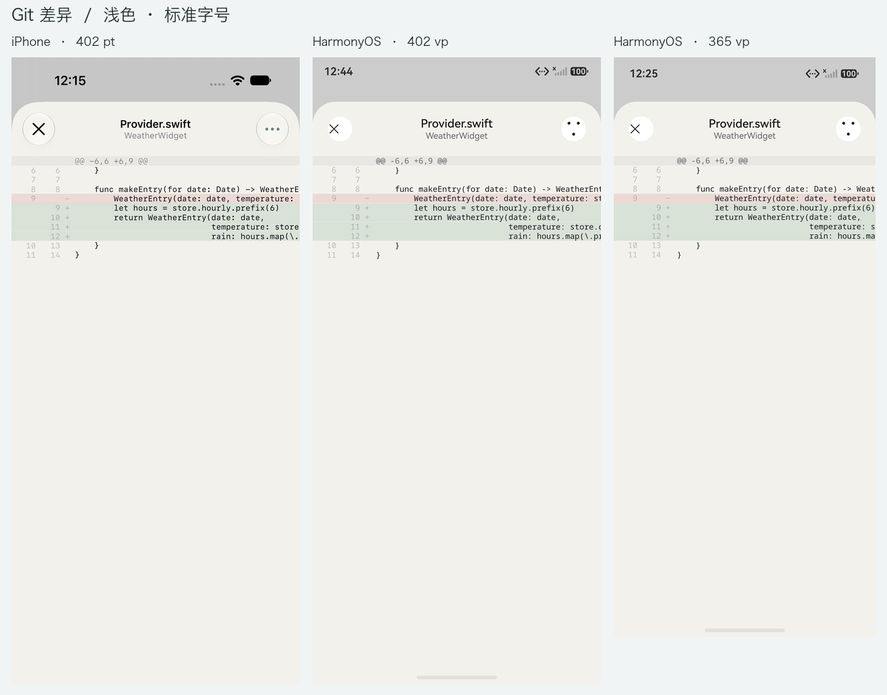
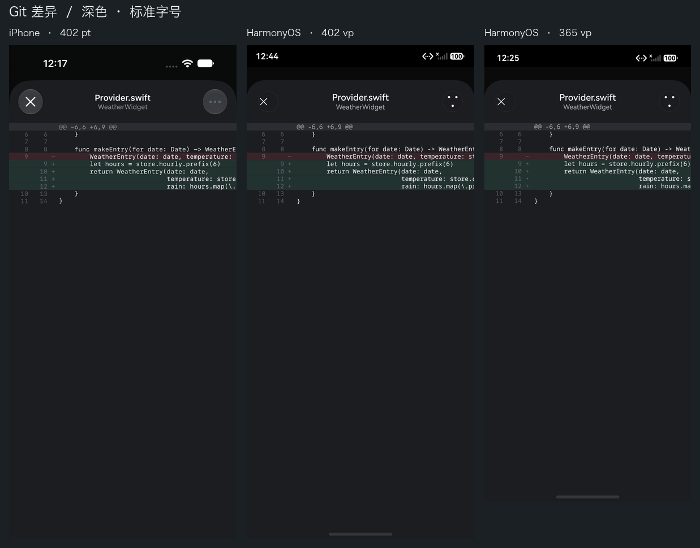

# Git 差异 · File diff

[返回全部页面 · All pages](../README.md)

读取 Provider.swift 的逐行差异。

Three independent native captures, left to right: iPhone 402 pt, HarmonyOS 402 vp, HarmonyOS 365 vp. The complete screen, including system bars, is visible.

[Download all original screenshots and accessibility trees for this page](../originals/git-diff.zip?raw=1) · [Source and capture method](../SOURCES.md)

Original archive SHA-256: 14c712cee77e1ff0c7651bf3e1b178f28bfa278e8ed036811daaf950356ef0ac

## 浅色 · 标准字号

| Device | Pixels | Captured at | PNG digest | Hierarchy digest |
| --- | --- | --- | --- | --- |
| iPhone 402 pt | 1206 × 2622 | 2026-11-23T04:15:05.287+00:00 | d73c455418f0354c | 6cd4151a16d67384 |
| HarmonyOS 402 vp | 1206 × 2622 | 2026-11-23T12:44:16+08:00 | 08363232c6c8f9da | 97a134400b8f2025 |
| HarmonyOS 365 vp | 1280 × 2832 | 2026-11-23T12:25:22+08:00 | f11947483b8908cc | d6aeadfd656c687e |

## 深色 · 标准字号

| Device | Pixels | Captured at | PNG digest | Hierarchy digest |
| --- | --- | --- | --- | --- |
| iPhone 402 pt | 1206 × 2622 | 2026-11-23T04:17:25.361+00:00 | c6acbe9fef073fcf | ac6b3fa5b1c07b11 |
| HarmonyOS 402 vp | 1206 × 2622 | 2026-11-23T12:44:19+08:00 | a55fb674dd28fbf8 | 0460705ed794ef6a |
| HarmonyOS 365 vp | 1280 × 2832 | 2026-11-23T12:25:26+08:00 | f2e451c0d2fba7fd | d9064c757a85229e |

## 浅色 · 最大字号

| Device | Pixels | Captured at | PNG digest | Hierarchy digest |
| --- | --- | --- | --- | --- |
| iPhone 402 pt | 1206 × 2622 | 2026-11-23T04:20:02.259+00:00 | 02b3cde66e7fcd3e | 07a7527ea5157e6e |
| HarmonyOS 402 vp | 1206 × 2622 | 2026-11-23T12:44:24+08:00 | 81cb91b4bdd515bd | d7a1d318d77afcab |
| HarmonyOS 365 vp | 1280 × 2832 | 2026-11-23T12:25:31+08:00 | 7b46060bfbfb24ea | adceb1efed27deeb |

Full 64-character digests and ZIP entry paths are under this page in the [manifest](../manifest.json).

[← 提交详情](git-commit.md)
[机器总览 →](machines.md)
