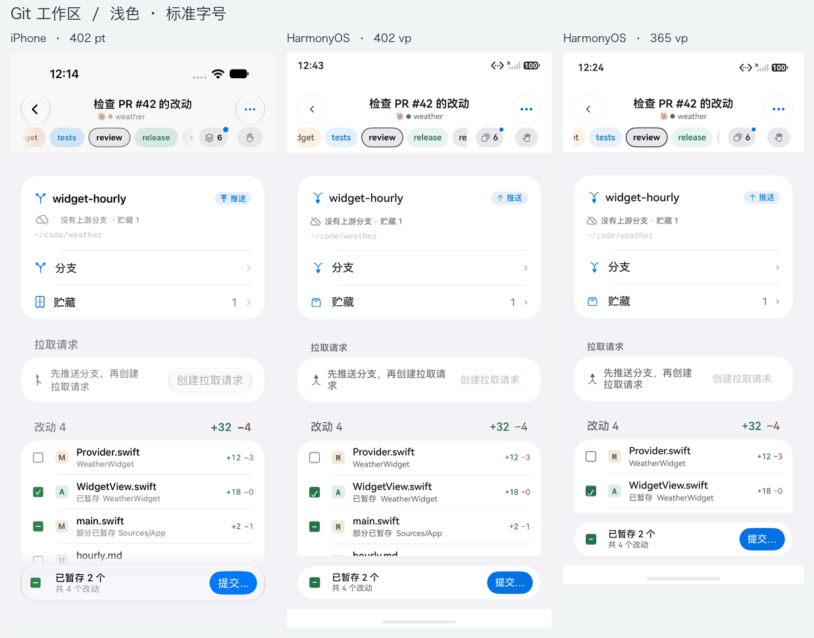
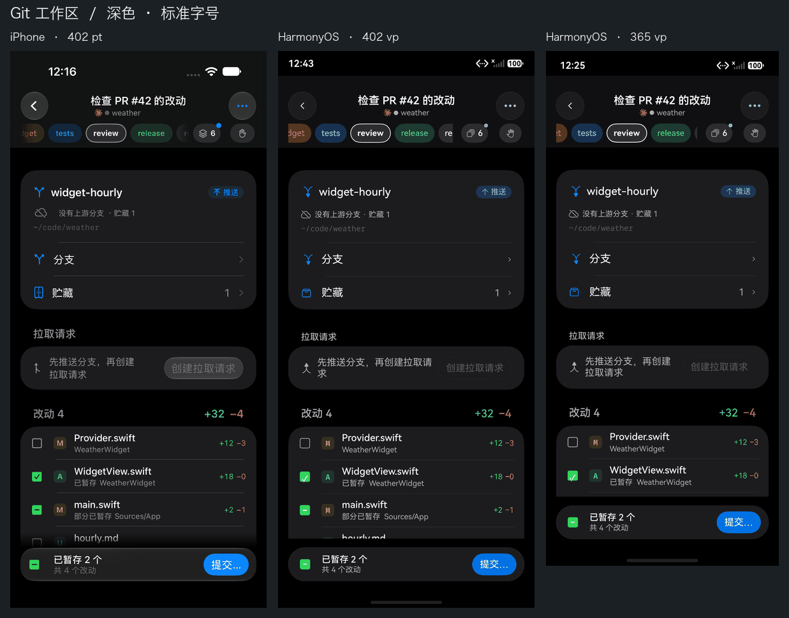

# Git 工作区 · Git workspace

[返回全部页面 · All pages](../README.md)

查看分支、改动文件及暂存状态。
Open Git from the PR #42 conversation menu and inspect its branch, stash, pull request and changes.

Three independent native captures, left to right: iPhone 402 pt, HarmonyOS 402 vp, HarmonyOS 365 vp. The complete screen, including system bars, is visible.

[Download all original screenshots and accessibility trees for this page](../originals/git.zip?raw=1) · [Source and capture method](../SOURCES.md)

Original archive SHA-256: 3ea798f5353128c32f9b32eebef23944108cb53d337fc969ef8d3879e87cb4cb

## 浅色 · 标准字号

| Device | Pixels | Captured at | PNG digest | Hierarchy digest |
| --- | --- | --- | --- | --- |
| iPhone 402 pt | 1206 × 2622 | 2026-11-23T04:14:32.201+00:00 | af8e823cccb0f7c8 | 187ea9dfc3cc11d4 |
| HarmonyOS 402 vp | 1206 × 2622 | 2026-11-23T12:43:45+08:00 | 0daefb3635ffa18c | 970089a485abc5b8 |
| HarmonyOS 365 vp | 1280 × 2832 | 2026-11-23T12:24:56+08:00 | 00652fa15d540146 | 293826ad4b5273fe |

## 深色 · 标准字号

| Device | Pixels | Captured at | PNG digest | Hierarchy digest |
| --- | --- | --- | --- | --- |
| iPhone 402 pt | 1206 × 2622 | 2026-11-23T04:16:51.860+00:00 | 75321068a98b50df | 1c195062cc8ce1bc |
| HarmonyOS 402 vp | 1206 × 2622 | 2026-11-23T12:43:49+08:00 | 4a21ddfc5a4a1d5a | 970089a485abc5b8 |
| HarmonyOS 365 vp | 1280 × 2832 | 2026-11-23T12:25:00+08:00 | 476763f55fe57d17 | 526018134e177db3 |

## 浅色 · 最大字号

| Device | Pixels | Captured at | PNG digest | Hierarchy digest |
| --- | --- | --- | --- | --- |
| iPhone 402 pt | 1206 × 2622 | 2026-11-23T04:19:29.110+00:00 | 702348332dbf6bd9 | 0914e5f537c21299 |
| HarmonyOS 402 vp | 1206 × 2622 | 2026-11-23T12:43:54+08:00 | c0d349dc23cfd398 | 1418582da37e894f |
| HarmonyOS 365 vp | 1280 × 2832 | 2026-11-23T12:25:05+08:00 | efef316ef0a68101 | 8f48387f3bbc73d2 |

Full 64-character digests and ZIP entry paths are under this page in the [manifest](../manifest.json).

[← 工作区文件搜索](file-search.md)
[提交详情 →](git-commit.md)
