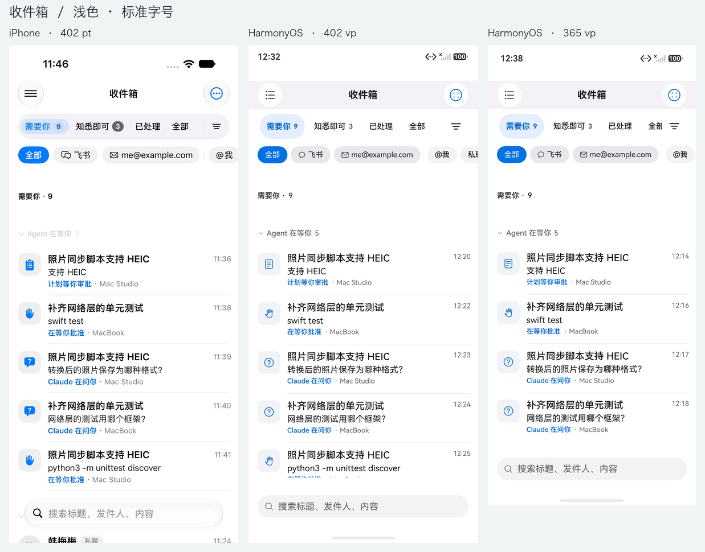
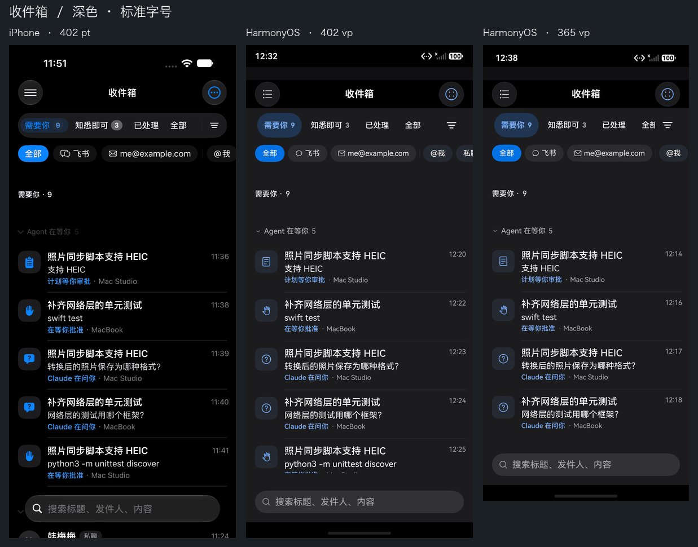
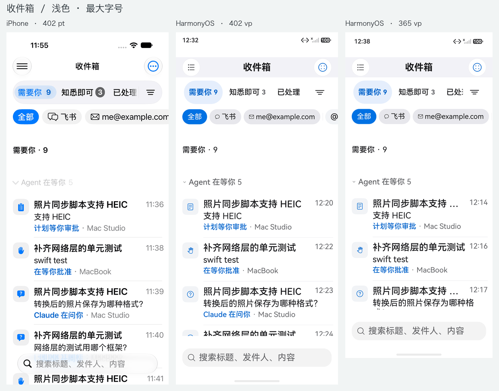

# 收件箱 · Inbox

[返回全部页面 · All pages](../README.md)

查看收件箱的分类、筛选和待处理事项。

Three independent native captures, left to right: iPhone 402 pt, HarmonyOS 402 vp, HarmonyOS 365 vp. The complete screen, including system bars, is visible.

[Download all original screenshots and accessibility trees for this page](../originals/inbox.zip?raw=1) · [Source and capture method](../SOURCES.md)

Original archive SHA-256: bb1ef86ed920fb1f521804a10da18fcf6456ae17b79845bc15f582f2444ca3f5

## 浅色 · 标准字号

| Device | Pixels | Captured at | PNG digest | Hierarchy digest |
| --- | --- | --- | --- | --- |
| iPhone 402 pt | 1206 × 2622 | 2026-11-23T03:46:52.984+00:00 | f17fd80e7cb103bc | f7226f4745f246c8 |
| HarmonyOS 402 vp | 1206 × 2622 | 2026-11-23T12:32:34+08:00 | c66a9968d0075f9f | f5ba08a5ceacc63a |
| HarmonyOS 365 vp | 1280 × 2832 | 2026-11-23T12:38:25+08:00 | 45835784dc9385a3 | 33e3e8deb4d4e3da |

## 深色 · 标准字号

| Device | Pixels | Captured at | PNG digest | Hierarchy digest |
| --- | --- | --- | --- | --- |
| iPhone 402 pt | 1206 × 2622 | 2026-11-23T03:51:23.244+00:00 | 286534499fb26ae2 | 3e1e79ef8b4f04d1 |
| HarmonyOS 402 vp | 1206 × 2622 | 2026-11-23T12:32:38+08:00 | 8c76688c6507046e | f5ba08a5ceacc63a |
| HarmonyOS 365 vp | 1280 × 2832 | 2026-11-23T12:38:28+08:00 | 9aa2e92a2035e463 | e9714be68d01d83b |

## 浅色 · 最大字号

| Device | Pixels | Captured at | PNG digest | Hierarchy digest |
| --- | --- | --- | --- | --- |
| iPhone 402 pt | 1206 × 2622 | 2026-11-23T03:55:27.213+00:00 | 6502343ca847e070 | f72a46527f39f8c4 |
| HarmonyOS 402 vp | 1206 × 2622 | 2026-11-23T12:32:42+08:00 | 7fbe7258323816f2 | 3626b0bf4e19017c |
| HarmonyOS 365 vp | 1280 × 2832 | 2026-11-23T12:38:33+08:00 | aecdbb2fe4c54929 | eaa6bf835099343f |

Full 64-character digests and ZIP entry paths are under this page in the [manifest](../manifest.json).

[← 搜索会话内容](search.md)
[待办 →](todo.md)
