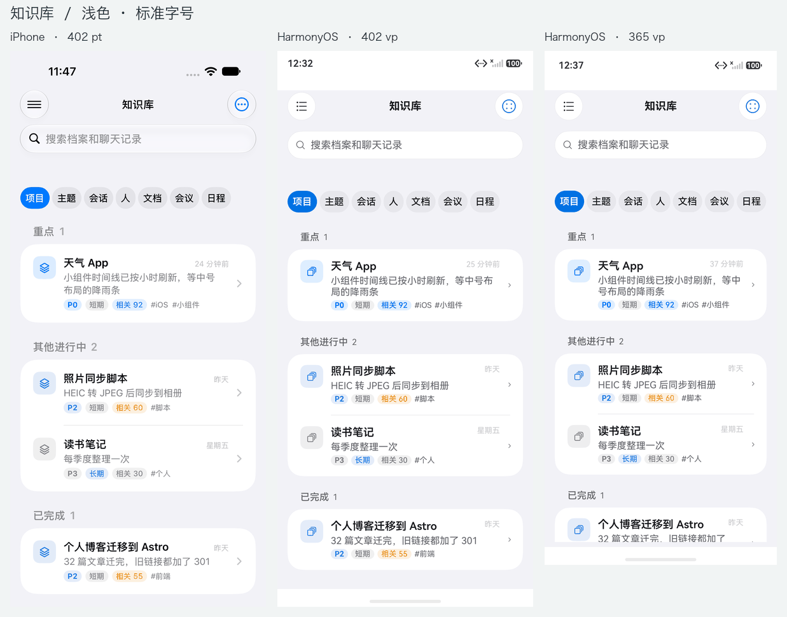
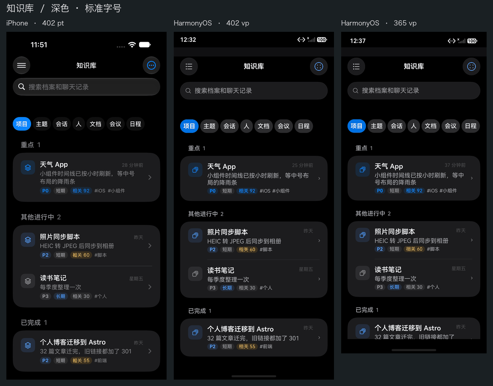
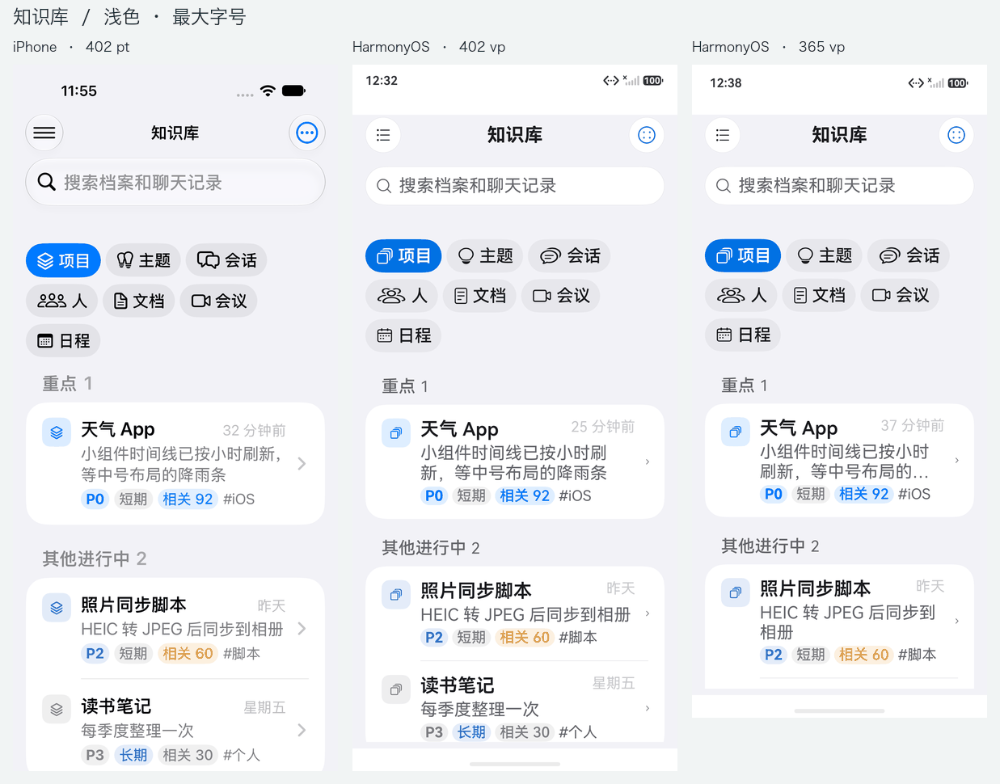

# 知识库 · Knowledge

[返回全部页面 · All pages](../README.md)

浏览知识库的分类和条目。
Compare the same projects across Focus, Other Active and Completed, including priority and state.

Three independent native captures, left to right: iPhone 402 pt, HarmonyOS 402 vp, HarmonyOS 365 vp. The complete screen, including system bars, is visible.

[Download all original screenshots and accessibility trees for this page](../originals/knowledge.zip?raw=1) · [Source and capture method](../SOURCES.md)

Original archive SHA-256: ae619c61ebf9e73daa5c1f6f9fd2cef558f5d97c1a2c1fea2b86854aa6f1f7e6

## 浅色 · 标准字号

| Device | Pixels | Captured at | PNG digest | Hierarchy digest |
| --- | --- | --- | --- | --- |
| iPhone 402 pt | 1206 × 2622 | 2026-11-23T03:47:04.955+00:00 | adf1c593557eda56 | 11617a745b08deae |
| HarmonyOS 402 vp | 1206 × 2622 | 2026-11-23T12:32:01+08:00 | 522f932d65823e10 | e3ba2a72394f07a0 |
| HarmonyOS 365 vp | 1280 × 2832 | 2026-11-23T12:37:52+08:00 | 73817c84e260b702 | ed8cbe191430562f |

## 深色 · 标准字号

| Device | Pixels | Captured at | PNG digest | Hierarchy digest |
| --- | --- | --- | --- | --- |
| iPhone 402 pt | 1206 × 2622 | 2026-11-23T03:51:34.509+00:00 | b26965c385855c79 | dc82327574abafce |
| HarmonyOS 402 vp | 1206 × 2622 | 2026-11-23T12:32:05+08:00 | 88265285abf828a8 | e3ba2a72394f07a0 |
| HarmonyOS 365 vp | 1280 × 2832 | 2026-11-23T12:37:55+08:00 | 3a7b70256631c9f5 | 3949945778fe7db8 |

## 浅色 · 最大字号

| Device | Pixels | Captured at | PNG digest | Hierarchy digest |
| --- | --- | --- | --- | --- |
| iPhone 402 pt | 1206 × 2622 | 2026-11-23T03:55:37.604+00:00 | 2d48f1f2f6b2e534 | d2624df61339ed59 |
| HarmonyOS 402 vp | 1206 × 2622 | 2026-11-23T12:32:09+08:00 | fe5e08a490fee978 | 006d966c4efc6e38 |
| HarmonyOS 365 vp | 1280 × 2832 | 2026-11-23T12:38:00+08:00 | 3d8b5d86d745e2b9 | 5014832b63808d35 |

Full 64-character digests and ZIP entry paths are under this page in the [manifest](../manifest.json).

[← 今日待办与排序](todo-due.md)
[会议 →](meetings.md)
