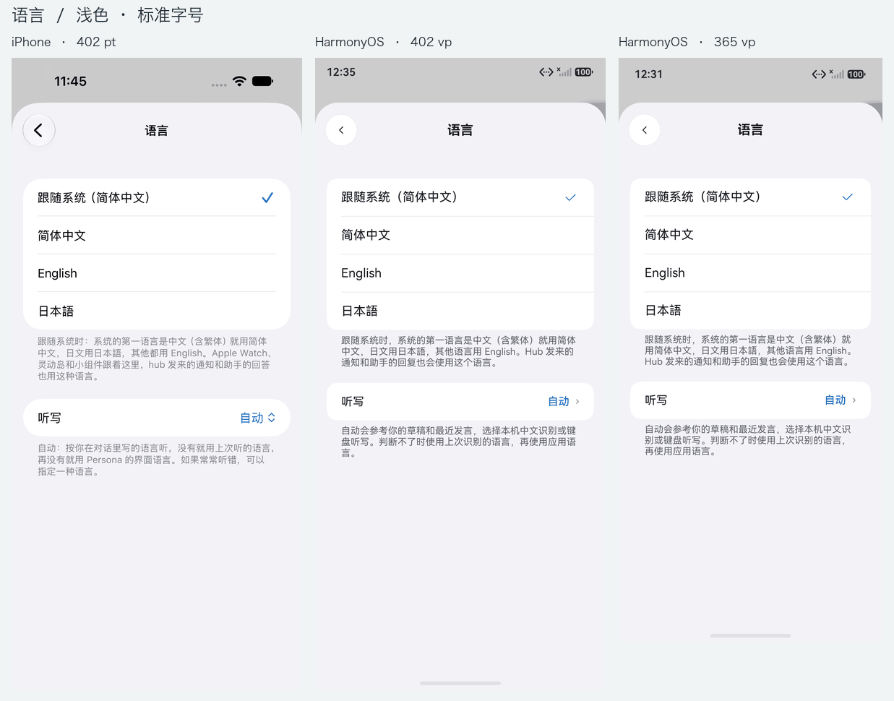
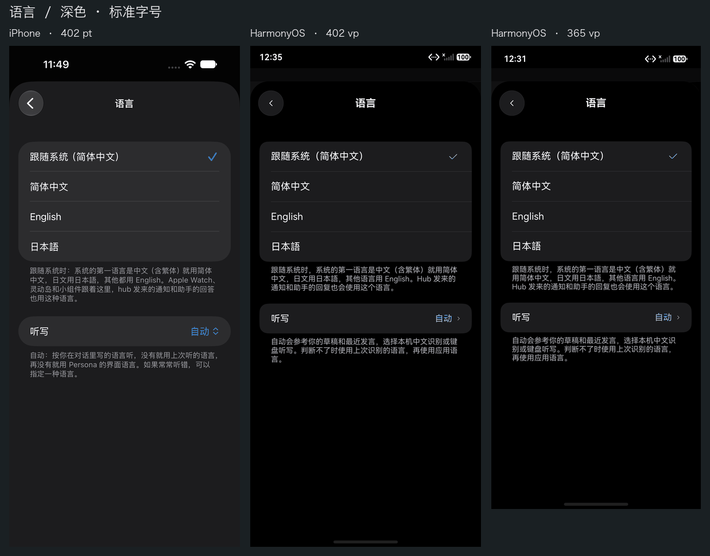
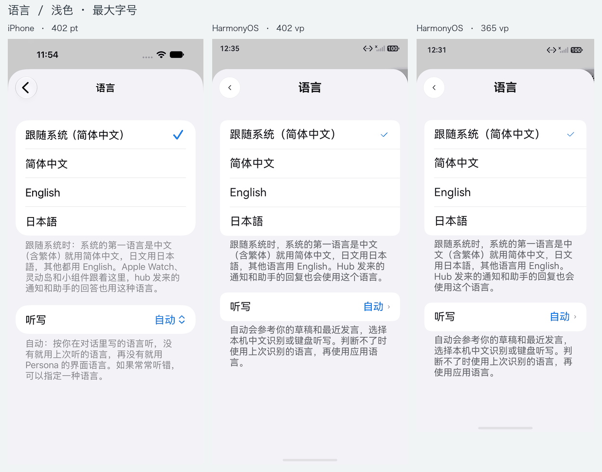

# 语言 · Language settings

[返回全部页面 · All pages](../README.md)

查看可选应用语言和当前语言设置。
Open Language in Settings. Automatic dictation follows the conversation language and the device’s available input methods.

Three independent native captures, left to right: iPhone 402 pt, HarmonyOS 402 vp, HarmonyOS 365 vp. The complete screen, including system bars, is visible.

[Download all original screenshots and accessibility trees for this page](../originals/language.zip?raw=1) · [Source and capture method](../SOURCES.md)

Original archive SHA-256: f19f15d706a31e1cb11e9a9e2a05c8094972089883bb4b5cebf2b11f19bcef65

## 浅色 · 标准字号

| Device | Pixels | Captured at | PNG digest | Hierarchy digest |
| --- | --- | --- | --- | --- |
| iPhone 402 pt | 1206 × 2622 | 2026-11-23T03:45:10.768+00:00 | fe2b97a653f7f473 | 01bb55439167b5e6 |
| HarmonyOS 402 vp | 1206 × 2622 | 2026-11-23T12:35:02+08:00 | e6fa87d33b6cffab | f40b2f7c49d69e8a |
| HarmonyOS 365 vp | 1280 × 2832 | 2026-11-23T12:31:08+08:00 | 86f0a23ad5b97981 | 4e1d69c27120a18e |

## 深色 · 标准字号

| Device | Pixels | Captured at | PNG digest | Hierarchy digest |
| --- | --- | --- | --- | --- |
| iPhone 402 pt | 1206 × 2622 | 2026-11-23T03:49:49.380+00:00 | 7970e0c0c894c9f9 | bed21ca367bc8af4 |
| HarmonyOS 402 vp | 1206 × 2622 | 2026-11-23T12:35:08+08:00 | ac3fab4d71cc37a4 | b09fc66702615877 |
| HarmonyOS 365 vp | 1280 × 2832 | 2026-11-23T12:31:26+08:00 | 98344f5538791302 | 4af2a7b682cc430c |

## 浅色 · 最大字号

| Device | Pixels | Captured at | PNG digest | Hierarchy digest |
| --- | --- | --- | --- | --- |
| iPhone 402 pt | 1206 × 2622 | 2026-11-23T03:54:06.279+00:00 | e3aa1b7f7093ffa2 | 3b67b25ee0685736 |
| HarmonyOS 402 vp | 1206 × 2622 | 2026-11-23T12:35:13+08:00 | fbbeb62da7c6e086 | d62b8eb52312ef0a |
| HarmonyOS 365 vp | 1280 × 2832 | 2026-11-23T12:31:37+08:00 | 8c1672f7bf9c8a3a | 765eea265df9c5c2 |

Full 64-character digests and ZIP entry paths are under this page in the [manifest](../manifest.json).

[← 返回设置搜索结果](settings-search-restored.md)
[Agent 偏好 →](agent-preferences.md)
