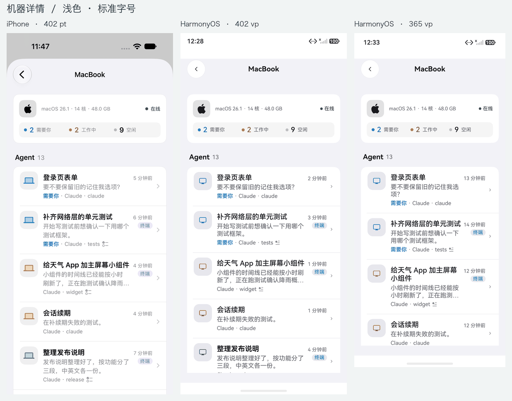
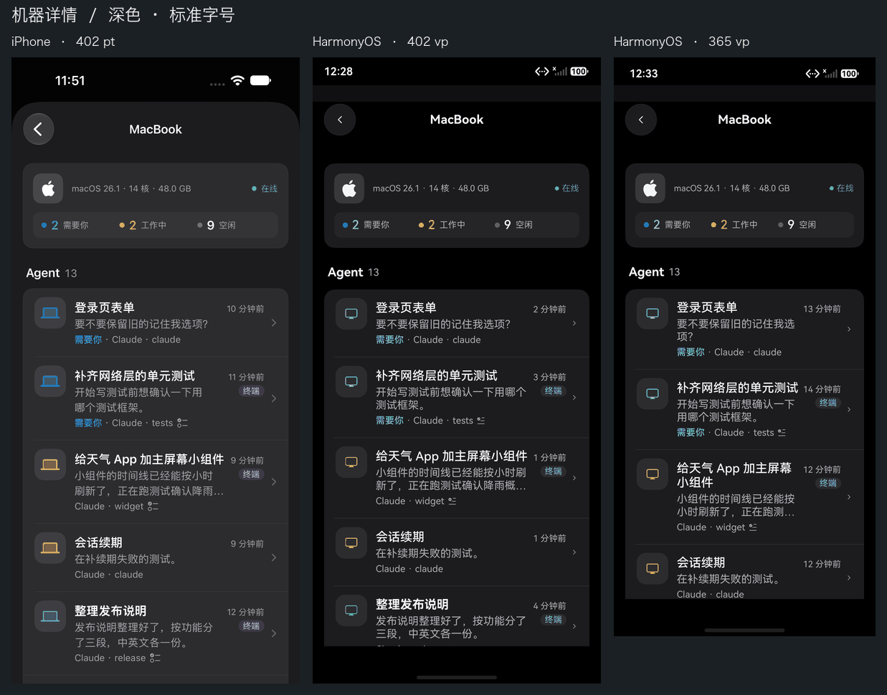

# 机器详情 · Machine details

[返回全部页面 · All pages](../README.md)

进入同一台测试 MacBook 的详情。
Open the fixture MacBook from the machine directory and inspect its agents.

Three independent native captures, left to right: iPhone 402 pt, HarmonyOS 402 vp, HarmonyOS 365 vp. The complete screen, including system bars, is visible.

[Download all original screenshots and accessibility trees for this page](../originals/machine-detail.zip?raw=1) · [Source and capture method](../SOURCES.md)

Original archive SHA-256: 7ee4bffd35918a5195a6b23c86c3431230ec42929727ce7f33d729f1dc6111ea

## 浅色 · 标准字号

| Device | Pixels | Captured at | PNG digest | Hierarchy digest |
| --- | --- | --- | --- | --- |
| iPhone 402 pt | 1206 × 2622 | 2026-11-23T03:47:18.644+00:00 | ded5c81ec82181c6 | 1ea8a946317302e6 |
| HarmonyOS 402 vp | 1206 × 2622 | 2026-11-23T12:28:01+08:00 | 3babd1170e043e7d | 6bdcf3157acd7784 |
| HarmonyOS 365 vp | 1280 × 2832 | 2026-11-23T12:33:06+08:00 | 1340216d0280ce80 | c3f92baf618c7a77 |

## 深色 · 标准字号

| Device | Pixels | Captured at | PNG digest | Hierarchy digest |
| --- | --- | --- | --- | --- |
| iPhone 402 pt | 1206 × 2622 | 2026-11-23T03:51:47.599+00:00 | 462155be5ba66055 | 28fef38f21418b2b |
| HarmonyOS 402 vp | 1206 × 2622 | 2026-11-23T12:28:05+08:00 | 9c9353f9897adc5e | 6bdcf3157acd7784 |
| HarmonyOS 365 vp | 1280 × 2832 | 2026-11-23T12:33:10+08:00 | 7630b18af0d98d81 | b75dc0f23c8f02ec |

## 浅色 · 最大字号

| Device | Pixels | Captured at | PNG digest | Hierarchy digest |
| --- | --- | --- | --- | --- |
| iPhone 402 pt | 1206 × 2622 | 2026-11-23T03:55:48.707+00:00 | 22be2d412bd91dea | 68f103e140bf53c6 |
| HarmonyOS 402 vp | 1206 × 2622 | 2026-11-23T12:28:09+08:00 | aac6c925bcda986a | 2119dacf9fd06f7c |
| HarmonyOS 365 vp | 1280 × 2832 | 2026-11-23T12:33:14+08:00 | fb3d8e7fb124ce3a | 07366bfdbd8ebc14 |

Full 64-character digests and ZIP entry paths are under this page in the [manifest](../manifest.json).

[← 机器总览](machines.md)
[机器监控读数 →](machine-monitor.md)
