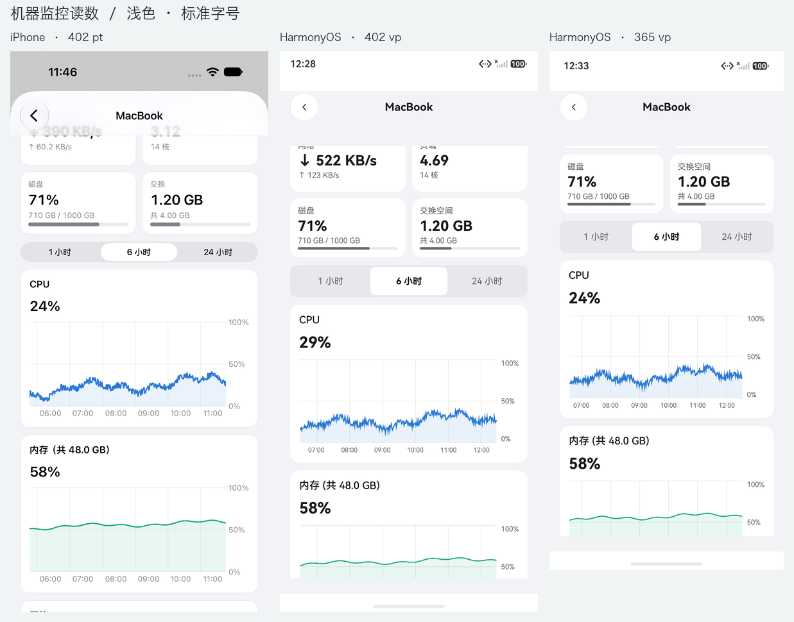
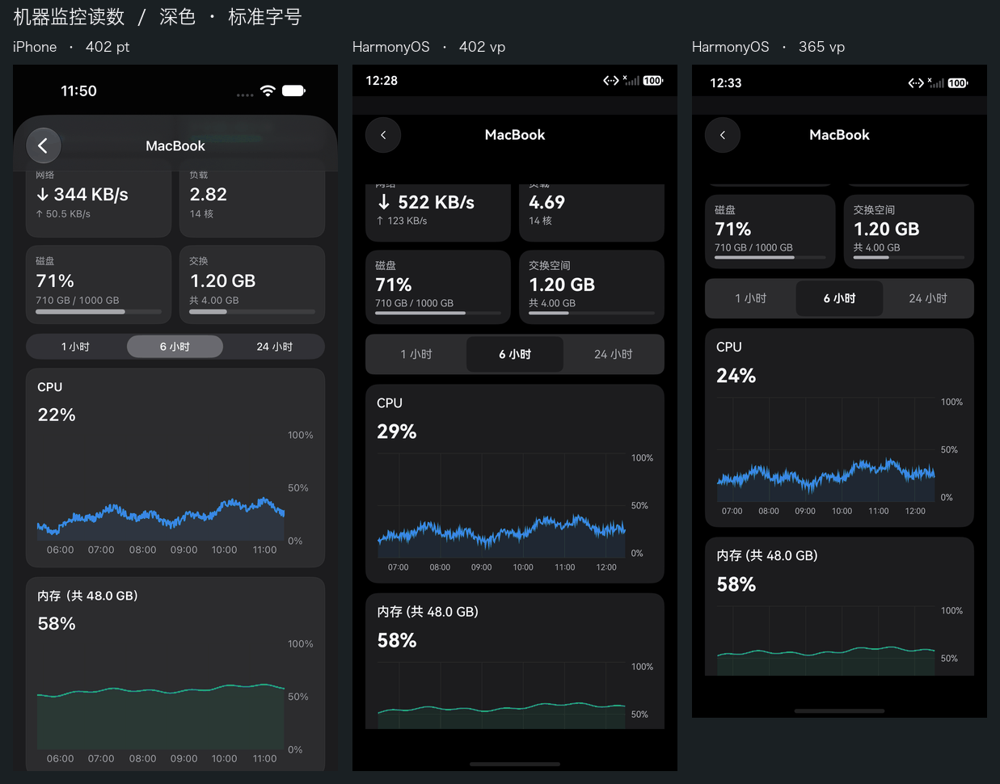
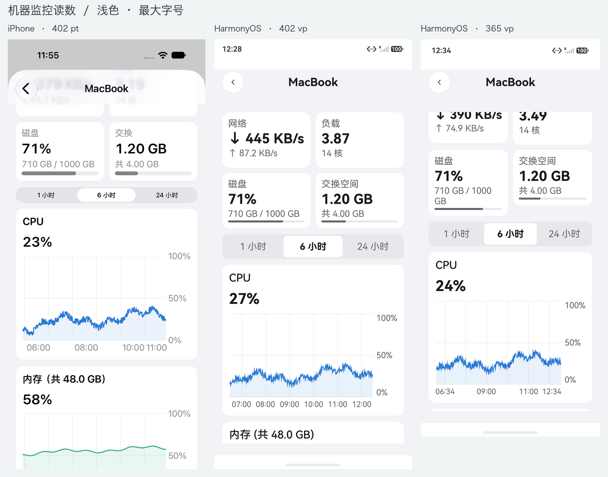

# 机器监控读数 · Machine metrics

[返回全部页面 · All pages](../README.md)

查看 MacBook 的 CPU 历史曲线及所选时间范围。
Inspect six hours of CPU history on the fixture MacBook. Each local Hub has its own sampling time and values.

Three independent native captures, left to right: iPhone 402 pt, HarmonyOS 402 vp, HarmonyOS 365 vp. The complete screen, including system bars, is visible.

[Download all original screenshots and accessibility trees for this page](../originals/machine-monitor.zip?raw=1) · [Source and capture method](../SOURCES.md)

Original archive SHA-256: 91cad47ae1aaea1f694beccb4054e9cbda62d1acace5472e5ec787966cb73993

## 浅色 · 标准字号

| Device | Pixels | Captured at | PNG digest | Hierarchy digest |
| --- | --- | --- | --- | --- |
| iPhone 402 pt | 1206 × 2622 | 2026-11-23T03:46:13.790+00:00 | 94d0f9de787a6d9e | 06863e946a1e9d71 |
| HarmonyOS 402 vp | 1206 × 2622 | 2026-11-23T12:28:32+08:00 | 60c47a5b07459764 | 2a458229e0ee7a57 |
| HarmonyOS 365 vp | 1280 × 2832 | 2026-11-23T12:33:42+08:00 | 2a8a530c150f7f30 | 01a9457999ae37c9 |

## 深色 · 标准字号

| Device | Pixels | Captured at | PNG digest | Hierarchy digest |
| --- | --- | --- | --- | --- |
| iPhone 402 pt | 1206 × 2622 | 2026-11-23T03:50:47.259+00:00 | 03ca8d8cb6d0c6b9 | 5dee76907f08fb49 |
| HarmonyOS 402 vp | 1206 × 2622 | 2026-11-23T12:28:36+08:00 | cc67f60d801b1273 | 2a458229e0ee7a57 |
| HarmonyOS 365 vp | 1280 × 2832 | 2026-11-23T12:33:46+08:00 | b7cac150c1fd0af3 | 468d69d7135355f3 |

## 浅色 · 最大字号

| Device | Pixels | Captured at | PNG digest | Hierarchy digest |
| --- | --- | --- | --- | --- |
| iPhone 402 pt | 1206 × 2622 | 2026-11-23T03:55:05.619+00:00 | b946da9726c8e08b | 5023d2be2713347d |
| HarmonyOS 402 vp | 1206 × 2622 | 2026-11-23T12:28:48+08:00 | 2c849bd572afce19 | 1db1309462be1861 |
| HarmonyOS 365 vp | 1280 × 2832 | 2026-11-23T12:34:11+08:00 | 035331eb993c7509 | 6e71936a545b32b5 |

Full 64-character digests and ZIP entry paths are under this page in the [manifest](../manifest.json).

[← 机器详情](machine-detail.md)
[侧栏 →](drawer.md)
