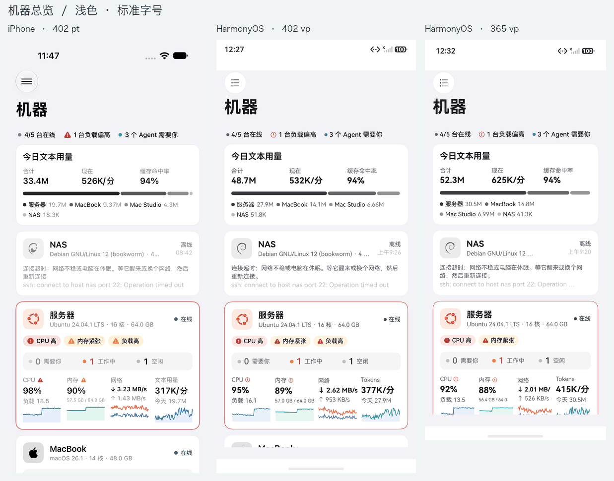
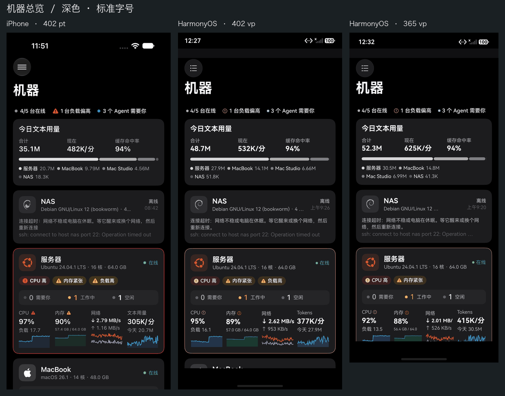
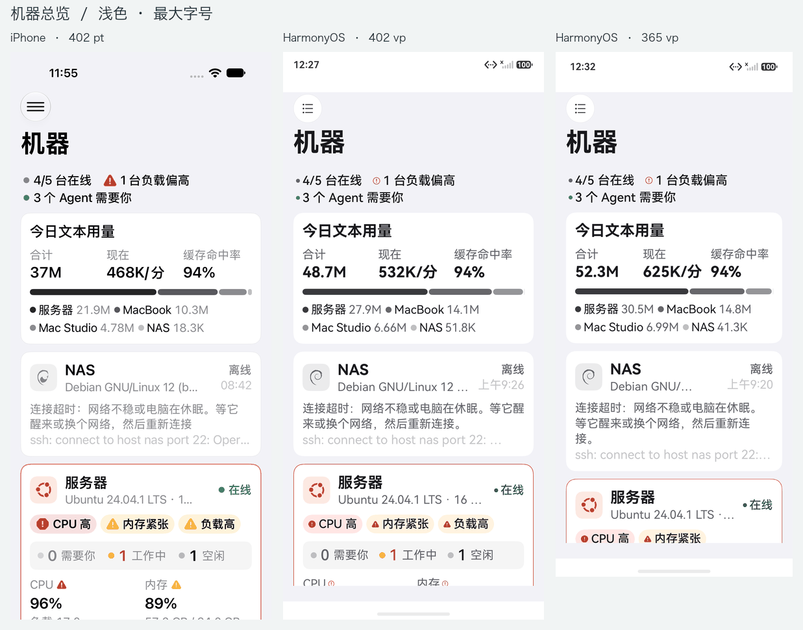

# 机器总览 · Machines

[返回全部页面 · All pages](../README.md)

比较机器的在线状态、负载与使用量。

Three independent native captures, left to right: iPhone 402 pt, HarmonyOS 402 vp, HarmonyOS 365 vp. The complete screen, including system bars, is visible.

[Download all original screenshots and accessibility trees for this page](../originals/machines.zip?raw=1) · [Source and capture method](../SOURCES.md)

Original archive SHA-256: 568160783ef1d116d0faa39bfb6ffb176658475410d3a42c04f526f1a05e68f7

## 浅色 · 标准字号

| Device | Pixels | Captured at | PNG digest | Hierarchy digest |
| --- | --- | --- | --- | --- |
| iPhone 402 pt | 1206 × 2622 | 2026-11-23T03:47:31.633+00:00 | 4a22ad4036597628 | c47ae7eb5612b306 |
| HarmonyOS 402 vp | 1206 × 2622 | 2026-11-23T12:27:48+08:00 | a78f8f40142abd66 | 3d00d4a7ec5d5bc6 |
| HarmonyOS 365 vp | 1280 × 2832 | 2026-11-23T12:32:47+08:00 | fec4a41ed0510048 | 591b7e48cebbd4d9 |

## 深色 · 标准字号

| Device | Pixels | Captured at | PNG digest | Hierarchy digest |
| --- | --- | --- | --- | --- |
| iPhone 402 pt | 1206 × 2622 | 2026-11-23T03:51:59.282+00:00 | 53384c30d517a64f | aad8f80389806184 |
| HarmonyOS 402 vp | 1206 × 2622 | 2026-11-23T12:27:52+08:00 | 7e490cbdf9fb67c5 | 3d00d4a7ec5d5bc6 |
| HarmonyOS 365 vp | 1280 × 2832 | 2026-11-23T12:32:51+08:00 | e211cd26b9e788db | 686d0788dacd044b |

## 浅色 · 最大字号

| Device | Pixels | Captured at | PNG digest | Hierarchy digest |
| --- | --- | --- | --- | --- |
| iPhone 402 pt | 1206 × 2622 | 2026-11-23T03:55:59.611+00:00 | 78fc14144742a23e | aeddb58ded0e0bf9 |
| HarmonyOS 402 vp | 1206 × 2622 | 2026-11-23T12:27:56+08:00 | 7ddbacc84c7e9ed1 | 112f4eeaceabf279 |
| HarmonyOS 365 vp | 1280 × 2832 | 2026-11-23T12:32:55+08:00 | 1578e92593911720 | 63bbcfe3168bb274 |

Full 64-character digests and ZIP entry paths are under this page in the [manifest](../manifest.json).

[← Git 差异](git-diff.md)
[机器详情 →](machine-detail.md)
