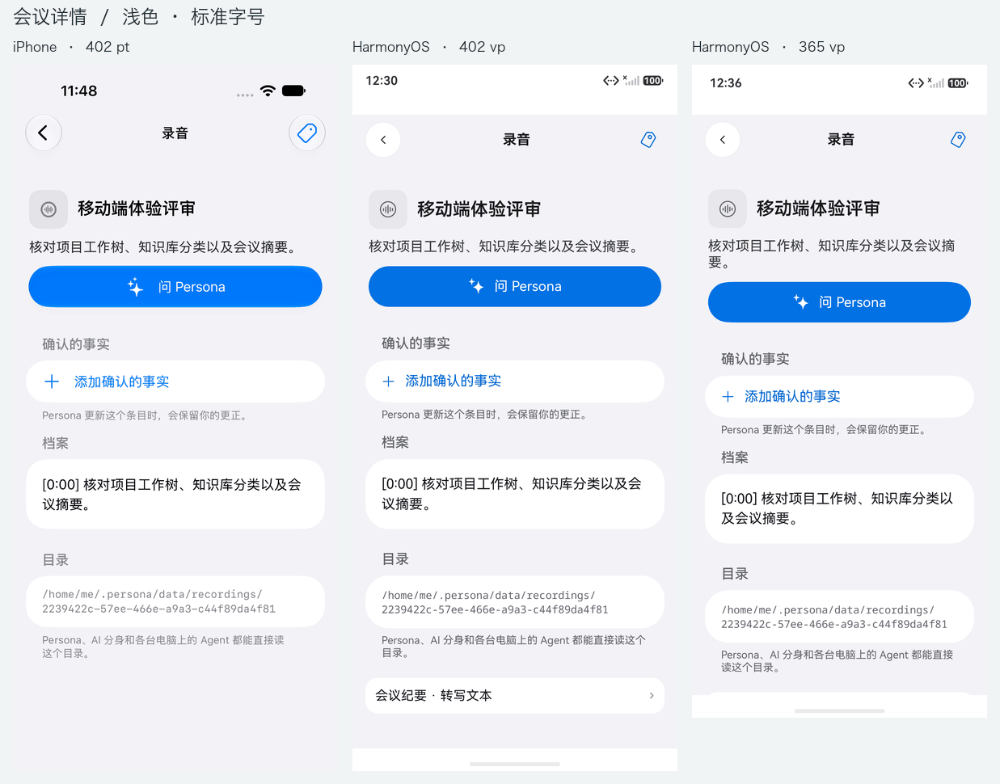
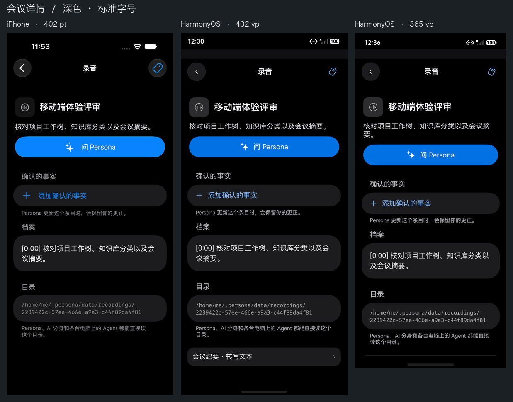
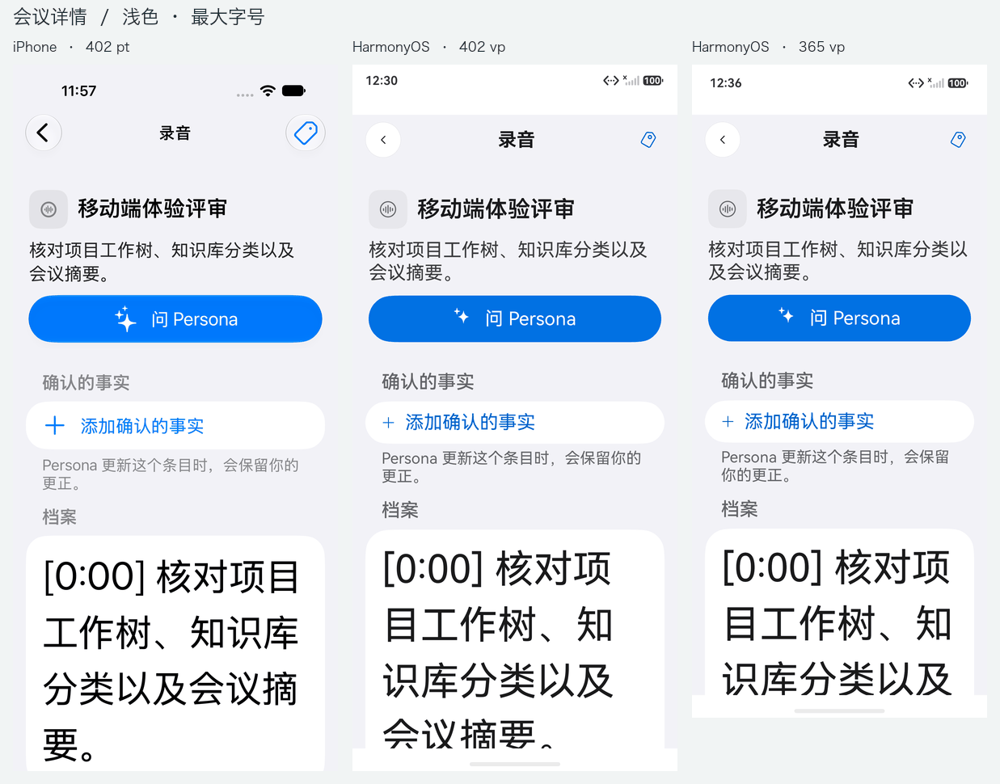

# 会议详情 · Meeting details

[返回全部页面 · All pages](../README.md)

打开移动端体验评审，阅读会议记录。
Open the Mobile Experience Review recording and inspect its tags and confirmed facts.

Three independent native captures, left to right: iPhone 402 pt, HarmonyOS 402 vp, HarmonyOS 365 vp. The complete screen, including system bars, is visible.

[Download all original screenshots and accessibility trees for this page](../originals/meeting-detail.zip?raw=1) · [Source and capture method](../SOURCES.md)

Original archive SHA-256: 541aadc12d816cccafecbe154d2873711653d6b8b63b7249fac1989c1e22ca04

## 浅色 · 标准字号

| Device | Pixels | Captured at | PNG digest | Hierarchy digest |
| --- | --- | --- | --- | --- |
| iPhone 402 pt | 1206 × 2622 | 2026-11-23T03:48:46.871+00:00 | 0227f1c0531a7e68 | 39a559fd0a0a3bdf |
| HarmonyOS 402 vp | 1206 × 2622 | 2026-11-23T12:30:44+08:00 | 91fbe1ae174ce096 | 63f49da7ca9e2b73 |
| HarmonyOS 365 vp | 1280 × 2832 | 2026-11-23T12:36:41+08:00 | 247e7363b1b06121 | 12c2e5aa156ea765 |

## 深色 · 标准字号

| Device | Pixels | Captured at | PNG digest | Hierarchy digest |
| --- | --- | --- | --- | --- |
| iPhone 402 pt | 1206 × 2622 | 2026-11-23T03:53:09.859+00:00 | d622eea12d5c908e | 953e8488a8b28129 |
| HarmonyOS 402 vp | 1206 × 2622 | 2026-11-23T12:30:48+08:00 | dfe6c31d0965c5ff | 63f49da7ca9e2b73 |
| HarmonyOS 365 vp | 1280 × 2832 | 2026-11-23T12:36:45+08:00 | ccc0f9686372c6be | f58983637a3dcc1c |

## 浅色 · 最大字号

| Device | Pixels | Captured at | PNG digest | Hierarchy digest |
| --- | --- | --- | --- | --- |
| iPhone 402 pt | 1206 × 2622 | 2026-11-23T03:57:04.726+00:00 | a0b18adb898bac09 | 35678885e20ebd81 |
| HarmonyOS 402 vp | 1206 × 2622 | 2026-11-23T12:30:53+08:00 | 86ec49538e86be03 | 9c5487bbe1a6dd4a |
| HarmonyOS 365 vp | 1280 × 2832 | 2026-11-23T12:36:51+08:00 | 83033018b6a56223 | c4b5b568e32cc9c9 |

Full 64-character digests and ZIP entry paths are under this page in the [manifest](../manifest.json).

[← 全部会议](meeting-list.md)
